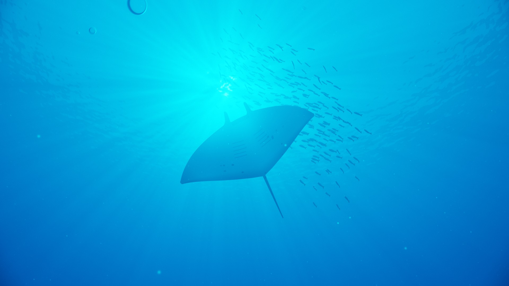

# Awesome Fable 5.2

用纯代码做出来的画面和影片合集。每个作品的代码都由 Claude（模型 `claude-fable-5-2`）在 Claude Code 里编写，
画面和声音由这些代码计算得出：没有用 AI 生图/生视频模型，没有照片、贴图、3D 模型或音效素材，
也没有用 Blender、游戏引擎或现成渲染器。

A collection of pictures and films computed entirely by code. The code for each work was written by Claude
(`claude-fable-5-2`) in Claude Code; no image/video generation models, no photos, textures, 3D models or sound
assets, and no off-the-shelf renderers were used.

## 作品 · Works

### [Deep Dive · 深潜](deep-dive/)

78 秒的第一人称潜水短片（1920×1080，30 fps，带合成音轨）：从水面下仰望斯涅尔之窗，游过浅礁，翻下峭壁，
在深蓝里遇到一只蝠鲼。自写的无头 Metal 计算着色器光线步进渲染器，FFT 波面和正向追踪的焦散光场，
群体行为鱼群，numpy/scipy 合成的声音。

A 78-second first-person dive (1080p, 30 fps, synthesised soundtrack). A self-written headless Metal compute
ray marcher, FFT waves with a forward-traced caustic light field, boids, and audio synthesised with numpy/scipy.

- 成片 · Film：[deep_dive.mp4](https://github.com/BubbleBrainBB/awesome-fable-5.2/releases/download/deep-dive-v1.0/deep_dive.mp4)（129 MB，Release 附件）
- 说明、质检结果和已知不足 · Details：[deep-dive/README.md](deep-dive/README.md)（中文）
- 需要 · Requires：macOS + Apple GPU（Metal）、clang++、Python 3（numpy / scipy / Pillow）、ffmpeg

### [Afternoon Light · 午后](afternoon-light/)

一幅静止画面（3840×2560）：深秋午后的安静房间，低斜的阳光穿过落地门，把窗格和树影投在白墙与人字拼地板上。
自写的 C++ 路径追踪器，场景完全由代码建模。

A still image (3840×2560): a quiet room on a late-autumn afternoon. A from-scratch C++ path tracer and a fully
procedural scene.

- 成品 · Image：[afternoon_light.png](afternoon-light/afternoon_light.png)
- 说明 · Details：[English](afternoon-light/README.md) | [中文](afternoon-light/README.zh-CN.md)
- 需要 · Requires：C++17 编译器、Python 3（numpy / scipy / Pillow）

## 说明 · Notes

- 每个作品在自己的目录里，互相独立，各带源码、渲染脚本和说明；各自的 README 里如实列出了验证过什么、没验证什么、还有哪些不足。
- 渲染产生的中间文件（`work/`）不在仓库里，按各目录的脚本可以重新生成。

Each work lives in its own directory with its source, render script and README, including an honest list of
what was verified and what falls short. Intermediate render files (`work/`) are not in the repository.
