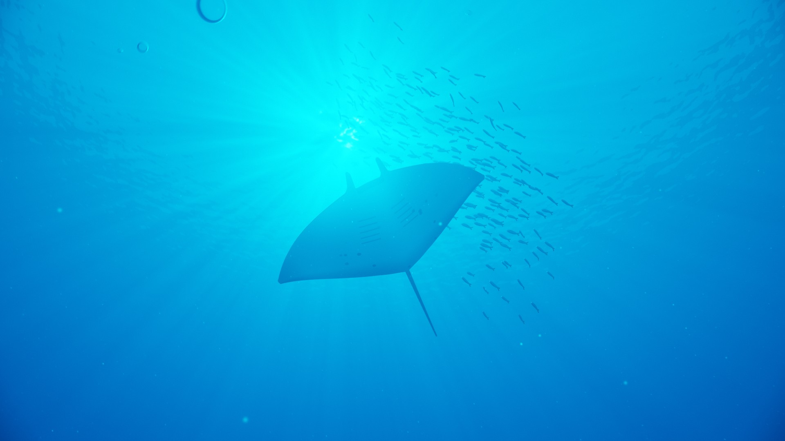
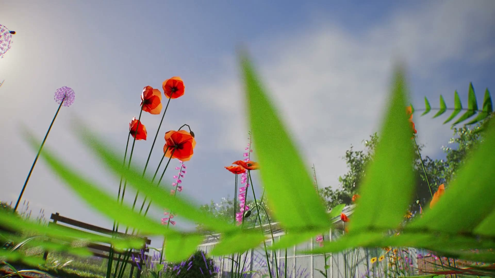
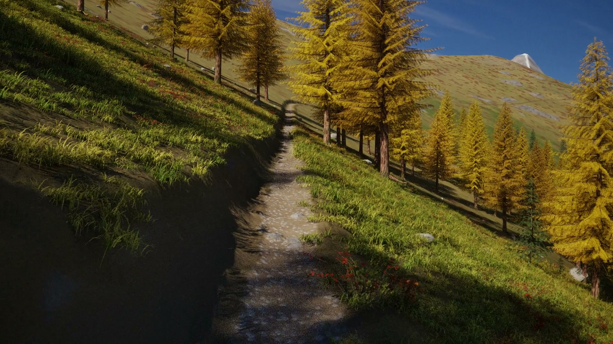
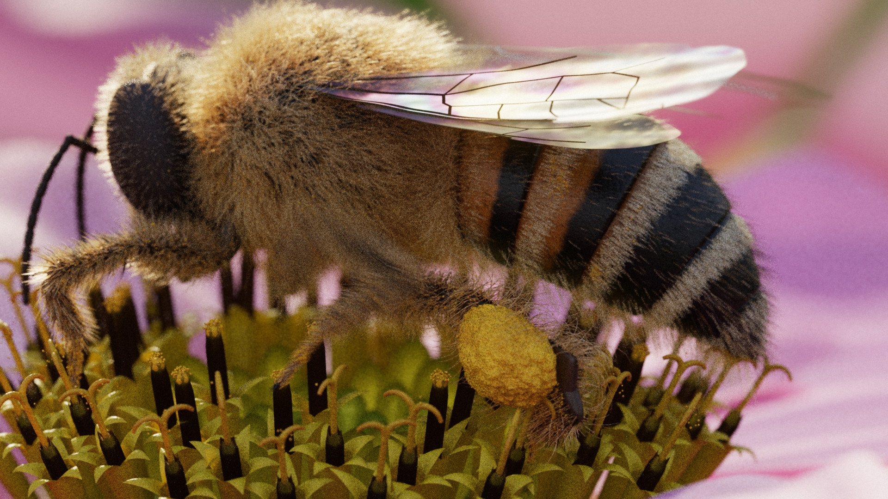
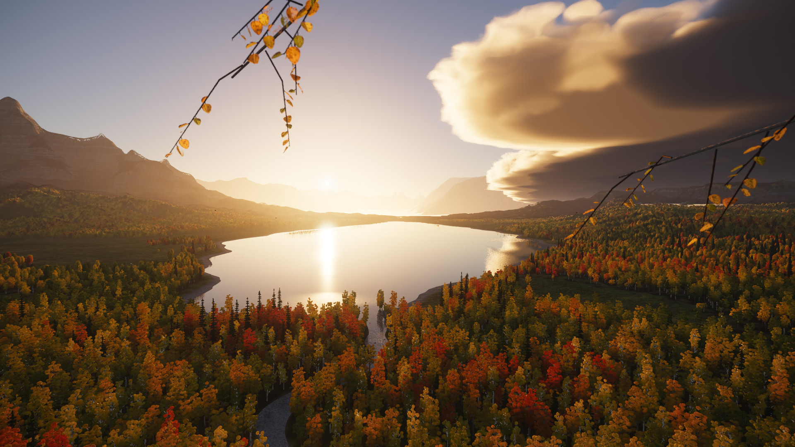

# Awesome Fable 5.2

[English](README.md) | 中文

用纯代码做出来的画面和影片合集。每个作品的代码都由 Claude（模型 `claude-fable-5-2`）在 Claude Code 里编写，画面和声音由这些代码计算得出：没有用 AI 生图/生视频模型，没有照片、贴图、3D 模型或音效素材，也没有用 Blender、游戏引擎或现成渲染器。唯一的例外写在对应作品里：《山行》《采蜜》和《万物生》的旁白来自语音合成服务。

## 作品

### [Deep Dive · 深潜](deep-dive/)

78 秒的第一人称潜水短片（1920×1080，30 fps，带合成音轨）：从水面下仰望斯涅尔之窗，游过浅礁，翻下峭壁，在深蓝里遇到一只蝠鲼。自写的无头 Metal 计算着色器光线步进渲染器，FFT 波面和正向追踪的焦散光场，群体行为鱼群，numpy/scipy 合成的声音。

- 成片：[deep_dive.mp4](https://github.com/BubbleBrainBB/awesome-fable-5.2/releases/download/deep-dive-v1.0/deep_dive.mp4)（129 MB，Release 附件）
- 说明、质检结果和已知不足：[English](deep-dive/README.md) | [中文](deep-dive/README.zh-CN.md)
- 需要：macOS + Apple Silicon（Metal）、clang++、Python 3（numpy / scipy / Pillow）、ffmpeg

### [Cat Garden · 猫眼植物园](cat-garden/)

110 秒、一镜到底的猫第一视角短片（1920×1080，30 fps，带合成音轨）：猫从栅栏下钻进植物园，盯瓢虫、遇熊蜂、在锦鲤池边喝水、在温室里被仙人掌扎到、追蝴蝶，最后跳上石墙晒太阳。自写的 Metal 计算内核路径追踪器，自建 BVH，约 38 万个实例化的植物；头部运动由步态和注视弹簧模拟；numpy/scipy 合成的声音。

- 成片：[cat_garden.mp4](https://github.com/BubbleBrainBB/awesome-fable-5.2/releases/download/cat-garden-v1.0/cat_garden.mp4)（304 MB，Release 附件）
- 说明、质检结果和已知不足：[English](cat-garden/README.md) | [中文](cat-garden/README.zh-CN.md)
- 需要：macOS + Apple Silicon（Metal）、clang++、Python 3（numpy / scipy / Pillow）、ffmpeg

### [Mountain Hike · 山行](mountain-hike/)

95 秒、8 个镜头的第一人称登山短片（1920×1080，30 fps，带合成的配乐、环境声和英文旁白）：沿同一条山径，从海拔 1600 m 的云杉林出发，过溪上木桥，穿过晨雾里的林子和金色的落叶松林线，经草甸、鞍部、带薄雪的岩脊，日落时站上 2488 m 的峰顶，脚下是云海。自写的 Metal 计算着色器路径追踪器，高度场光线步进，自建 BVH（每个镜头最多 46 万个实例化的树、草和岩块），物理天空，地形由地貌演化模型"长"出来；配乐和环境声由 numpy/scipy 合成；7 句旁白是唯一不由这些代码计算的部分（来自联网的语音合成服务 `edge-tts`）。

- 成片：[mountain_hike.mp4](https://github.com/BubbleBrainBB/awesome-fable-5.2/releases/download/mountain-hike-v1.0/mountain_hike.mp4)（384 MB，Release 附件）
- 说明、质检结果和已知不足：[English](mountain-hike/README.md) | [中文](mountain-hike/README.zh-CN.md)
- 需要：macOS + Apple Silicon（Metal）、clang++、Python 3（numpy / scipy / Pillow）、ffmpeg；旁白一步需要联网

### [Bee Documentary · 采蜜](bee-documentary/)

75 秒、10 个镜头的蜜蜂微距纪录短片（1920×1080，24 fps，带合成的环境声和配乐、英文旁白和软字幕轨）：一只工蜂以慢动作飞到粉色波斯菊上，落花、在花盘上行走、伸出喙探蜜，特写一直近到羽状毛上的花粉粒，然后梳理、把花粉装进后足的花粉篮、起飞。自写的 Metal 计算内核光线追踪器，自建两级 BVH：蜜蜂是代码生成的约 60 个刚体部件、最多 11.7 万根毛，由带腿部反向运动学的骨架驱动；景深和运动模糊都是逐条光线采样出来的。环境声、翅声和配乐由 numpy/scipy 合成；10 句旁白是唯一不由这些代码计算的部分（来自联网的语音合成服务 `edge-tts`）。

- 成片：[bee_documentary.mp4](https://github.com/BubbleBrainBB/awesome-fable-5.2/releases/download/bee-documentary-v1.0/bee_documentary.mp4)（220 MB，Release 附件）
- 说明、质检结果和已知不足：[English](bee-documentary/README.md) | [中文](bee-documentary/README.zh-CN.md)
- 需要：macOS + Apple Silicon（Metal）、clang++、Python 3（numpy / scipy / Pillow）、ffmpeg；旁白一步需要联网

### [Spring Awakening · 万物生](spring-awakening/)

93 秒、13 个镜头的自然短片（1920×1080，24 fps，带合成的环境声、鸟鸣和配乐、旁白和软字幕轨）：积雪的冬日林地化成春日草地，冰凌滴水、积雪退去、番红花开放、种子破土、蕨展开、山毛榉的芽裂开、瓢虫爬上草茎起飞、春雨落在新叶上、蜗牛出门。自写的 Metal 计算内核路径追踪器，自建两级 BVH，小亮点用解析的散景光斑层，光柱用单独模糊的雾缓冲区；植物、瓢虫和蜗牛都由代码生成并驱动。环境声、鸟鸣和配乐由 numpy/scipy 合成；12 句旁白是唯一不由这些代码计算的部分。同一画面有两个版本：英文版（`edge-tts`）和台湾腔中文版（Seed Audio），都来自联网的语音合成服务。

- 成片：[spring_awakening_v2.mp4](https://github.com/BubbleBrainBB/awesome-fable-5.2/releases/download/spring-awakening-v1.0/spring_awakening_v2.mp4)（英文）、[spring_awakening_v2_zh_tw.mp4](https://github.com/BubbleBrainBB/awesome-fable-5.2/releases/download/spring-awakening-v1.0/spring_awakening_v2_zh_tw.mp4)（台湾腔中文），各 388 MB，Release 附件
- 说明、质检结果和已知不足：[English](spring-awakening/README.md) | [中文](spring-awakening/README.zh-CN.md)
- 需要：macOS + Apple Silicon（Metal）、clang++、Python 3（numpy / scipy / Pillow）、ffmpeg；旁白一步需要联网

### [Bird Flight · 燕归枝](bird-flight/)

103 秒、一镜到底的家燕第一视角短片（1920×1080，60 fps，带合成音轨）：从云海之上钻云洞俯冲到湖面，贴水疾飞并点水，逆流钻进林间河道和峡谷，贴着 63 米高的瀑布水帘拉起，在崖顶借上升气流盘旋，最后落在桦树枝头望向日落。自写的 Metal 计算着色器确定性距离场光线步进渲染器，没有蒙特卡洛噪点；地形由河流侵蚀模型"长"出来，物理大气，体积云，树由树干、枝条和叶团构成；航线的坡度由横向加速度算出，头部稳定并以跳视转动；声音由 numpy/scipy 按飞行数据合成。

- 成片：[bird_flight.mp4](https://github.com/BubbleBrainBB/awesome-fable-5.2/releases/download/bird-flight-v1.0/bird_flight.mp4)（324 MB，Release 附件）
- 说明、质检结果和已知不足：[English](bird-flight/README.md) | [中文](bird-flight/README.zh-CN.md)
- 需要：macOS + Apple Silicon（Metal）、clang++、Python 3（numpy / scipy / Pillow）、ffmpeg

### [Afternoon Light · 午后](afternoon-light/)

一幅静止画面（3840×2560）：深秋午后的安静房间，低斜的阳光穿过落地门，把窗格和树影投在白墙与人字拼地板上。自写的 C++ 路径追踪器，场景完全由代码建模。

- 成品：[afternoon_light.png](afternoon-light/afternoon_light.png)
- 说明：[English](afternoon-light/README.md) | [中文](afternoon-light/README.zh-CN.md)
- 需要：C++17 编译器、Python 3（numpy / scipy / Pillow）

## 说明

- 每个作品在自己的目录里，互相独立，各带源码、渲染脚本和说明；各自的 README 里如实列出了验证过什么、没验证什么、还有哪些不足。
- 渲染产生的中间文件（`work/`）不在仓库里，按各目录的脚本可以重新生成。
