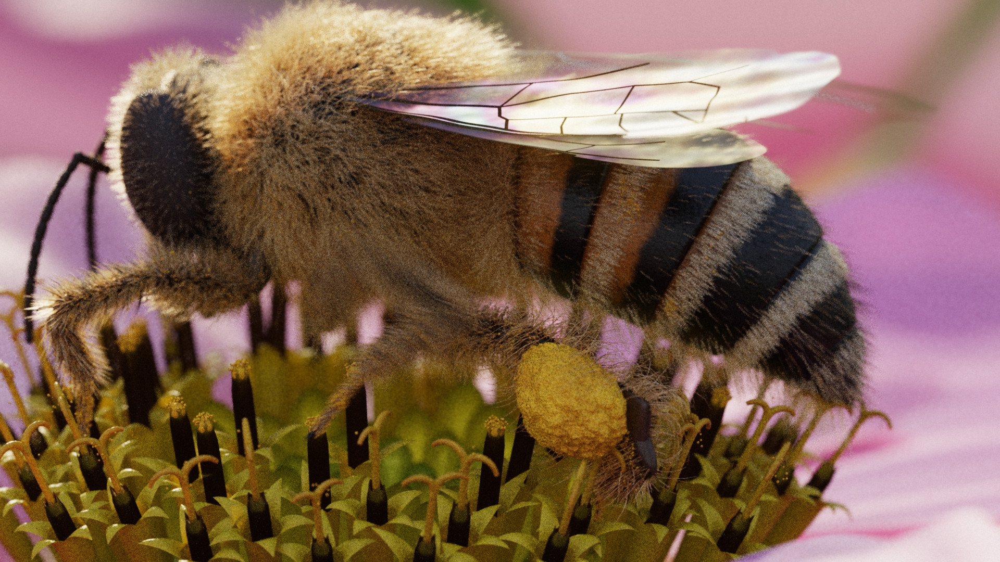

# Bee Documentary: a macro documentary short of a honey bee foraging, computed entirely by code

English | [中文](README.zh-CN.md)

[](https://github.com/BubbleBrainBB/awesome-fable-5.2/releases/download/bee-documentary-v1.0/bee_documentary.mp4)

A worker honey bee (*Apis mellifera*) forages on a pink cosmos flower, filmed the way a macro documentary would film it: the flower bed in the morning, the bee arriving in slow motion, the landing (the flower head dips and springs back), walking on the disc and unfolding the proboscis, a close-up of the mouthparts, backlit fur dusted with pollen, grooming and the pollen baskets, a move to another floret, take-off, and the empty flower. The narration keeps to the facts: on the flower the bee collects nectar and pollen, and honey is made later, in the hive.

Every pixel is computed by the code in `src/`. No AI image, video or music generation, no photos, textures, models, HDRIs or font files, no Blender, game engine, off-the-shelf renderer or ray-tracing library, and no ready-made filters or LUTs were used. No agent skill was used. The ambience, the wing sounds, the contact sounds and the music are synthesised with numpy.
**The one exception is the narration**: the English voice was generated with `edge-tts` (an online neural text-to-speech service, voice `en-GB-ThomasNeural`, rate −10%). Only the ten sentences listed below were sent to that service. ffmpeg is used only for encoding, muxing, and decoding for QC measurements.

The code was written by Claude, an AI model (`claude-fable-5-2`), in Claude Code; the picture and the sound (apart from the narration) were computed by that code. The bee, the flower and the background plants are geometry generated by functions in `src/`; the program reads no model or texture file.

| Item | Value |
|---|---|
| Film | [`bee_documentary.mp4`](https://github.com/BubbleBrainBB/awesome-fable-5.2/releases/download/bee-documentary-v1.0/bee_documentary.mp4) (above GitHub's per-file limit, so it is attached to a release; the cover `preview.jpg` is frame 1195), 1920×1080, 24 fps, 75.25 s (1806 frames), 10 shots, H.264 High yuv420p (BT.709) + AAC-LC 48 kHz stereo, with an English soft-subtitle track; about 220 MB, about 23 Mbps |
| Subtitles | [`narration.srt`](narration.srt) |
| Contact sheet | [`contact_sheet.jpg`](contact_sheet.jpg) (40 frames spread evenly over the film) |
| Source | `src/` (about 4200 lines: Objective-C++ host, C++ headers, Metal kernel, Python for developing, audio, muxing and QC) |
| One-command rebuild | `./render.sh` (fixed random seed, resumable per shot; the narration step needs the network) |
| QC reports | [`qc_report.txt`](qc_report.txt), [`qc_verify_diff.jpg`](qc_verify_diff.jpg), [`audio_report.txt`](audio_report.txt), [`audio_spectrogram.png`](audio_spectrogram.png) |

## Shot list (24 fps)

| # | Time (s) | Frames | Picture | "Camera" | Time scale |
|---|---|---|---|---|---|
| 1 | 0.00–8.00 | 192 | A bed of cosmos in the morning, the hero flower in the middle, swaying in the wind; from 5.3 s a bee flies in from the distance | Field of view about 125 mm wide, subject distance 600 mm, a slider moving slowly right to left and slightly in; fades in from black over 0.9 s | Real time (180° shutter, the wings are a blur) |
| 2 | 8.00–15.00 | 168 | The bee flies along the petals towards the disc; every wing beat is visible, legs hanging, a rim of backlit hair | From the side, field 31 mm wide, panning with the bee and lagging a little; the focus runs ahead at 2.6 s and behind at 5.2 s, then recovers | 60× slow (equivalent to 1440 fps; 230 beats per second become 3.8 per second on screen) |
| 3 | 15.00–21.25 | 150 | The landing: legs reach forward, the forelegs touch first, the flower head dips and springs back, the wings fold | Locked off, field 47 mm wide | 20× slow (480 fps) |
| 4 | 21.25–30.25 | 216 | Walking on the disc (alternating tripod gait), antennae tapping in bursts; she stops, lowers her head, and the proboscis unfolds into a floret | Medium close-up, field 28→24 mm, a slow push in; the focus hunts slightly at 3.9 s | Real time |
| 5 | 30.25–39.25 | 216 | Mouthparts close-up: the proboscis in a floret, the tongue moving; at 3.3 s she withdraws, turns her head and probes another | Very close, from the front and side, field 10→9 mm, very shallow depth of field; from 5.4 s the focus moves from the compound eye to the proboscis | Real time |
| 6 | 39.25–47.25 | 192 | Extreme close-up of the thorax fur and the wing base: backlit rim, pollen grains on branched hairs; the abdomen pumps in bursts | Backlit, from the side and behind, field 8 mm, a slider moving slowly along the body from back to front | Real time |
| 7 | 47.25–55.25 | 192 | Grooming: the left middle leg scrapes back along the side of the thorax twice; the hind legs lift and rub together; the pollen pellet in the hind-leg basket | From the side, field 15→14 mm, focus on the pollen basket | Real time |
| 8 | 55.25–62.25 | 168 | From above: the bee withdraws the proboscis, turns about 55° around the disc and probes again; the flower sways in the wind | Looking down at 37°, field 50 mm | Real time |
| 9 | 62.25–68.25 | 144 | Take-off: head up, wings spread and beat, push off, the flower head rebounds, the bee leaves up and to the left | Fixed, from the side, tilting up a little in the second half, field 56 mm | 14× slow (336 fps) |
| 10 | 68.25–75.25 | 168 | The empty flower sways; from 3.2 s the focus drifts to the distance and the flower dissolves into bokeh; fades to black over 1.6 s | Field 66→72 mm, a slow pull back | Real time |

1806 frames in all. Every transition is a hard cut.

## Narration (edge-tts, `en-GB-ThomasNeural`)

1. Morning. The cosmos are open, and the first foragers are already at work.
2. A worker honey bee. Her wings beat more than two hundred times a second.
3. She weighs about a tenth of a gram. Enough to make the flower bow.
4. Her antennae taste the surface as she walks. Every floret on this disc is a flower of its own.
5. Then the tongue unfolds, and reaches down for the nectar. Sugar water: fuel for the flight home.
6. Her coat does the rest. Each hair is branched, like a feather, and pollen clings.
7. She combs it out with her legs, and packs it into the baskets on her hind legs.
8. What she drinks is not yet honey. That is made later, in the hive.
9. Loaded, she lifts off. For the hive, or the next flower.
10. And the flower has been paid in return: a dusting of pollen from somewhere else.

Each line falls inside its own shot and none is cut by an edit (start and end times are in `audio_report.txt`).

**These facts were written from memory and were not checked against any source**: the wing-beat rate of "more than two hundred times a second" (the remembered figure is about 230 Hz); a worker weighing "about a tenth of a gram"; each tubular floret on a cosmos disc being a flower of its own (the composite flower head of the daisy family); antennae carrying taste and smell receptors; bee hair being branched; the pollen basket on the outside of the hind tibia; nectar becoming honey only after it is passed between workers in the hive and dried. The narration deliberately contains no number I was unsure of (trips per day, milligrams per trip).

How the voice was chosen: I cannot hear, so I synthesised the same passage with 8 candidate English voices and measured the median pitch, the interquartile range of the pitch (how much the intonation moves), the share of pauses and the spectral centroid, and took `en-GB-ThomasNeural`: low pitch (126 Hz), moderate movement, and the most pauses (the least hurried). It was chosen by measurement, not by ear.

## The engine (`src/`, all written for this film; the modelling functions for the bee and the flower were copied from my own code for an earlier macro still of a bee, which is not in this repository, and then changed)

| File | What it does |
|---|---|
| `kernel.metal` | The Metal compute kernel (MSL, compiled at run time): two-level BVH traversal, intersection of three kinds of primitive, a thin-lens camera, materials and procedural textures, lighting, layer compositing and the far background |
| `shared.h` | Constants shared by the host and the kernel |
| `main.mm` | The host: builds the scene, builds the TLAS for every frame, drives the kernel, validates, writes linear half-float frames |
| `world.h` | Parts, instances and the GPU data layout; the binned-SAH BVH builder; the per-frame top-level BVH |
| `model.h` | Meshing of parametric surfaces, spline tubes, hair grown at area-weighted points (optionally with side branches) |
| `bee.h` | The anatomical model of the bee (about 60 rigid parts) and its rig, the inverse kinematics of the legs, the kinematics of the wing beat |
| `flower.h` | The cosmos: 8 petals with thickness, pleats and irregular curled edges; 118 tubular florets (buds, pollen-shedding, stigma stage) |
| `bg.h` | The background garden: other cosmos, buds, feathery leaves, blades of grass, each swaying in the wind |
| `shots.h` `anim.h` | The shot table: camera position, focus, and the actions of the bee and the flower for each shot; the gait simulation; keyframes and smooth noise |
| `post.py` | Developing: smoothing masked by depth of field, lens softening, glow, a film curve, grain, dither |
| `audio.py` | Synthesis of all sound, ducking, loudness normalisation, subtitles |
| `narration.py` `tts.py` | The narration text and its timing; the call to edge-tts |
| `assemble.py` `qc.py` | Muxing and the contact sheet (the time labels are seven-segment digits drawn by the script); QC |

### Why not the path tracer from the earlier still

The CPU path tracer used for that still took 78 minutes for one 4K frame at 1024 samples per pixel. Scaled to 1080p that is still only about one sample per second, which rules out 1806 frames.
This film uses **ray tracing in a Metal compute kernel** instead (still with a BVH and intersection code written here; Metal's ray-tracing acceleration-structure API is not used):

- **Parts and a two-level BVH**: an insect's exoskeleton is rigid segments joined by hinges, so the bee is split by segment into about 60 rigid parts (thorax, head, antennal scapes and flagella, three proboscis segments, six abdominal segments, four wings, six legs of four segments each, two pollen pellets). The flower is 8 petals, a base and the florets; each background plant is one part. Each part gets a BLAS built once; per frame only a top-level BVH over about 250 instances is rebuilt. Animation is one matrix per part per frame.
- **Motion blur**: each instance carries 2 to 20 matrix keys across the shutter, rays carry a time, and the kernel interpolates. In the real-time shots the wings really are blurred by the shutter; the slow-motion shots use the short shutter of a high-speed camera.
- **Depth of field**: a thin lens with a finite aperture, nine rounded blades, and a second stop that produces mechanical vignetting (cat's-eye bokeh and darker corners). Every camera ray picks a point on the aperture, so the blur and the way a soft foreground partly covers what is behind it are sampled directly, not blurred in post. The field of view changes slightly with focus distance (focus breathing).
- **Lighting**: the sun (warm, 0.8° half-angle) is sampled directly. Shadow rays do not stop at the first hit; they multiply transmittance: light through a petal takes on the petal's colour, a wing membrane dims it slightly, hair attenuates it by the number of hairs crossed. One indirect bounce is added (direct sun at the hit point plus an estimated ambient term). The sky and the surrounding vegetation are an analytic environment function.
- **Hair**: each hair is 2 to 6 ribbon segments that face the ray (root radius about 4 µm); on the thorax and head each segment carries one or two oblique side branches (branched hairs). The amount of hair depends on how close the shot is: about 34,000 hairs (thickened) in the establishing shot, 68,000 to 117,000 hairs and 490,000 to 830,000 segments elsewhere (the figures after round 5 thinned the fur on the head and legs).
  The shading is not path traced. Direct sun uses an analytic approximation of the R, TT and TRT lobes (the form in Karis 2016); when other hairs are in the way, forward scattering is scaled by how many hairs the shadow ray crossed; multiple scattering is approximated by a diffuse term proportional to the hair colour. The bright backlit rim comes from the TT lobe and this transmittance.
- **Other materials**: petals and leaves are thin sheets with diffuse reflection and diffuse transmission (they glow when backlit; the hero flower's petals are two surfaces enclosing a thickness). The wing membrane has thin-film interference reflection (Airy's formula at three wavelengths) plus tinted straight-through transmission; the veins are opaque. The cuticle, the compound eyes and the legs are dark diffuse with a GGX highlight and procedural bumps (punctures, hexagonal facets at 22.5 µm spacing). The pollen pellets are orange-yellow lumps with a highlight. Every texture is an analytic function of position or UV.
- **Three layers**: the subject (hero flower and bee, full resolution, 56 to 64 samples per pixel); the middle ground (other flowers and leaves, at quarter resolution with 192 samples per pixel, since it is out of focus anyway); and an analytic far background: blotches of colour from noise with the high frequencies removed according to the bokeh radius, plus about 46 highlights in the shape of the aperture (including the vignetting cut). The subject's coverage comes from the rays; it is laid over the middle ground, which is laid over the far background.
- **Guard against bad frames**: every pixel records how many samples it received. If any pixel is short, the GPU reports an error, or a NaN appears, the frame is discarded and rendered again.

### The bee (`bee.h`)

- Head, thorax and abdomen. Each of the six abdominal tergites is its own shell overlapping the next; the abdomen can bend segment by segment and telescope (pumping). T1 to T3 are amber with dark rear margins.
- Head: a rounded-triangle capsule (raised clypeus, the suture above it, antennal sockets), kidney-shaped compound eyes (hexagonal facet bumps and fine eye hairs), three ocelli, labrum and mandibles; elbowed antennae (a scape and a flagellum with constrictions between segments, posed differently left and right, always probing); a proboscis in three segments (cardo and stipes / a sheath standing for the galeae and labial palps / a glossa with rings of hair) that unfolds, aims at a floret, and moves the tongue in and out.
- Legs: all six on the thorax; femur (with trochanter), tibia, basitarsus, tarsomeres 2 to 5 with a pair of forked claws and a pad. The middle tibia has a spur, the foreleg has the small flap of the antenna cleaner; the hind tibia is a flat plate widening towards its end with the pollen basket on the outside (ringed by curved hairs), and the inner face of the basitarsus has 10 rows of pollen comb.
- Wings: two pairs. The vein network is drawn, from memory of honey bee venation, as a distance field to polylines; the trailing edge of each wing is frayed differently. At rest they fold over the abdomen. In flight they sweep in the stroke plane and flip their angle of attack at each end of the stroke, the hind wing hooked to the trailing edge of the forewing.
- Hair: dense long branched hair on the thorax (with a worn bald patch in the middle of the back), long hair on top of the head and short hair on the face, pale bands of down at the base of each abdominal segment with dark bristles, soft hair and stiff bristles on the legs; colour and length vary with noise.
- Pollen: clumps and scattered grains of 25 to 35 µm stuck to the hair, more in each successive shot; the hind-leg pellets grow from shot to shot (0.55 → 1.0).

### Motion

- **Standing and walking**: each foot is placed on the top of the nearest floret; body height and pitch are computed from the six footholds. Walking is a simulated alternating tripod gait (a leg steps when its foothold leaves a comfortable range; a step takes 0.085 s). At rest each leg lifts every 2 to 3 seconds to take a new grip.
- **Leg solver** (rewritten once, see "Iterations"): the foot meets the surface at an elevation angle; when the foothold is close to the hip the leg folds into a Z (knee and ankle out, foot tucked under the body); the knee always bends towards a fixed "up and out" side; the handedness of each leg's plane normal is fixed. The aim is that joints move smoothly whenever the foothold moves smoothly.
- **Constant small movements**: the two antennae swing independently and tap in quick bursts; the abdomen pumps in bursts; the head moves slightly; while feeding the head nods with the tongue (4.6 times per second); the wings open a little now and then.
- **Flight**: 230 wing beats per second; the body pitched up about 23°, rising and falling slightly with the beat; the legs hang and swing a little, and reach forward before landing.
- **Flower**: the head swings about a pivot below it on the stalk (wind: a few sines plus smooth noise), each petal trembles about its hinge; when the bee lands the head sinks about 2 mm as an underdamped oscillator and springs back, and rebounds the other way at take-off.

### Imaging and developing (`post.py`)

Linear light → smoothing masked by depth of field → very light softening of the whole frame (σ ≈ 0.55 px; a lens is not infinitely sharp) → a faint highlight glow → exposure → an S-curve with a shoulder → sRGB → grain → ±1 LSB dither.

### Sound (`audio.py`)

- Ambience: wind with gusts (filtered noise), rustling leaves, three synthesised bird calls (a short falling chirp, a two-note whistle, a trill) with reverb; in the slow-motion shots the ambience is lowered and muffled.
- The bee: in shot 1 a harmonic buzz on a 232 Hz fundamental, approaching. In the slow-motion shots the sound is not slowed down; instead, **at the wing-beat rate actually seen on screen** (3.8, 11.5 and 16.4 per second), every half beat triggers a puff of air and a low thump, heavier on the downstroke. The landing has a soft thud, a fine rustle from the florets and the low sway of the flower head springing back; walking and grooming have very quiet taps and rubbing; the move to a new position has a short burst of wing sound.
- Music: a pad with one chord per shot (D major: D–Bm–G–A–D–F♯m–G–Bm–A–D) and sparse plucked notes, with synthesised reverb.
- The narration is in front. While it speaks the ambience and music drop 7 dB and the bee's sounds 6 dB (starting 0.1 s early, releasing over about 0.5 s).
- Loudness is normalised to −16 LUFS with my own implementation of the ITU-R BS.1770 meter (K-weighting and two-stage gating). A look-ahead soft limiter holds the mix's true peak at about −2.6 dBTP (headroom for AAC overshoot). The encoded track was measured again with ffmpeg's ebur128: −16.1 LUFS, −2.2 dBTP.

## Iterations (each round: render → open the images and look → write down the problems → change)

The images looked at in each round are not in the repository; the notes describe what they showed.

**Round 0: the engine, with only the flower.** A 960×540 frame at 16 samples took 38 seconds. Timing by stage showed primary rays took 0.05 s and the bounce rays were slow: a few vertex normals had degenerated to NaN, and a ray with a NaN direction "passes" every bounding-box test, so one bad ray walks the whole tree. After rejecting non-finite rays at entry and falling back to the geometric normal when the shading normal is degenerate, the flower rendered at 1080p and 48 samples in 1.2 s.

**Round 1: the first furred bee.** Problems seen: the body sank into the disc and the legs were hidden (the bee is longer than the disc, feet reaching past it landed on the lower petals and pulled the body down); the fur was creamy white and overexposed, like a plush toy; the wings were rainbow-coloured with reddish veins; the proboscis pointed horizontally into the distance; the background was flat green. Changes: feet that would land outside the disc are pulled back to grip the outer florets, and body height is recomputed from the footholds; overall exposure down to 0.42; fur colour changed to yellow-brown and its multiple-scattering gain reduced; thin-film reflection cut to 55% and desaturated; the proboscis given two-bone inverse kinematics aimed at the nearest floret below and in front of the feet.

**Round 2: anatomy checked from four views.** Problems: the red veins came from a debug colour on the wing membrane leaking into the indirect light; the antennae were two thick straight black sticks with no visible elbow; the whole face was covered in long hair like a teddy bear, the compound eyes buried under long eye hairs; the mouthparts were bright orange-red; the pollen pellets looked like tennis balls; head and thorax ran together. Changes: fixed the leak; thinner antennae with a sharper elbow, a natural droop in the flagellum and a different pose on each side; shorter, sparser hair on the face and clypeus so the shiny black cuticle shows, eye hairs shortened and halved; mandibles and proboscis changed to dark red-brown; highlight and bumps on the pollen pellets and fewer loose grains on their surface; the neck opened up a little; uneven length and shade in the thorax fur.

**Round 3: background, shots, and a preview strip per shot.** Problems and changes: a plain background → a background garden laid out as real geometry (the middle layer) and a far background scaled by the bokeh radius; in flight the folded proboscis jabbed forward like a spear → folded, the two segments point back and down and shorten along their axis; the wings were almost invisible in slow motion (at 20× with a 180° shutter they were completely blurred, and the membrane was too transparent) → a short shutter for slow-motion shots, a faint diffuse layer on the membrane and slightly lower transmission; the landing at 10× was too quick to read → 20× and stretched to 6.25 s; in the overhead shot a blade of grass crossed in front of the bee → no long blades within 150 mm of the hero flower; in the backlit side shot the whole wing reflected as one white patch → a roughness floor and a weaker sun highlight on the membrane; the establishing shot was cluttered and the hero flower did not stand out → a narrower field, a wider aperture, and new slider end points.

**Round 4: 1080p single frames and numeric checks.** Problems and changes: black knee spheres showed in close-ups → removed; depth of field in the close-ups was too deep for macro → apertures about 1.5× wider in the three close-up shots; close-up frames took 18 to 21 s → the middle layer no longer traces indirect light and the subject traces it with probability 1/2 (weight 2), which brought it to about 10 s per frame with no visible difference in a before/after comparison; too little pollen in the pollen close-up → doubled in that shot.
**The most important finding**: neither thumbnails nor whole-frame difference numbers showed anything wrong, but printing the knee position of every leg for every frame showed that the leg solver flipped between two solutions on many frames (the knee jumping 2 to 4 mm in one frame, the leg's plane normal turning over), and that there were NaNs in the flight shots. The cause was the ankle passing directly above the hip when a foot was lifted to about hip height. The leg solver was rewritten (see above) and the check rerun: apart from gait steps, no frame where the knee moves more than the foot, and no NaN.

**Round 5: the first full render (about 3 hours, stopped during shot 8), then finished frames examined shot by shot.** The first seven shots were usable overall, but three problems showed:

1. In the mouthparts close-up, the knee of the foreground leg pointing at the camera was "a ring of hair around a black dot", like an eye on a pom-pom. I first took it for the open end of a tube exposed when the joint spheres were removed, and added an end cap, a joint sphere and a tuft of hair; none of it helped. A frame rendered with 3% of the hair made it clear: that dot is simply the dark end of the knee joint, and the problem was not the knee but **leg hair that was too long and too dense**, wrapping the leg like a bottle brush.
2. In the same almost hairless frame the head was at once the head of a real insect (shiny black capsule, three ocelli, kidney-shaped eyes), while the furred version looked like a plush toy: **too much hair on the head and legs was the main source of the toy look**. Changes: head hair halved in number and about a quarter shorter; leg hair reduced to about 64% in number and about 70% in length, and darker. The dense thorax fur was kept. For consistency, every shot with the bee in it was rendered again.
3. In the overhead shot the thin stems of a clump of feathery leaves crossed between the camera and the bee and, out of focus, looked like wire mesh → no leaf clumps within 140 mm of the hero flower in that shot (a cameraman would have moved the leaves aside too).

Also changed: in the grooming shot the pollen pellet left the focal plane while the hind legs rubbed together, and moved too fast, becoming a yellow smear → the focus now follows the pellet, the rubbing slowed from 5.2 to 4.2 per second with a slightly smaller amplitude, and the aperture closed a little; the constrictions between flagellum segments were deepened.
The leg-continuity check was rerun after these changes with the same result (no flips, no NaN).

**Round 6: the second full render** (this is the one delivered). The review after it is in the next section.

## Review of the finished film

Checks made after the second render:

- **Looking**: the contact sheet (40 cells); for each of the 10 shots a check sheet of 3 to 12 finished frames; 100% crops of the slow-motion flight, the landing, the mouthparts close-up and the walk; a tracking crop of 12 frames of the take-off; two frames decoded from the muxed MP4 (to confirm the encoded picture matches the PNGs).
- **Numbers** (all in `qc_report.txt`): container parameters and frame count, a full decode, black and frozen frames, per-frame brightness and block differences, all-zero blocks, the renderer's sample-count check (zero retries), loudness and true peak, narration against shot boundaries, and an independent low-resolution re-render of 30 frames.
- **Sound**: numbers only: loudness, true peak, the margin of each narration line over the bed (8.6 to 14.3 dB; this figure counts the pauses between words in the narration's average level, so the margin while a word is being spoken is larger), and a spectrogram of the mix (`audio_spectrogram.png`).

Two errors found by QC after muxing, and fixed:

1. The first mux used `-shortest`, and the subtitle track ends at 73.7 s, so the picture was cut to 1768 frames. The duration is now given from the frame count: 1806 frames, 75.250 s.
2. The mix limited true peak to −1.3 dBTP, but after AAC encoding it measured −0.8 dBTP (above −1). The limiter target was lowered to about −2.6 dBTP; the encoded track measures −2.2 dBTP and the loudness is still −16.1 LUFS.

The encoder's CRF was also changed from 19 to 21 (324 MB → 220 MB). Neighbouring frames of a slow-motion shot (not strictly the same frame) were compared before and after; what is lost is mainly some of the grain.

In the independent re-render comparison, 107 blocks out of the 59,400 sampled differ by more than 20%, all in the three close-up shots, the largest by 50%. I took one frame from each of those three shots and looked at the re-render, the delivered frame and the difference map side by side ([`qc_verify_diff.jpg`](qc_verify_diff.jpg)):
the blocks with the largest differences are all on the compound eyes. The facet texture of the eye fades out according to how much surface one pixel covers; in the 480-pixel-wide re-render the facets fade out completely, so the mean brightness of the eye differs from the delivered frame. This is a material that does not preserve its mean across resolutions (see "Known shortcomings"), not a lost tile or missing geometry.
The other 6 sampled close-up frames were not examined one by one.

Problems that **remain and were not changed** after looking at the finished frames:

- In the two seconds of the grooming shot where the hind legs rub together, the pollen pellet is in focus but still smeared by motion blur (at 4.2 per second and a 180° shutter that is what happens); you can see it moving but not how.
- In about a third of the take-off frames the wings are almost invisible (the membrane is nearly transparent and happens to be edge-on to the camera); in the rest they are blurred wing shapes.
- Around 2.6 s in the slow-motion flight the focus runs ahead on purpose and the bee is soft for about half a second; it is designed, but may read as missed focus.
- At the top edge of the overhead shot a petal of a neighbouring white flower moves in and out of frame with the wind and draws the eye a little.
- In the close-ups, out-of-focus areas of the thorax show coarser noise than the in-focus areas (depth-of-field sampling noise plus grain).
- Feathery leaves near the focal plane in the establishing and closing shots still look like thin wire.

## Render time (measured on an Apple M4 Max; other programs were using the GPU during the run, and the time per frame of one shot varied by up to a factor of two)

The delivered (second) pass, wall time per shot from start to developed frames:

| Shot | Frames | Samples per pixel (subject / background layer) | Mean render time per frame | Whole shot |
|---|---|---|---|---|
| 1 establishing | 192 | 64 / 192 | 2.0 s | 6.5 min |
| 2 slow-motion flight | 168 | 64 / 192 | 2.7 s | 7.8 min |
| 3 landing | 150 | 64 / 192 | 4.2 s | 10.7 min |
| 4 walking and probing | 216 | 64 / 192 | 6.0 s | 21.9 min |
| 5 mouthparts close-up | 216 | 56 / 192 | 10.3 s | 37.3 min |
| 6 fur and pollen | 192 | 56 / 192 | 8.9 s | 28.6 min |
| 7 grooming | 192 | 56 / 192 | 10.9 s | 35.2 min |
| 8 overhead | 168 | 64 / 192 | 7.7 s | 22.0 min |
| 9 take-off | 144 | 64 / 192 | 3.4 s | 8.4 min |
| 10 closing | 168 | 64 / 192 | 4.0 s | 11.5 min |
| Total | 1806 | | | **about 3 h 10 min** |

- Scene generation and BVH build: 0.6 to 0.9 s per shot. Developing (6 processes) is included in the table. The mix takes about 11 s, the encode about 54 s, QC (with the 30 re-rendered frames) about 3 minutes.
- **Discarded renders**: the first pass ran for about 3 h 10 min (shots 1 to 7 and half of shot 8) and was thrown away entirely because of the three problems in round 5; in the second pass shot 5 was rendered once more for 21 minutes (the version before the foreleg foothold was moved).
- From starting on the engine to the finished film took about 8.5 hours of wall time (including a pause of about 25 minutes).

## Known shortcomings

**The bee**

- The antennae still look like two smooth dark hoses: the constrictions between segments are shallow, and the sensory hairs on the surface are essentially invisible at the film's resolution.
- In close-up the compound eye is a dark curved surface with fine hairs. The hexagonal facets (22.5 µm apart) are only about 4 pixels across when the field is 9 to 10 mm wide, so they read as a fine texture, not a clear honeycomb. The facet texture does not preserve mean brightness as it fades with magnification, so the eye is slightly different in tone in wide shots and close-ups.
- With the head hair thinned, the capsule, ocelli and eyes are clear in close-up, but the clypeus, labrum and mandibles are still only faintly visible; the thorax is still very fluffy, and in medium shots the whole bee is "fuzzier" than a real honey bee.
- The proboscis is three straight thin tubes, and folding is faked by shortening along the axis (a real proboscis folds back into a groove behind the head); the movement of the tongue is hidden by the floret most of the time. The proboscis and tongue do not collide with the floret; they are only aimed into its mouth.
- Leg segments are smooth tubes of elliptical section with hair, without real joint sockets. There is no collision detection between legs and florets: a foot is "stuck" to the top of the nearest floret, and a leg sometimes passes slightly through a neighbouring one.
- Walking is only a regular alternating tripod. The grooming (middle leg scraping the thorax, hind legs rubbing) is choreographed from a general impression, much simpler than real pollen transfer, and no pollen is actually moved: the pellet simply grows from shot to shot.
- The wings are rigid sheets: no bending or twisting during the stroke; the stroke plane, amplitude and angle-of-attack reversal are parameters set from a general impression, not from measurements. The venation is drawn from memory and was not checked against a specimen.
- Each hair is a few straight ribbons, shaded by an analytic approximation and not path traced: multiple scattering inside the fur is only a diffuse term, so the fur looks a little "cleaner and more even" than real fur, and in extreme close-up some plush-toy feeling remains.
- The body's attitude changes very little in flight (slight heave and sway); a real hovering bee moves more.
- Landing and take-off forces only move the flower head as a whole; the florets and petals that are stepped on do not bend.

**Flower and background**

- The florets are rigid and do not move individually in the wind; the hero flower's petals are shells of two surfaces and their edges are still thin.
- Background plants are low-detail models (made to be out of focus): the feathery leaves are thin cylinders, and the few near the focal plane in the establishing and closing shots look like wire.
- The middle layer is rendered at quarter resolution and upscaled, and it is **always drawn behind the subject** (composited by layer, not by depth): a background leaf that is physically in front of the bee would still be drawn behind it.
- The colour blotches and highlights of the far background are "painted" by analytic functions; they are not real geometry blurred by the lens. The highlights are not occluded by the middle ground and are perfectly uniform inside. The far background has no parallax when the camera translates (it is treated as infinitely far).

**Imaging and physics**

- Only one indirect bounce, followed by an estimated ambient term; indirect light is sampled with probability 1/2; the brightness of a single sample is clamped (40 for the subject, 10 for the background layer). All of these are biased noise controls.
- **Denoising was used**: in developing, regions where "every subject surface seen by this pixel is far out of focus" (circle of confusion over 9 pixels) get a Gaussian blur of σ = 1.1 to 2.4 pixels. In-focus hair and florets are outside the mask, but out-of-focus detail near the mask's edge is smoothed a little.
- The whole frame is also softened by σ ≈ 0.55 pixels and grain is added: this is meant to make it less sharp than CG, and it also hides some sampling noise.
- No diffraction, chromatic aberration or spherical aberration; bokeh discs are uniform inside. Motion blur is linear interpolation between matrix keys.
- No dewdrops (the earlier still had them; this film does not).
- The slow-motion factors (60×, 20×, 14×) were chosen for how they read; the strength and colour of the sun and sky were also set by eye, not from measurements of morning light.

**Sound**

- Nobody has listened to the soundtrack (I cannot hear): levels, ducking and loudness were set by measurement, and I cannot judge whether the timbres are natural or the music is pleasant.
- The wing sound in the slow-motion shots is a designed effect timed to the wing beats, not a slowed-down recording. The bird calls and the wind are very simple synthesis.
- The narration is TTS, not a person.

## Not verified

- **Nobody has watched or listened to the whole film.** What I checked are extracted stills, the contact sheet, frame-difference numbers, joint-position numbers, loudness numbers and a spectrogram. How it plays (whether the motion is natural, the rhythm of the cuts, whether sound and picture fit) is not verified.
- The bee's anatomy, colours, gait and flight posture were not checked against any reference footage or specimen; they are from memory. The facts in the narration were not checked against any source either (see above).
- It has been compiled and run only on one Apple M4 Max (macOS, Metal). The delivered frames were rendered by `render.sh` in three runs (stopped by hand twice and resumed); after the two errors above were fixed, the mix and the mux were rerun by hand with `src/audio.py` and `src/assemble.py`, the same scripts as in this directory. The whole of `render.sh` has not been run in one go from an empty directory. For `QUICK=1 ./render.sh` see "Rebuilding".
- The independent re-render in QC sampled only 30 frames at low resolution; it can only catch large faults such as lost tiles or missing geometry.
- Whether the same binary renders the same frame bit for bit was not specifically verified (the random seed depends only on shot number, frame number and pixel coordinates, so by design it should).

## Rebuilding

```bash
./render.sh
```

It resumes: shots already developed to PNG are skipped, and a half-rendered shot continues from its first missing frame. The narration needs `work/tts/line_XX.wav` (`python3 src/tts.py final`, which needs the network and `edge-tts`; on the machine used here `edge-tts` was installed in a virtual environment at `work/venv`). `QUICK=1 ./render.sh` is a pipeline check at 480×270 with a quarter of the samples (frames only, written to `work_quick/`): before delivery it was run once from an empty directory with this source and rendered all 1806 frames in 7.5 minutes with zero retries; 10 of those frames were looked at and matched the film.
The seed is fixed at 20261117; hair, pollen, background layout and motion are all deterministic.

Requires: macOS on Apple Silicon (Metal), clang++, Python 3 (numpy, scipy, Pillow), ffmpeg; the narration step needs the network and `edge-tts`.

## Files

- `src/`, `render.sh`: all source and the one-command script
- `narration.srt`, `contact_sheet.jpg`, `preview.jpg`: subtitles, contact sheet, cover
- `qc_report.txt`, `qc_verify_diff.jpg`, `audio_report.txt`, `audio_spectrogram.png`: QC results
- The film `bee_documentary.mp4` is attached to a release and is not in the repository.
- Not in the repository: the images looked at during the iterations, and `work/` (intermediate files produced by the render: about 5.8 GB of developed PNG frames, the mix, the narration audio, logs).
