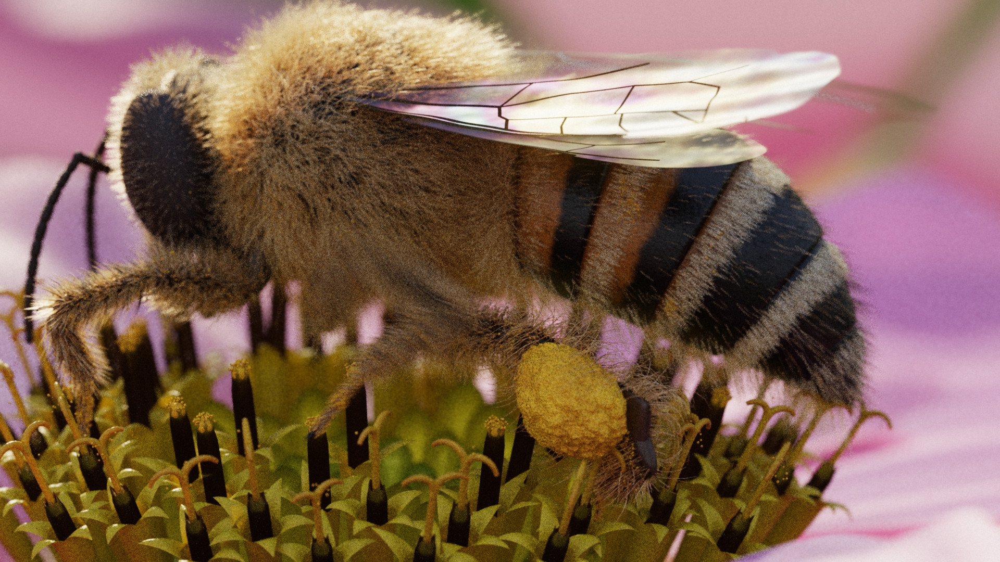

# 采蜜：蜜蜂微距纪录短片，完全由代码计算

[English](README.md) | 中文

[](https://github.com/BubbleBrainBB/awesome-fable-5.2/releases/download/bee-documentary-v1.0/bee_documentary.mp4)

成品：[`bee_documentary.mp4`](https://github.com/BubbleBrainBB/awesome-fable-5.2/releases/download/bee-documentary-v1.0/bee_documentary.mp4)（超过 GitHub 的单文件上限，所以作为 Release 附件；封面 `preview.jpg` 是第 1195 帧）：1920×1080，24 fps，75.25 秒 / 1806 帧，H.264 High / yuv420p，约 23 Mbps，AAC 立体声 48 kHz，带一条英文软字幕轨，约 220 MB。
字幕 [`narration.srt`](narration.srt)，总览图 [`contact_sheet.jpg`](contact_sheet.jpg)，质检 [`qc_report.txt`](qc_report.txt)、[`audio_report.txt`](audio_report.txt)、[`audio_spectrogram.png`](audio_spectrogram.png)。

代码由 Claude（模型 `claude-fable-5-2`）在 Claude Code 里编写，画面和声音（旁白除外）由这些代码计算得出。蜜蜂、花和背景植物都是 `src/` 里的函数生成的几何体，程序不读取任何模型或贴图文件。

画面的每一个像素都由本目录 `src/` 里的代码算出来：没有 AI 生图/生视频，没有照片、贴图、模型、HDRI、字体文件，
没有 Blender / 游戏引擎 / 现成渲染器 / 光线追踪库，没有现成滤镜或 LUT，也没有使用任何 skill。
环境声、翅声、接触声和配乐全部用 numpy 合成。**唯一的例外是旁白**：英文配音由 edge-tts（微软的神经网络语音 `en-GB-ThomasNeural`，语速 −10%）生成，
发给该服务的只有下面“旁白全文”里的十句英文。ffmpeg 只用于编码、混流和质检时的解码测量。

## 片子讲什么

一只西方蜜蜂工蜂（*Apis mellifera*）在一朵粉色波斯菊上采蜜的完整过程：清晨的花丛 → 蜜蜂飞来（高速摄影式慢动作）→ 落花（花头一沉再回弹）→
在花盘上行走、触角探路、伸出喙 → 口器特写 → 逆光下沾着花粉的绒毛 → 梳理、后足花粉篮 → 换位置继续采 → 起飞 → 空了的花。
旁白按事实讲：蜜蜂在花上采的是花蜜和花粉，蜂蜜是回巢以后才酿成的。

## 分镜表（24 fps）

| # | 时间（秒） | 帧数 | 画面 | “机位”与镜头 | 时间倍率 |
|---|---|---|---|---|---|
| 1 | 0.00–8.00 | 192 | 清晨的波斯菊丛，主花在中央，风里轻摇；5.3 秒起一只蜜蜂由远及近飞入 | 取景宽约 125 mm，物距 600 mm，滑轨自右向左缓移并略推近；片头 0.9 秒由黑渐入 | 实时（快门 180°，翅是一片虚影） |
| 2 | 8.00–15.00 | 168 | 蜜蜂贴着花瓣飞向花盘，翅的每一拍都看得清，足悬垂，逆光毛边 | 侧面，取景宽 31 mm，摇镜跟拍并略滞后；2.6 秒处追焦跑前、5.2 秒处跑后，再拉回 | 60 倍慢（相当于 1440 fps；拍翅 230 次/秒 → 画面上 3.8 次/秒） |
| 3 | 15.00–21.25 | 150 | 降落：足前伸、前足先触花、花头下沉后回弹、收翅 | 三脚架固定，取景宽 47 mm | 20 倍慢（480 fps） |
| 4 | 21.25–30.25 | 216 | 在花盘上行走（交替三角步），触角一阵阵点触；停下、低头、喙展开探进一朵小花 | 中近景，取景宽 28→24 mm 缓推；3.9 秒处对焦略游移 | 实时 |
| 5 | 30.25–39.25 | 216 | 口器特写：喙探进小花，舌伸缩；3.3 秒抽出、转头换一朵再探入 | 前侧方极近，取景宽 10→9 mm，景深很浅；5.4 秒起焦点由复眼移向喙 | 实时 |
| 6 | 39.25–47.25 | 192 | 胸部绒毛与翅基的极近特写：逆光毛边、羽状分叉的毛上沾着花粉粒；腹部一阵阵泵动 | 逆光侧后方，取景宽 8 mm，滑轨沿身体自后向前缓移 | 实时 |
| 7 | 47.25–55.25 | 192 | 梳理：左中足两次沿胸侧向后刮；后足抬起互搓；后足花粉篮里的花粉团 | 侧面，取景宽 15→14 mm，焦点在后足花粉篮 | 实时 |
| 8 | 55.25–62.25 | 168 | 俯拍：蜜蜂抽出喙，绕花盘转过约 55° 换位置，再探入；花在风里摇 | 俯角 37°，取景宽 50 mm | 实时 |
| 9 | 62.25–68.25 | 144 | 起飞：抬头、展翅振翅、蹬离，花头回弹，蜜蜂向左上方飞出 | 侧面固定，后半段略上摇，取景宽 56 mm | 14 倍慢（336 fps） |
| 10 | 68.25–75.25 | 168 | 空了的花在风里轻摇；3.2 秒起焦点慢慢移向远处，花化进光斑；片尾 1.6 秒渐黑 | 取景宽 66→72 mm 缓拉 | 实时 |

全片 1806 帧。镜头之间都是硬切。

## 旁白全文（edge-tts，`en-GB-ThomasNeural`）

1. Morning. The cosmos are open, and the first foragers are already at work.
2. A worker honey bee. Her wings beat more than two hundred times a second.
3. She weighs about a tenth of a gram. Enough to make the flower bow.
4. Her antennae taste the surface as she walks. Every floret on this disc is a flower of its own.
5. Then the tongue unfolds, and reaches down for the nectar. Sugar water: fuel for the flight home.
6. Her coat does the rest. Each hair is branched, like a feather, and pollen clings.
7. She combs it out with her legs, and packs it into the baskets on her hind legs.
8. What she drinks is not yet honey. That is made later, in the hive.
9. Loaded, she lifts off. For the hive, or the next flower.
10. And the flower has been paid in return: a dusting of pollen from somewhere else.

每句都落在对应镜头之内，没有被镜头切断（起止时间见 `qc_report.txt`）。

**这些事实是凭记忆写的，没有联网查证**：拍翅频率“每秒两百多次”（记忆中的数值约 230 Hz）；工蜂体重“约十分之一克”；
波斯菊花盘上每朵管状小花是一朵独立的花（菊科头状花序）；触角有味觉/嗅觉感受器；蜂毛是羽状分叉的；后足胫节外侧有花粉篮；
花蜜回巢后经工蜂之间传递、脱水才成为蜂蜜。旁白里故意没有写任何拿不准的数字（如一天飞多少趟、一次采多少毫克）。

选声音的方法：我听不到声音，所以对 8 个候选英文声音各合成同一段话，测量基频中位数、基频四分位距（语调起伏）、停顿占比和频谱重心，
选了基频低（126 Hz）、起伏适中、停顿最多（最从容）的 `en-GB-ThomasNeural`。这是按测量选的，不是听出来的。

## 引擎（`src/`，全部新写；蜜蜂与花的建模函数是从此前一张蜜蜂微距静帧（不在本仓库）的自己的旧代码抄过来再改的）

| 文件 | 内容 |
|---|---|
| `kernel.metal` | Metal compute 内核（MSL，运行时编译）：两级 BVH 遍历、三种图元求交、薄透镜相机、材质与程序纹理、光照、分层合成与远景 |
| `shared.h` | 宿主与内核共用的常量 |
| `main.mm` | 宿主：建场景、每帧建 TLAS、驱动内核、校验、输出线性半浮点帧 |
| `world.h` | 部件 / 实例 / GPU 数据布局；分箱 SAH 的 BVH 构建；每帧的顶层 BVH |
| `model.h` | 参数曲面网格化、样条管体、按面积撒点长毛（可带羽状小枝） |
| `bee.h` | 蜜蜂解剖模型（约 60 个刚体部件）与骨架、腿的反向运动学、翅的拍动运动学 |
| `flower.h` | 波斯菊：8 枚有厚度、带褶和不规则卷边的花瓣；118 朵管状小花（花蕾 / 散粉期 / 柱头期） |
| `bg.h` | 背景花园：别的波斯菊、花蕾、羽状细裂叶、草叶，各自随风摆动 |
| `shots.h` `anim.h` | 镜头表：每个镜头的机位、对焦、蜜蜂与花的动作；步态模拟；关键帧与平滑噪声 |
| `post.py` | 显影：景深掩膜平滑、镜头柔化、辉光、胶片曲线、颗粒、抖动 |
| `audio.py` | 全部声音的合成、闪避、响度归一、字幕 |
| `narration.py` `tts.py` | 旁白文本与落点；调用 edge-tts |
| `assemble.py` `qc.py` | 封装与总览图（时间标注用自己画的七段数码）；质检 |

### 为什么不用上次静帧的路径追踪器

那张静帧用的 CPU 路径追踪 4K/1024spp 一张要 78 分钟，折到 1080p 也只有约 1 采样/秒，1806 帧不可能。
这次改成 **Metal compute 上的光线追踪**（仍然是自己写的 BVH 和求交，没有用 Metal 的光追加速结构 API）：

- **部件化 + 两级 BVH**：昆虫的外骨骼本来就是刚体铰接，所以蜜蜂按体节拆成约 60 个刚体部件（胸、头、触角柄节/鞭节、喙三节、腹部 6 节、4 片翅、6 足×4 节、2 个花粉团），
  花拆成花瓣×8 + 花托 + 小花，背景每株一个部件。每个部件建一次 BLAS；每帧只重建约 250 个实例的顶层 BVH。动画就是每帧给每个部件一个矩阵。
- **运动模糊**：每个实例带 2–20 个快门时间内的矩阵关键帧，光线带时间，内核里插值。常速镜头里翅是真的被“拍糊”的；慢动作镜头按高速摄影的短快门算。
- **景深**：薄透镜、有限孔径、九叶圆角光圈、第二光阑产生口径蚀（猫眼光斑和暗角），每条相机光线在光圈上取点——焦外虚化、前景对后景的半透明遮挡都是直接采样出来的，不是后期模糊。
  跟焦时取景随对焦距离略有伸缩（对焦呼吸）。
- **光照**：太阳（暖色、0.8° 半角）直接采样，阴影光线不是“遇到东西就停”，而是累乘透过率——穿过花瓣带上花瓣的颜色，穿过翅膜略减，穿过毛按根数衰减；
  再加一次间接反弹（命中处算太阳直射 + 估计的环境光）；天空/四周植被是一个解析的环境函数。
- **毛发**：每根毛是 2–6 段朝向光线的细带（根部半径约 4 µm），胸、头的毛每段带 1–2 根斜出的小枝（羽状毛）。毛量按镜头的远近取不同的细节级别：建立镜头约 3.4 万根（加粗），其余镜头 6.8–11.7 万根、49–83 万段（这是第 5 轮把头、足的毛减疏之后的数字）。
  着色不是路径追踪：太阳直射用 R/TT/TRT 三瓣的解析近似（Karis 2016 的形式），被前面的毛挡住时按“穿过了几根毛”给前向散射；多次散射用一个与毛色成正比的漫射项近似。逆光的毛边发亮来自 TT 瓣和这套透过率。
- **其他材质**：花瓣/叶是薄片的漫反射 + 漫透射（逆光透亮，主花花瓣是上下两层曲面，有厚度）；翅膜是薄膜干涉反射（Airy 公式取三个波长）+ 带色直穿，翅脉是不透明的；
  体壁、复眼、足是深色漫反射 + GGX 高光，带程序凹凸（刻点、22.5 µm 间距的六角小眼面）；花粉团是带高光的橙黄色团块。全部纹理是位置/UV 的解析函数。
- **三层合成**：主体（主花 + 蜜蜂，全分辨率，56–64 采样/像素）；中景（别的花、叶，1/4 分辨率、192 采样/像素，反正被虚化了）；
  远景是解析的——按光斑半径滤掉高频的噪声色块 + 约 46 个光圈形状（含口径蚀裁切）的光斑。主体的覆盖率来自光线，叠在中景上，中景叠在远景上。
- **防坏帧**：每个像素记录拿到的采样数，任何像素不满、GPU 报错或出现 NaN，这一帧作废重渲。

### 蜜蜂（`bee.h`）

- 头、胸、腹三段；腹部 6 节背板各自一片壳、后缘压住后一节，可逐节弯曲、套叠伸缩（泵动呼吸）；T1–T3 琥珀色带深色后缘。
- 头：倒圆角三角形的头壳（唇基隆起、额唇基沟、触角窝），肾形复眼（表面六角小眼面凹凸 + 眼面细毛），三个单眼，上唇、上颚；
  膝状触角（柄节 + 带节间缩痕的鞭节，左右姿态不同，持续探动）；喙三节（轴节茎节 / 外颚叶与下唇须合成的鞘 / 带环毛的中唇舌），能从折叠伸出、对准小花、舌伸缩。
- 足：六条都长在胸部；股节（含转节）、胫节、基跗节、跗节 2–5 + 一对二叉的爪和中垫。中足胫节有距，前足有净角器的小片；
  后足胫节是向端部变宽的扁片，外侧是花粉篮（周围长弯毛），基跗节内侧有 10 排花粉梳。
- 翅：前后翅两对，翅脉网络按记忆中的意蜂脉序画成折线距离场；每片翅的后缘破损不同。静止时收拢搭在腹上；飞行时在拍动平面内扑动、行程两端翻转攻角，后翅钩在前翅后缘一起动。
- 毛：胸部浓密羽状长毛（背板中央一块磨秃）、头顶长毛与颜面短毛、腹部各节基部的浅色绒毛带与深色刚毛、足上的软毛与硬刚毛；毛色和长短按噪声不均匀。
- 花粉：成团 + 零散地粘在毛上的 25–35 µm 小球，数量随镜头递增；后足花粉团在片中逐镜头变大（0.55 → 1.0）。

### 动作

- **站立与行走**：落脚点取最近的小花顶端；体高与俯仰由六个落脚点算出。行走是交替三角步的步态模拟（落点超出舒适范围就换步，换步 0.085 秒）。
  静止时每条腿隔 2–3 秒抬起来换一次抓握点。
- **腿的求解**（重写过一次，见“迭代”）：足端按仰角搭在落脚面上；落脚点离髋近时腿折成 Z 形（膝和踝在外、脚收在身下）；膝朝“上 + 外”固定的一侧弯；每条腿平面法线的手性固定。目标是落脚点平滑移动时关节也平滑移动。
- **常驻小动作**：两根触角各自摆动，一阵阵地快速点触；腹部一阵阵泵动；头部微动；进食时头随舌的节奏（4.6 次/秒）轻点；翅偶尔微张。
- **飞行**：拍翅 230 次/秒；身体抬头约 23°，随拍翅微微起伏；足悬垂并轻微晃动，降落前前伸。
- **花**：花头绕花梗下方的支点摆动（风：几个正弦 + 平滑噪声），花瓣各自绕基部铰点轻颤；蜜蜂落上去时按欠阻尼振子下沉约 2 mm 再回弹，起飞时反向回弹。

### 成像与显影（`post.py`）

线性光 → 景深掩膜平滑 → 极轻的全画面柔化（σ≈0.55 像素，镜头不是无限锐的）→ 很弱的高光辉光 → 曝光 → 带肩部的 S 曲线 → sRGB → 颗粒 → ±1 LSB 抖动。

### 声音（`audio.py`）

- 环境：带阵风起伏的风声（滤波噪声）、叶子的窸窣、三种合成的鸟鸣（下行短啾、双音哨、颤音）加混响；慢动作镜头里环境声压低变闷。
- 蜜蜂：镜头 1 是以 232 Hz 为基频的谐波嗡鸣，由远及近；慢动作镜头不是把声音放慢，而是**按画面上真实的拍翅节奏**（3.8 / 11.5 / 16.4 次每秒）每半拍放一次气流声 + 低频鼓动，下拍重上拍轻；
  落花有一声闷响、花蕊的细碎声和花头回弹的低频晃动；行走、梳理有很轻的触碰声和摩擦声；换位置时有短促振翅。
- 配乐：每个镜头一个和弦的铺底（D 大调：D–Bm–G–A–D–F♯m–G–Bm–A–D）+ 稀疏的拨弦音，带合成混响。
- 旁白在最前；说话时环境与配乐压 7 dB、蜜蜂的声音压 6 dB（提前 0.1 秒起、约 0.5 秒释放）。
- 响度用自己实现的 ITU-R BS.1770 表（K 加权 + 双门限）归一到 −16 LUFS，前视软限幅把混音的真峰值压到约 −2.6 dBTP（给 AAC 编码的过冲留余量）；成片音轨再用 ffmpeg 的 ebur128 复核：−16.1 LUFS、−2.2 dBTP。

## 迭代记录（每一轮都是“渲染 → 打开图看 → 记下问题 → 改”）

**第 0 轮：引擎起步（只有花）。** 960×540/16 采样居然要 38 秒。分阶段计时发现主光线只要 0.05 秒，慢的是反弹光线：个别顶点法线退化成 NaN，NaN 方向会让所有包围盒测试“通过”，一条坏光线就遍历整棵树。
入口处拦掉非有限光线、法线退化时退回几何法线后，1080p/48 采样的花 1.2 秒一帧。

**第 1 轮：第一张带毛的蜜蜂。** 看到的问题：身体陷进花盘里看不到腿（蜜蜂比花盘长，伸到盘外的足踩到了低处的花瓣上，把体高拉低了）；毛色奶白、过曝，像毛绒玩具；翅是彩虹色、翅脉发红；
喙水平伸向远处；背景一片平绿。改动：伸出盘外的足收回来抓外圈小花、体高按落脚点重算；整体曝光降到 0.42；毛色改成黄褐、降低毛的多次散射增益；薄膜反射降到 55% 并去饱和；喙改用两段反向运动学对准脚前下方最近的小花。

**第 2 轮：四视角检查解剖。** 问题：翅脉红色的原因是翅膜的调试色漏进了间接光；触角是两根又粗又直的黑棍，看不出膝状弯折；整张脸被长毛盖成“泰迪熊”，复眼被长眼毛盖成毛团；口器是亮橙红色；
花粉团像网球；头胸连成一团。改动：修掉漏色；触角变细、肘弯加大、鞭节加自然下弯、左右不对称；颜面和唇基的毛改短改疏露出黑亮体壁，眼毛缩短减半；上颚/喙改成深红褐；
花粉团加高光和凹凸、减少表面散粒；颈部拉开一点；胸毛加入长短与深浅的不均匀。

**第 3 轮：加背景、排镜头、逐镜头预览条。** 问题：背景是纯色 → 加了真实布置的背景花园（中景层）和按光斑半径定标的远景；飞行时折叠的喙像矛一样向前戳 → 折叠时两节指向后下方并沿轴缩短；
慢动作里翅几乎看不见（20 倍慢 + 180° 快门把翅完全拍糊了，而且翅膜太透）→ 慢动作镜头改用短快门，翅膜加一层很淡的漫射、透过率略降；降落镜头 10 倍慢看不清动作 → 改 20 倍慢并拉长到 6.25 秒；
俯拍镜头里一片草叶横在蜜蜂前面 → 主花 150 mm 内不放长草叶；侧逆光镜头里整片翅反光成一块白 → 翅膜的太阳高光加粗糙度下限并减弱；建立镜头杂乱、主花不突出 → 收窄取景、加大光圈、调整滑轨起止点。

**第 4 轮：1080p 单帧 + 数值检查。** 问题：特写里膝关节的黑球露出来 → 去掉；特写景深太深不像微距 → 三个特写镜头光圈加大约 1.5 倍；特写单帧 18–21 秒太慢 → 中景层不追间接光、主体的间接光按 1/2 概率追（权重 2），
降到约 10 秒/帧，对比前后画面没有可见差别；花粉特写里花粉太少 → 该镜头花粉量加倍。
**最重要的一条**：缩略图和整帧差分都看不出问题，但把每帧各足的膝关节位置打印出来检查后，发现腿的反向运动学在大量帧上会在两个解之间翻转（膝一帧跳 2–4 mm，腿平面法线翻面），飞行镜头里还有 NaN。
原因是足抬得接近髋的高度时踝关节跑到了髋的正上方。重写了腿的求解（见上），重跑检查：除步态换步外，没有“膝动得比脚多”的帧，NaN 为 0。

**第 5 轮：第一遍全片渲染（约 3 小时，渲到镜头 8 时中止）后逐镜头看成片帧。** 前 7 个镜头整体可用，但看到三个问题：

1. 口器特写里，前景那条腿正对镜头的膝部是“一圈毛中间一个黑点”，像毛球上长了只眼睛。先以为是去掉关节小球后露出的管口，补了收口、关节球、一簇毛，都没用；
   把毛量降到 3% 渲了一张才看明白：那就是深色的膝关节端面，问题不在膝，而在**足上的毛太长太密**，把腿裹成了瓶刷。
2. 同一张“几乎无毛”的图里，头一眼就是真昆虫的头（黑亮的头壳、三个单眼、肾形复眼），而带毛的版本像毛绒玩具——**头和足的毛量过大是“玩具感”的主要来源**。
   改动：头部毛量减半、毛长减约 1/4；足毛数量减到约 64%、毛长减到约 70%、颜色偏深。胸部的浓毛保留。为了全片一致，决定把有蜜蜂的镜头全部重渲。
3. 俯拍镜头里一丛羽状叶的细茎横在镜头和蜜蜂之间，虚化后像一张铁丝网 → 该镜头主花 140 mm 内不放叶丛（真去拍的话，摄影师也会把挡镜头的叶子拨开）。

顺带改的：梳理镜头里后足互搓时花粉团离开了焦平面、又动得太快，成了一团黄色的糊 → 焦点改为跟着花粉团走，互搓由 5.2 次/秒放慢到 4.2 次/秒、幅度略小、光圈略收；触角鞭节的节间缩痕加深。
腿部求解的连续性检查在改动后重跑，结果不变（无翻转、无 NaN）。

**第 6 轮：第二遍全片渲染**（交付的就是这一遍）。渲完后的复查见“成片复查”。

## 成片复查

第二遍渲完后做过的检查：

- **看图**：总览图（40 格）；10 个镜头每个镜头 3–12 张成片帧拼成的检查图；慢动作飞行、降落、口器特写、行走的 100% 局部；起飞镜头 12 帧的跟随裁切；从封装好的 MP4 里解码出来的两帧（确认编码后的画面与 PNG 一致）。
- **数值**（全在 `qc_report.txt`）：容器参数与帧数、完整解码、黑帧/冻结帧、逐帧亮度与块差分、全零块、渲染器的采样数校验（零重试）、响度与真峰值、旁白与镜头边界、30 帧独立低分辨率重渲对比。
- **声音**：只能看数——响度、真峰值、各句旁白相对垫底声的余量（8.6–14.3 dB，这个数把词间停顿也算进了旁白的平均电平，说话瞬间的实际余量更大），以及一张混音频谱图（`audio_spectrogram.png`）。

封装后质检查出并修掉的两个错误：

1. 第一次封装用了 `-shortest`，而字幕轨在 73.7 秒就结束了，结果画面被截成 1768 帧。改为按帧数给定时长，现在是 1806 帧 / 75.250 秒。
2. 混音时把真峰值限在 −1.3 dBTP，但 AAC 编码后变成了 −0.8 dBTP（超出 −1）。把混音的限幅目标降到约 −2.6 dBTP，编码后实测 −2.2 dBTP，响度仍是 −16.1 LUFS。

另外把编码的 CRF 从 19 改成了 21（324 MB → 220 MB），编码前后对比过慢动作镜头里相邻的帧（不是严格同一帧），损失的主要是一部分颗粒。

独立重渲对比里，相差超过 20% 的块共 107 个（抽样总块数 59400），只出现在三个特写镜头里，最大 50%。我从这三个镜头各取一帧，把重渲 / 成片 / 差异图并排看过（[`qc_verify_diff.jpg`](qc_verify_diff.jpg)）：
差异最大的块都在复眼上。原因是复眼的小眼面纹理会按“一个像素对应多大”淡出，480 像素宽的重渲里小眼面完全淡出，眼的平均亮度就和成片不一样。这是材质在不同分辨率下不守恒的问题（见“已知不足”），不是掉块或缺几何。
其余 6 张抽到的特写帧没有逐张看差异图。

看完成片帧后**仍然存在、没有再改**的问题：

- 梳理镜头里后足互搓的那两秒，花粉团虽然在焦内，但仍被运动模糊拉成一团（4.2 次/秒、180° 快门下就是这样）；看得出在动，看不清怎么动。
- 起飞镜头约三分之一的帧里翅几乎看不见（翅膜近乎透明，又正好侧对镜头），其余帧是带模糊的翅影。
- 慢动作飞行镜头在 2.6 秒附近故意“追焦跑前”，大约半秒钟蜜蜂是软的；这是设计的，但也可能被看成没对上焦。
- 俯拍镜头上沿有一朵邻近白花的花瓣随风进出画面，略抢眼。
- 特写里景深外的胸部区域能看到比焦内更粗的噪点（景深采样噪声 + 颗粒）。
- 建立镜头和收尾镜头里靠近焦平面的羽状叶仍像细铁丝。

## 耗时（实测，Apple M4 Max；期间机器上有别的程序在用 GPU，同一镜头的单帧时间前后能差一倍）

交付的这一遍（第二遍），每个镜头从启动到显影完成的墙上时间：

| 镜头 | 帧数 | 采样/像素（主体 / 背景层） | 平均单帧渲染 | 整个镜头 |
|---|---|---|---|---|
| 1 建立 | 192 | 64 / 192 | 2.0 秒 | 6.5 分钟 |
| 2 慢动作飞行 | 168 | 64 / 192 | 2.7 秒 | 7.8 分钟 |
| 3 降落 | 150 | 64 / 192 | 4.2 秒 | 10.7 分钟 |
| 4 行走探蜜 | 216 | 64 / 192 | 6.0 秒 | 21.9 分钟 |
| 5 口器特写 | 216 | 56 / 192 | 10.3 秒 | 37.3 分钟 |
| 6 绒毛花粉 | 192 | 56 / 192 | 8.9 秒 | 28.6 分钟 |
| 7 梳理 | 192 | 56 / 192 | 10.9 秒 | 35.2 分钟 |
| 8 俯拍 | 168 | 64 / 192 | 7.7 秒 | 22.0 分钟 |
| 9 起飞 | 144 | 64 / 192 | 3.4 秒 | 8.4 分钟 |
| 10 收尾 | 168 | 64 / 192 | 4.0 秒 | 11.5 分钟 |
| 合计 | 1806 | | | **约 3 小时 10 分钟** |

- 场景生成 + 建 BVH：每个镜头 0.6–0.9 秒。显影（6 个进程）已含在上表里。混音约 11 秒；编码约 54 秒；质检（含 30 帧重渲）约 3 分钟。
- **被丢弃的渲染**：第一遍渲了约 3 小时 10 分钟（镜头 1–7 和半个镜头 8），因为第 5 轮的三个问题整遍作废；第二遍里镜头 5 还多渲了 21 分钟（改前足落点前的版本）。
- 从开始写引擎到出片，墙上时间约 8.5 小时（含中途暂停的约 25 分钟）。

## 已知不足（如实）

**蜜蜂**

- 触角仍像两根光滑的深色软管：节间缩痕很浅，表面的感觉毛在成片分辨率下基本看不见。
- 复眼在特写里是带细毛的深色曲面，六角小眼面间距（22.5 µm）在取景宽 9–10 mm 时只有约 4 像素，读起来只是一层细纹理，看不清蜂窝格。小眼面纹理随放大倍率淡出时不保持平均亮度，所以复眼在远景和特写里的明暗略有不同。
- 头部的毛减疏后，头壳、单眼、复眼在特写里看得清了，但唇基、上唇、上颚仍然只是隐约可见；胸部依旧非常蓬松，中景里整只蜂还是比真实的蜜蜂“绒”。
- 喙是三段直的细管，折叠是“沿轴缩短”的假动作（真实的喙是对折收进头后的凹窝）；舌的伸缩和舔吸大部分时间被小花挡住。喙和舌不与小花做碰撞，只是对准小花口伸进去。
- 足各节是光滑的椭圆截面管加上毛，没有真实的关节窝；足与小花之间没有碰撞检测——脚是“贴”在最近的小花顶端上，腿有时会与旁边的小花轻微穿插。
- 行走只是规则的交替三角步；梳理动作（中足刮胸、后足互搓）是按印象编排的，比真实的花粉传递动作简单得多，也没有真的把花粉“转移”——花粉团只是逐镜头变大。
- 翅是刚性的薄片：没有拍动中的弯曲和扭转；拍动平面、振幅、攻角翻转是按一般印象设的参数，没有对照测量数据。翅脉脉序凭记忆画，没有核对标本。
- 毛每根是几段直带，着色是解析近似而不是路径追踪：毛丛内部的多次散射只是一个漫射项，所以毛看上去比真实的略“干净均匀”，极近特写里仍有一点毛绒玩具感。
- 飞行中身体的姿态变化很小（只有轻微起伏和摆动），真实的蜜蜂悬停时身体晃动更明显。
- 蜜蜂落花、起飞的受力只影响花头的整体下沉/回弹；被踩到的小花和花瓣本身不会被压弯。

**花与背景**

- 小花是刚性的，不随风各自摆动；主花花瓣是两层曲面围成的壳，边缘仍然偏薄。
- 背景植株是低细节模型（专为被虚化）：羽状叶是细圆柱拼的，在建立镜头和收尾镜头里靠近焦平面的几根看上去像铁丝。
- 中景层用 1/4 分辨率渲染再放大，并且**永远画在主体后面**（按层而不是按深度合成）：如果有背景枝叶物理上在蜜蜂前面，它也会被画在后面。
- 远景的色块和光斑是解析函数“画”的，不是真实几何被镜头虚化的结果；光斑不会被中景遮挡，内部完全均匀。相机平移时远景没有视差（当作无穷远）。

**成像与物理**

- 只有一次间接反弹，之后用估计的环境光；间接光按 1/2 概率采样；单采样亮度有上限（主体 40、背景层 10）——都是有偏的噪声控制。
- **做了降噪（如实说明）**：显影时对“这个像素看到的所有主体表面都严重离焦”（弥散圆 > 9 像素）的区域做 σ=1.1–2.4 像素的高斯平滑。焦内的毛发、花蕊不在掩膜内；但掩膜边缘附近的离焦细节会略被抹平。
- 另外全画面做了 σ≈0.55 像素的柔化并加了颗粒：这是有意让它不像 CG 那么锐，但也掩盖了一部分采样噪声。
- 没有模拟衍射、色差、球差；光斑内部均匀。运动模糊是矩阵关键帧之间的线性插值。
- 没有露珠（上一张静帧里有，这次没做）。
- 慢动作的倍率（60/20/14 倍）是按观感选的；太阳、天空的强度和颜色也是按观感定的，不是实测的清晨光。

**声音**

- 整条声轨没有任何人听过（我听不到）：电平、闪避、响度都是按测量调的，音色是否自然、配乐是否好听，我无法判断。
- 慢动作镜头的翅声是按拍翅节奏设计的效果声，不是真实声音的慢放。鸟鸣、风声都是很简单的合成。
- 旁白是 TTS，不是真人。

## 没有验证过的

- **没有人完整看过或听过成片。** 我检查的是抽出来的静帧、总览图、帧间差分数值、关节位置数值、响度数值和一张频谱图；连续播放时的观感（动作是否自然、剪辑节奏、声画是否贴合）没有验证。
- 没有对照任何参考影像或标本核对蜜蜂的解剖、体色、步态和飞行姿态，全凭记忆。旁白里的事实也没有联网查证（见上）。
- 只在这台 Apple M4 Max（macOS，Metal）上编译运行过。成片的帧是 `render.sh` 分三次启动（中途两次人为中止后续渲）渲出来的；混音和封装在修掉上面两个错误后是手工重跑 `src/audio.py`、`src/assemble.py` 的，用的就是交付的这份脚本。没有在干净目录里从零一口气跑完整个 `render.sh`。`QUICK=1 ./render.sh` 的结果见“重现”。
- 质检里的“独立重渲对比”只抽了 30 帧，且是低分辨率，只能发现掉块/缺几何这类大问题。
- 同一个二进制重渲同一帧是否逐位相同，没有专门验证（随机数种子只依赖镜头号、帧号和像素坐标，按设计应当相同）。

## 重现

```bash
./render.sh
```

断点续渲：已经显影成 PNG 的镜头会跳过；渲到一半的镜头从缺的帧接着渲。旁白需要 `work/tts/line_XX.wav`（`python3 src/tts.py final`，需要联网和 edge-tts；
本机把 edge-tts 装在了 `work/venv` 这个虚拟环境里）。`QUICK=1 ./render.sh` 是 480×270、1/4 采样的流程检查版（只出画面帧，输出到 `work_quick/`）：交付前用交付的源码从空目录跑过一遍，7.5 分钟渲出全部 1806 帧，零重试，抽 10 帧看过内容与成片一致。
固定种子 20261117；毛发、花粉、背景布局、动作都是确定性的。

## 目录

- `src/`、`render.sh`：全部源码与一键脚本
- `narration.srt`、`contact_sheet.jpg`、`preview.jpg`：字幕、总览图、封面
- `qc_report.txt`、`qc_verify_diff.jpg`、`audio_report.txt`、`audio_spectrogram.png`：质检结果
- 成片 `bee_documentary.mp4` 在 Release 里，不在仓库里。
- 不在仓库里的：各轮迭代时看的图（“迭代记录”里描述的那些画面），以及 `work/`（渲染时生成的中间文件：显影后的 PNG 帧序列约 5.8 GB、混音、旁白音频、日志）。

需要：macOS + Apple Silicon（Metal）、clang++、Python 3（numpy / scipy / Pillow）、ffmpeg；旁白一步需要联网和 `edge-tts`。
