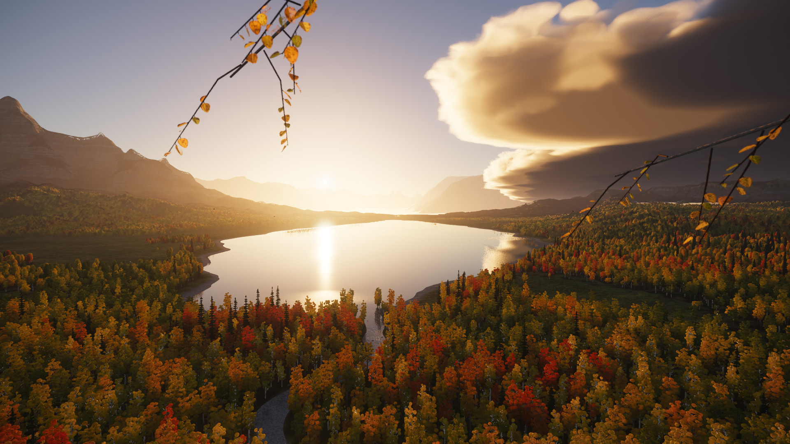

# Bird Flight: a barn swallow's first-person flight, computed entirely by code

English | [中文](README.zh-CN.md)



The camera is a barn swallow's eyes, in one continuous shot. It starts above a sea of cloud, dives through a hole in the cloud, skims a lake and drinks on the wing, flies upstream through a wooded river corridor and a gorge, climbs the face of a 63 m waterfall, circles in the updraught above the cliff, and lands on a twig of an old birch at the cliff edge. It turns its head a few times and looks at the sunset.

The picture and the sound are all generated by the code in this directory. No AI image, video or music generation, no photos, videos, textures, HDRIs, models, sound packs, sampled instruments or fonts, and no Blender, game engine, off-the-shelf renderer or ray-tracing library were used. No agent skill was used. The only outside tools are the system's clang++ and Metal, Python with numpy, scipy and Pillow, and ffmpeg (for encoding and muxing, and for decoding during QC).

The code was written by Claude, an AI model (`claude-fable-5-2`), in Claude Code; the picture and the sound were computed by that code.

| Item | Value |
|---|---|
| Film | `bird_flight.mp4`, 1920×1080, 60 fps, 103.15 s (6189 frames), one continuous shot, H.264 High yuv420p (BT.709) + AAC-LC 48 kHz stereo; 324 MB, about 24.9 Mbps. It is above GitHub's per-file limit and is not in the repository; `./render.sh` regenerates it. The cover `preview.jpg` is frame 6000 |
| Contact sheet | [`contact_sheet.jpg`](contact_sheet.jpg) (about one frame per second, 104 cells) |
| Source | `src/` (about 3100 lines: C++/Objective-C++ host, Metal shaders, Python audio and QC) |
| One-command rebuild | `./render.sh` (fixed random seeds, 52 segments, resumable; about 4.5 hours on an M4 Max) |
| QC reports | [`qc_report.txt`](qc_report.txt) (per-frame QC, sampled re-render comparison, container parameters, audio check), [`audio_check.png`](audio_check.png) |
| Vegetation before and after | [`compare_river.jpg`](compare_river.jpg) (river corridor), [`compare_perch.jpg`](compare_perch.jpg) (on the perch); old on the left, new on the right |

**One thing first: nobody has watched this film from start to finish, and nobody has listened to it.** I can only look at extracted stills, strips of consecutive frames, and numbers. The "QC" and "verification" below are those substitutes. They are not the same as someone sitting down and playing it.

## The bird: a barn swallow

I chose the barn swallow (*Hirundo rustica*) because its habits fit this route:

- It cruises at 13–18 m/s in a flap-and-glide pattern, with a wingbeat of about 7.5 Hz (9.2 Hz in the climb up the waterfall, 11.5 Hz in the braking flaps before landing).
- It likes to fly low over water and drinks on the wing. The film has one such dip at 28.1 s.
- It turns by banking and is very agile, which suits a river corridor and a gorge.
- It migrates south in flocks in autumn and crosses mountains, and it likes to perch on bare twigs. So the season is early autumn, and the companions are a few other swallows.

Two things are exaggerated for the film. The dive reaches about 53 m/s, two or three times what a real swallow does, and a swallow would not normally climb 60 m straight up the face of a waterfall.

## Shots and route (one continuous shot, no cuts)

World coordinates: x points east, z points south, and the lake surface is at 0 m. The sun is in the west. Its elevation falls slowly from 8.6° at the start to 4.3° at landing, which compresses about 20 minutes of sunset into 100 seconds. Its azimuth lines up with the gorge, so the evening light shines along the gorge onto the waterfall.

| Time | Section | What happens | Speed |
|---|---|---|---|
| 0–9.3 s | Above the cloud | Heading west into the sun, low over the top of a stratocumulus layer, with the open valley and the lake to the left. Five companions ahead. A glance right at them at 3.2 s, and down-left at the valley at 6.4 s | 19 m/s, flap and glide |
| 9.3–15.6 s | Left turn through the cloud | Bank left, then turn; the nose drops and the bird goes down an irregular hole in the cloud. Cloud walls pass on both sides and the teal lake shows at the bottom. The companions dive first | 20→53 m/s, wings tucked, bank up to about 70° |
| 15.6–23.5 s | Dive and pull-out | Towards the autumn forest and the shingle beach on the north shore. The gaze lifts to the east end of the lake (where the bird is going), with the horizon near the top of the frame. In the last 2 seconds it levels out over the shore, with g-load | Up to about 53 m/s, about 3.2 g in the pull-out |
| 23.5–36.5 s | Skimming the lake | East, 0.4–1.3 m above the water, with snow peaks and autumn forest reflected in it. Rings from jumping fish. A dip to drink at 28.1 s. A glance at 29.5 s at a ring that has just started ahead to the right | 30→16 m/s |
| 36.5–55 s | River mouth and wooded corridor | Upstream, banking through the S-bends. Under a fallen log across the river at 49.7 s, over a boulder in mid-stream at 52.5 s | 15.5–18.5 m/s |
| 55–65.8 s | Gorge | The walls close in: layered rock, vertical water stains, joints. The water gets louder. A look up at the top of the waterfall at 62.4 s | 16 m/s |
| 65.8–71.3 s | Up the waterfall (the climax) | A fast flapping climb close to the 63 m sheet of water, with a rainbow in the spray, then out over the cliff top and back into the evening sun | About 13 m/s vertical |
| 71.3–79.7 s | Circling in the updraught | Most of a left-hand circle above the top of the waterfall (east → north → west), hardly flapping, gaining another 24 m. A look at the upper valley and the snow peaks, then back to the sun | About 11 m/s |
| 79.7–89.15 s | Approach and landing | A descending glide west along the north rim of the gorge, eyes on a bare twig of the old birch at the cliff edge. It slows, brakes with flaps for the last 1.2 seconds, and lands. The twig dips about 3.4 cm and springs back | 11→0 m/s |
| 89.15–103.15 s | On the twig | First a look down at the forest and river below the cliff. Then six small, fast head turns with pauses (twigs and leaves to the right, up at the cloud, left, down at the gorge and river, roughly towards the distance, a final adjustment). At 94.45 s the gaze settles to the west: forest, the river winding into the lake, the column of light on the water, ranges layered in haze, the setting sun, and a cloud at upper right. It holds still for about 7 seconds and fades out | Still |

What makes this a bird and not a drone (all in `src/flight.h`):

- The path is a spline through key points, smoothed with a Gaussian in time. **The bank angle is computed from the lateral acceleration** (coordinated turn: tan φ = a_lateral / (g + a_vertical)) with a 0.1 s lead, so the bird always banks first and turns after.
- **The head is steady.** The camera does not point along the velocity. It points along a low-passed gaze towards the position the bird will reach 0.45 s later. Only part of the body's bank reaches the head: small banks are almost fully compensated, large ones pass through at 60%.
- **Looking happens in jumps.** There are five brief saccades in flight (about 0.1 s to get there, then a hold), and three sustained fixations (on the destination during the dive, on the water during the climb, on the landing spot during the approach). On the perch, each head turn takes 0.11 s and overshoots slightly.
- The wingbeat has a rhythm: 0.5–1 s of flapping, 0.3–0.6 s of gliding. While flapping there is a slight synchronised nod and heave; while gliding there is none. In the cloud and in the updraught above the cliff there is stronger gust disturbance.
- The eye adapts to light. A low-resolution pass meters the whole film and produces a per-frame exposure table (fast adaptation to brighter, slow to darker), so the gorge slowly becomes visible, and the frame overexposes slightly on leaving the cliff top before settling.

## The engine (all newly written)

| File | Role |
|---|---|
| `src/erosion.cpp` | Terrain. Landscape evolution on a 2048² grid: a designed valley skeleton, tectonic uplift, river incision (stream-power law, implicit solve, priority-flood routing) and a slope limit for collapse. The strata are tilted and vary in hardness, so a mountain has a cliff on one side and a gentle slope on the other, not the same slope everywhere |
| `src/layout.h` | Layout functions shared by host and shader: river centreline, river-bed profile, the cut of the gorge, water level |
| `src/world.h` | Upsamples the height map to 8192² (2.9 m) and adds slope-dependent detail; horizon AO; a 4096² "one tree per cell" map (height, species, jitter, base elevation); tileable 3D cloud noise |
| `src/flight.h` | Path, flight dynamics, head and gaze, wingbeat rhythm, ripples and companions |
| `src/main.mm` | Metal compute pipeline, per-frame rendering, per-pixel sample-count check, segmented output |
| `src/atmos.metal` | Physical atmosphere: Rayleigh, Mie, ozone and valley haze; a sky LUT, a sun transmittance table and an ambient cube are computed for each frame |
| `src/scene.metal` | The distance-field scene: terrain, five kinds of tree (spruce, larch, pine, broadleaf, birch, plus standing dead trees), shrubs, scattered stones, river boulders, the fallen log, gorge walls (3D strata displacement), volumetric cloud, water normals. The tree structure is described under "Vegetation" below |
| `src/hero.metal` | The old birch at the cliff edge (trunk, the perch twig, buds, fine twigs, individual leaves; the crown is 22 leaf clusters, which change gradually into individual leaves once the camera is within 48 m), the companion swallows, the waterfall sheet and spray (volume integration), the rainbow, the light shafts in the gorge |
| `src/render.metal` | Shading, the main render kernel, the shadow height map, bloom and tone mapping, probes |
| `src/audio.py` | Soundtrack synthesis and mastering |
| `src/exposure.py` `sheet.py` `qc.py` `verify.py` `audio_check.py` | Exposure table, contact sheet, QC, independent re-render comparison, audio check |

Some key choices:

- **Deterministic ray marching, not path tracing.** Each pixel takes 12 samples (16 on the perch), and the sub-pixel positions are fixed for every pixel and every frame. Direct light is an analytic sun with a marched shadow; ambient light is an ambient cube integrated from the sky, multiplied by horizon AO. There is no Monte Carlo noise in the picture, so nothing "boils". The only things that vary per pixel are the time offset for motion blur and the step offset in the cloud, and on the perch those are fixed too, so the still picture does not shimmer.
- **Motion blur**: a 180° shutter (1/120 s) with 12 time samples jittered in strata across it. Things close by (water, trees) blur; the distance stays sharp. Saccades are the exception: if the gaze turns more than 0.8° within one exposure, the shutter is shortened in proportion (140 frames in the film), otherwise the frames of a head turn would be a smear.
- **All geometric noise is computed analytically** (integer hashes). The height map is read texel by texel with exact bilinear interpolation and does not go through the GPU's 8-bit-weight texture filtering.
- **Vegetation** (redone on 2026-11-21): a broadleaf tree or a birch is a trunk, branches reaching out to the branch ends, and foliage clumps at the branch ends. The clumps exist only inside a crown envelope and blend smoothly into each other. The clump surface is carved into small flattened sprays with random orientations, and within 16–34 m these are replaced by the geometry of individual leaves. A conifer is tiers of drooping whorled branches and a leader. Detail drops with distance: no sprays beyond 260 m, only the envelope plus noise beyond 800 m, a gradual change to a canopy height layer between 650 and 1700 m, and only the canopy layer beyond that. Ground detail fades with the pixel footprint, so the distance does not flicker.
- **Light on leaves**: the leaf normal is mixed with the direction outwards from the clump centre, and the shaded side receives transmitted light. Four points inside the crown envelope along the sun direction estimate how much foliage the light has to cross, so thin parts glow and thick parts are dark. Under the low sun, the light and shade across a whole forest come from a 9-step shadow march over the canopy height layer.
- **Stands**: the autumn colour of broadleaf trees varies continuously by stand (green → yellow-green → gold → amber → red) and is not picked at random for each tree. The random offset of a tree inside its cell was increased, which weakens the look of rows and columns.
- **Water**: Fresnel reflection (the reflected ray marches the scene again), absorption by depth down to the bed, anisotropic band-limited wave normals, and ripple rings. Lake and river blend smoothly by position at the river mouth.
- **Cloud**: two volumetric layers (stratocumulus on the north side of the valley and to the east, and a sea of fog over the lowland to the west), with self-shadowing from 5 samples towards the sun and a multiple-scattering approximation. Where the bird goes through, an irregular tunnel is left in the cloud along the path.
- **Guarding against bad frames that raise no error**: the alpha channel of the accumulation texture holds the sum of sample weights. Every frame is checked to confirm that every pixel received all its samples, and is re-rendered if not.

## Sound (`src/audio.py`, all synthesised)

The sound is driven by flight data at 120 Hz (speed, wingbeat phase, wing tuck and braking, g-load, position):

- **Wind noise**: 7 fixed band-pass filters whose gains follow airspeed (about v^2.2, with more high frequencies at higher speed). In the cloud the highs are muffled. In the dive a narrow-band whistle rises with speed. In the pull-out the low end presses down.
- **Wingbeats**: the envelope of the noise pulses is taken directly from the wingbeat phase (strong downstroke, weak upstroke), so it is aligned with the picture sample by sample. It is harder in the climb and in braking.
- **Ambience**: above the cloud, a very low wind bed and the twittering of the companions. On the lake, light lapping, a hiss when close to the water, the "plop" of jumping fish and the bird's own dip. In the river corridor, running water built from tens of thousands of small random bubbles, and forest birds. Reverb in the gorge. The roar of the waterfall grows with distance travelled towards it, and once over the cliff top it is blocked and only the low end remains. On the perch, rustling leaves, autumn insects and sparse distant birdsong. The birdsong is four kinds of syllable I designed (glides, trills, a few harmonics) and does not imitate any particular recording.
- **Landing**: the "tick" of feet gripping the twig, the creak as the twig dips, and a burst of leaf noise.
- **Harmonic bed**: a very quiet pad of sine tones, only above the cloud at the start and after leaving the cliff top.
- **Mastering**: my own BS.1770 loudness meter normalises to −16 LUFS, and a look-ahead limiter holds the true peak at −1.6 dBTP.

## Process and iterations

1. I first wrote a storyboard with timecodes and made three full previews at 640×360. For each one I looked at a 104-frame contact sheet, then rendered full-resolution stills and strips of consecutive frames at chosen times.
2. **Round one** (preview 1) found: 3 seconds of plain white with no sense of volume in the cloud; the gaze pointing straight down in the dive, so that 5 seconds showed only teal water; a horizon that stayed slightly tilted over the lake; a gorge that was almost black; 2 seconds of nothing but sky in the climb up the waterfall; and a sun glow at the end that washed out the far ranges. The fixes were the cloud tunnel, lifting the gaze to the destination in the dive, the head's compensation for small banks, the light-adaptation exposure, fixing the gaze on the water in the climb, and less bloom.
3. **Round two** (stills) found: peaks like regular pyramids (I added tilted strata hardness and different collapse angles); gorge walls like concrete slabs (changed to 3D strata displacement); a waterfall that looked like a white thread and then like a white rock (changed to a volumetric sheet thrown clear of the wall); trees like broccoli up close (crowns changed to leaf clumps); grass slopes like a golf course (added tussocks, shrubs, scattered stones); and "TV static" on the river (removed the randomly jittered reflection on the river surface).
4. **Round three** (full-resolution stills and 60 fps strips) found: a dead straight line of colour difference across the lake from the air (the lake and the river had two shading models joined at a hard edge; now blended by position); foreground trees at the perch like a row of pills blocking the view (moved the perch tree to the cliff edge, cleared the trees in front, made the crowns wider and rounder); fine twigs like wire (changed to two curved segments); and a hero tree like a lollipop from a distance (changed to twenty-odd small leaf clusters).
5. **Round four** (2026-11-21, vegetation): once the film existed, the trees were what looked most like CG. Each tree was an ellipsoid wrapped in clump noise; up close it looked like a clipped shrub, and the foreground canopy at the end looked like a row of pills. This round rewrote the tree structure and the leaf lighting as described under "Vegetation", then re-metered and re-rendered the whole film. Wrong turns on the way: the first branch-end clumps were hard-union spheres and a tree looked like a string of glowing balls (changed to smooth blending, flattened, with less transmission); the hero birch was still "a mass of bubbles" on approach (added individual leaf geometry); a random colour per tree looked like scattered confetti (changed to continuous variation by stand). While spot-checking key frames during the re-render I also found a very faint vertical line in the sky (a brightness step of about 1.5/255). The sky lookup table did not join up at due west, and the film looks west at the start and at the end, so during the 7-second hold the line sat in the middle of the frame. The earlier cut had it too. It is fixed.
6. The scale of the geography changed three times. A small bird at 15 m/s covers only 150 m in 10 seconds. The first 1 km river corridor and 600 m thick cloud were absurdly large; in the end the corridor is 260 m, the gorge 180 m, the waterfall 63 m and the cloud layer 230 m thick.

Tried and dropped: bringing the bird's own wings into the frame before landing. They looked like two dark boards and were not believable, so they are switched off (the code is still in `hero.metal`). The sense of braking now comes only from the deceleration, the shake of the head and the sound.

## Known shortcomings

- **It still reads as CG, but the vegetation is no longer the biggest giveaway.** After round four the trees have branches, layered clumps and translucency, and the river corridor and the foreground at the end are much more believable than before (see [`compare_river.jpg`](compare_river.jpg) and [`compare_perch.jpg`](compare_perch.jpg); old on the left, new on the right). What remains: a branch is a straight line from the trunk to a clump and does not fork; trunks are too straight and smooth; trees of one species still have similar shapes; there is no understorey and no fallen dead wood; and at the river mouth a few trunks stand in shallow water.
- The hero birch: on approach the crown now shows sheets of leaves, but it is still one large orange-yellow mass without enough layering, and the nearby twigs are still too straight with too few leaves. The bark has only a colour pattern and no real peeling.
- The new version renders about half as fast again as the old one (see the measurements): 4–5 seconds per frame in the river corridor.
- Cloud: the tops and edges of the stratocumulus are eroded, but up close they are too soft and "creamy". The walls of the cloud hole are very soft and lack fine wisps. The cloud at upper right in the ending looks a little like a lenticular cloud and is not quite natural.
- The waterfall is a volume-integrated white sheet, which works from a distance. For the close climb it was changed to thinner, stranded flows, but it is still too blurry, the lower half is grey in the shade, and there are no flying droplets or real spray.
- The gorge walls have strata and joints, but very close up the large faces are still too smooth.
- The streaks in the river's reflections look "painterly" and lack the white broken water of a real riffle.
- Not done: reed beds, insects over the water, deer or other animals. The companion swallows appear only at the start and far off at the end. The bird's own wings and bill are not in frame.
- The dive speed is exaggerated, and the sun drops 4.3° in 100 seconds, which is time compression.
- The composition changes little during the dive at 16–21 s, and the 18 seconds of river corridor are slightly long.
- At about 69–70 s, around leaving the cliff top, one or two small bright spots appear near the bottom of the frame. I checked: they are the sun's reflection on the distant lake, seen along the slot of the gorge (sometimes through the sheet of water), and bloom makes them look like small balls of light. This is physically right but could well be taken for a defect.
- The first look after landing was designed as "look at the twig underfoot". That twig is not actually in the frame; in the film the bird first looks down at the forest and river below the cliff.

## QC, and what was not verified

The measured numbers for rendering and QC are under "Measurements" at the end and in [`qc_report.txt`](qc_report.txt), which also carries the results of the sampled re-render comparison and the audio check.

Not verified:

- **Nobody has watched the whole film, and nobody has listened to the soundtrack.** For how the motion feels (whether it is nauseating, whether the pacing works, whether the saccades are too abrupt) and how it sounds (whether the wind is harsh, whether the birdsong is convincing, whether the mix is balanced), there are only numbers and stills to go on.
- `render.sh` has not been run from start to finish in an empty directory; each step was run on its own. The film is the output of those steps. Round four re-ran only the metering, the render, the assembly and the QC; the soundtrack is the `work/audio.wav` synthesised the first time (the flight path did not change).
- It has only been run on this one machine (an M4 Max). Floating-point details may differ on other GPUs.
- The flight attitude and rhythm were not checked against real footage of barn swallows. The parameters come from what I know of the species.
- The independent re-render comparison samples 1 frame in 60 at low resolution and does not cover every frame. Bloom and water highlights depend on resolution, so the threshold has to be loose and frames over it have to be checked by eye.
- The wingbeat sound over the lake is covered by the wind and the fish (envelope cross-correlation only 0.16), so the flapping is probably inaudible in that section.

## Reproducing

```bash
./render.sh
```

The whole run takes about 4.5 hours on an M4 Max. In order: compile → terrain erosion → metering pass and exposure table → render the film in 52 segments (resumable; existing segments are skipped, and a bad segment is redone by deleting its `work/seg/seg_XXXXX.mp4` and running again) → synthesise the soundtrack → concatenate and encode → contact sheet and QC. All random numbers come from integer hashes with fixed seeds. Afterwards `work/` holds the terrain, the world cache, the exposure table, 52 near-lossless segments, one key-frame PNG per second, and logs (`work/` is not in the repository).

## Measurements

### Round four: the full re-render after the vegetation rewrite (2026-11-21, M4 Max). This is the current film

- After re-metering the whole film (3 minutes), 52 segments were re-rendered in 256.4 minutes of pure rendering (11:28–15:47), with no retried or failed frames. Time per frame: above the cloud 0.2–0.4 s, over the lake 1.7 s, river corridor 4.2–5.2 s, gorge and waterfall 1.2–1.9 s, circling 2.7–3.2 s, approach 2.6–4.2 s, perch (16 samples) 3.2–4.0 s.
- At segment 21 the render stopped for about 2 minutes between two segments to fix the sky seam. The fix affects only sky pixels within half a lookup-table texel on either side of the seam. The first 8 segments (0–16 s), which had already been rendered and can see the seam, were re-rendered after the main render in 7.4 minutes. The 13 segments covering 16–42 s were rendered before the fix. They do not look west, no seam was detected in their key frames, and they were not re-rendered.
- The film is 324 MB (video about 24.9 Mbps, x264 crf 18, preset slow).
- Picture QC (`qc_report.txt`): all 6189 frames decoded, and a full decode produced no error output. Black frames 0, frozen frames 0, lost-tile signatures 0. There are 6 frames with a luminance jump above 6/255, 2 frames with single-frame outlier blocks, and the 12 frames with the highest flicker index. That is 15 distinct frames, and all of them lie within 4 frames of a scripted saccade.
- Whether the new trees brought flicker: the temporal flicker index has a median of 0.478/255 (old version 0.479) and a 95th percentile of 2.45 (old 2.48). For 40–50 s, where the river corridor is, it is 1.80 (old 1.84). On the still perch the mean difference between consecutive frames is 0.68/255 (old 0.67). This index is computed over 30-pixel blocks and may not show fine shimmer at the scale of single leaves; only playing the film can show that.
- Sampled independent re-render: 103 frames, median 12.9/255. Two frames exceed 24 (frame 4590 at 42.8 and frame 5190 at 25.5). They are the same two frames that exceeded it in the old version, with similar values. The old ones were compared side by side at the time and the difference came from bloom and water highlights changing with resolution. They were not compared side by side again in this round.
- Sky seam: the brightness step at column 927 in the final hold was 1.52/255 in the old version and is 0 in the new one (in line with the gradient on both sides).
- The soundtrack did not change. Re-checked after AAC encoding in the new film: −16.3 LUFS, true peak −1.3 dBFS, loudness range 13.3 LU.
- The old cut was not published. Its numbers are kept below for comparison.

### Rounds one to three (2026-11-17, M4 Max). The old cut, not published

The numbers below are for the old cut. The audio check still applies to the current film.

**Rendering**

- Main render: 6189 frames in 52 segments, 174.2 minutes of pure rendering (03:13–06:08), with no retried or failed frames. Time per frame: above the cloud 0.2–0.6 s, over the lake 0.9 s, river corridor 2.0–3.1 s, gorge about 1.2 s, perch (16 samples) 2.7–3.9 s.
- After spot checks, 18 segments were redone (shorter shutter during head turns, the waterfall close-up, the focus after landing), which took another 68.7 minutes. The run was paused once; resuming rendered only the missing segments and left the finished ones alone.
- Also: three previews at 3–6 minutes each, terrain erosion about 1 minute, one metering pass about 3 minutes, soundtrack synthesis 9 seconds, final encode about 1 minute.
- The film was 294 MB (video about 22.5 Mbps, x264 crf 18, preset slow).

**Picture QC**

- All 6189 frames decoded; `ffmpeg -f null` decoded the whole file with no error output.
- Black frames 0 (outside the fades at the start and end); frozen frames 0; lost-tile signatures 0.
- There were 8 frames with a jump in mean luminance above 6/255 between neighbours, 2 frames with single-frame outlier blocks, and the 12 frames with the highest flicker index: 17 distinct frames, **all within 4 frames of a scripted saccade** (the view changes within 0.1 s). None was unexplained.
- Temporal flicker index (second difference of 30-pixel block luminance): median 0.48/255, 95th percentile 2.5. On the still perch the mean difference between consecutive frames was about 0.7/255.
- Every frame was checked at render time for "every pixel received all its samples"; the check never fired.
- Sampled independent re-render: 103 frames (1 in 60, at 480×270), compared in 30-pixel blocks, median 12.8/255; 3 frames above 24 (maximum 43.1). I compared those three side by side. The differences came from bloom and river highlights changing with resolution, not from bad tiles.

**Audio check** (results at the end of `qc_report.txt`; the spectrogram is [`audio_check.png`](audio_check.png))

- My own loudness meter: −16.2 LUFS, true peak −1.6 dBTP, no full-scale samples. The AAC-encoded film re-checked with ffmpeg's ebur128: −16.3 LUFS, true peak −1.3 dBFS, loudness range 13.3 LU.
- Mean momentary loudness by section: above the cloud −18, through the cloud −14, dive −12, lake −17, river −17, gorge −17, waterfall −13, circling −23, approach −23, perch −22 to −24 LUFS. The ending is quiet but not silent.
- Alignment with the picture: the high-frequency transient of the landing is 4 ms ahead of the picture event; the dip to drink is 18 ms ahead; the cross-correlation between the wingbeat envelope and the wingbeat phase peaks at 0–0.5 ms (correlation 0.98 in the braking before landing, 0.86 in the waterfall climb, 0.52 in the river corridor, 0.16 over the lake).
- These only show that the sounds occur at the right time and the right loudness. They do not show whether it sounds good.
