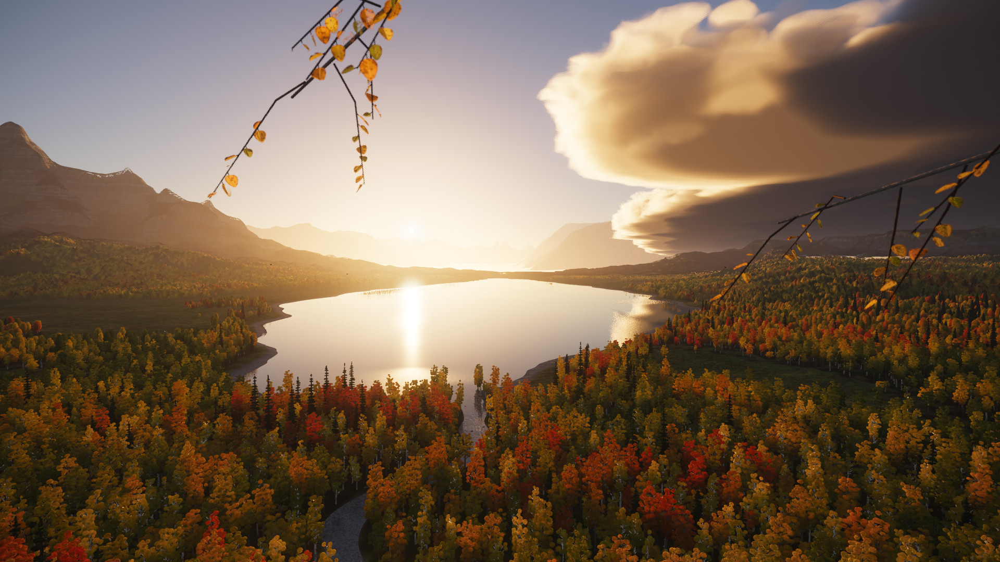

# 燕归枝：一只家燕的第一视角飞行短片，完全由代码计算

[English](README.md) | 中文

[](https://github.com/BubbleBrainBB/awesome-fable-5.2/releases/download/bird-flight-v1.0/bird_flight.mp4)

镜头就是一只家燕的眼睛，一个连续长镜头：从云海之上钻云洞俯冲，贴着湖面疾飞并点水，逆流钻进林间河道和峡谷，贴着 63 米高的瀑布水帘拉起，在崖顶借上升气流盘旋，最后落在崖边老桦树的枝头，转几次头，望向日落。

画面和声音全部由本目录里的代码生成：没有用 AI 生图/生视频/生音乐，没有照片、视频、贴图、HDRI、模型、音效包、采样音色或字体，没有用 Blender、游戏引擎、现成渲染器或光追库，也没有调用任何 skill。用到的外部工具只有系统自带的 clang++ 和 Metal、Python 的 numpy / scipy / Pillow，以及 ffmpeg（只做编码、封装，和质检时的解码）。

代码由 AI 模型 Claude（`claude-fable-5-2`）在 Claude Code 里编写，画面和声音由这些代码计算得出。

| 项目 | 值 |
|---|---|
| 成片 | [`bird_flight.mp4`](https://github.com/BubbleBrainBB/awesome-fable-5.2/releases/download/bird-flight-v1.0/bird_flight.mp4)（超过 GitHub 单文件上限，放在 Release 附件里；封面 `preview.jpg` 是第 6000 帧），1920×1080，60 fps，103.15 s（6189 帧），一个长镜头，H.264 High yuv420p（BT.709）+ AAC-LC 48 kHz 立体声；324 MB，约 24.9 Mbps |
| 总览图 | [`contact_sheet.jpg`](contact_sheet.jpg)（约每秒一帧，104 格） |
| 源码 | `src/`（约 3100 行：C++/Objective-C++ 主程序、Metal 着色器、Python 音频与质检） |
| 一键重建 | `./render.sh`（固定随机种子，分 52 段，可断点续渲；M4 Max 上约 4.5 小时） |
| 质检报告 | [`qc_report.txt`](qc_report.txt)（逐帧质检、抽帧重渲比对、封装参数、音轨检查）、[`audio_check.png`](audio_check.png) |
| 植被重做前后对比 | [`compare_river.jpg`](compare_river.jpg)（林间河道）、[`compare_perch.jpg`](compare_perch.jpg)（枝头），左旧右新 |

**先说在前面：这部片子没有人完整看过，也没有人听过。** 我只能看抽出来的静帧、连续帧条和各种数字指标。下文的"质检""验证"都是这种替代手段，不等于有人坐下来播放过。

## 主角：家燕

选家燕（*Hirundo rustica*）是因为它的习性正好对应这条路线：

- 巡航 13–18 m/s，典型的"拍几下、滑一段"；翅频约 7.5 Hz（片中沿瀑布爬升时 9.2 Hz，落枝前扑翼刹车 11.5 Hz）。
- 喜欢贴着水面飞，并且在飞行中点水喝水——片中 28.1 秒有一次。
- 转弯靠压坡度，机动性强，适合钻林间河道和峡谷。
- 秋季集群南迁，会翻越山地；喜欢落在裸露的枝梢上。季节因此定在初秋，同伴是另外几只家燕。

有两处是为了片子而夸张的，如实说明：俯冲段最高约 53 m/s，是真实家燕的两三倍；家燕一般不会沿瀑布水帘垂直拉起 60 米。

## 分镜与飞行路线（一个连续长镜头，没有切）

世界坐标：x 向东，z 向南，湖面为 0 米。太阳在西面，仰角从开场的 8.6° 缓慢降到落枝时的 4.3°（把约 20 分钟的日落压缩进 100 秒），方位对准峡谷轴线，所以夕阳能顺着峡谷照到瀑布上。

| 时间 | 段落 | 内容 | 速度 |
|---|---|---|---|
| 0–9.3 s | 云海之上 | 向西迎着夕阳，贴着层积云顶飞；左侧是敞开的谷地和湖。前方 5 只同伴。3.2 s 向右看一眼同伴，6.4 s 向左下瞥谷地 | 19 m/s，拍—滑交替 |
| 9.3–15.6 s | 左转穿云 | 先压左坡度再转向，机头下沉，从云层里一个不规则的"云洞"钻下去，云壁从两侧掠过，洞底露出青色的湖；同伴先一步扎下去 | 20→53 m/s，收翅，坡度最大约 70° |
| 15.6–23.5 s | 俯冲与拉起 | 冲向北岸的秋林和卵石滩；视线抬向湖东端（要去的方向），地平线留在画面上缘；最后 2 秒掠过岸边拉平，有过载 | 最高约 53 m/s，拉起过载约 3.2 g |
| 23.5–36.5 s | 贴湖疾飞 | 离水面 0.4–1.3 m 向东，雪峰和秋林倒映在水里；鱼跃的涟漪；28.1 s 点水；29.5 s 瞥一眼右前方刚起的涟漪 | 30→16 m/s |
| 36.5–55 s | 河口与林间河道 | 逆流而上，沿河道 S 弯连续压坡度；49.7 s 从横在河上的倒木下钻过，52.5 s 跃过河心巨石 | 15.5–18.5 m/s |
| 55–65.8 s | 峡谷 | 岩壁合拢，层状岩壁、竖向水渍与节理；水声渐大，62.4 s 抬头看瀑布顶 | 16 m/s |
| 65.8–71.3 s | 沿瀑布拉起（高潮） | 贴着 63 m 高的水帘急拍爬升，水雾里有虹；冲出崖顶，回到夕阳里 | 垂直约 13 m/s |
| 71.3–79.7 s | 借上升气流盘旋 | 在瀑布顶上方左盘大半圈（东→北→西），几乎不拍翅，高度再升 24 m；看上游谷地、雪峰，转回夕阳 | 约 11 m/s |
| 79.7–89.15 s | 进近与落枝 | 沿峡谷北缘向西滑降，盯住崖边老桦树的一根光枝；减速，最后 1.2 秒扑翼刹车，落下；树枝一沉（约 3.4 cm）再回弹 | 11→0 m/s |
| 89.15–103.15 s | 枝头 | 落下后先低头看一眼崖下的林与河，然后六次小幅快速转头加停顿（右侧枝叶、抬头看云、左侧、俯看峡谷与河、大致望向远方、最后微调），94.45 s 定住望向西面：林海、蜿蜒入湖的河、湖面的光柱、雾里分层的远山、落日和右上的云。静止约 7 秒后淡出 | 静止 |

"这是鸟不是无人机"靠这些做法（都在 `src/flight.h`）：

- 航线是过关键点的样条再做时间域高斯平滑；**坡度由横向加速度算出来**（协调转弯：tan φ = a横 / (g + a垂)），带 0.1 秒提前量，所以总是先倾斜、后转向。
- **头是稳的**：相机朝向不是速度方向，而是对"0.45 秒后要到的位置"做低通后的注视方向；身体坡度只有一部分传到头上（小坡度几乎全被补偿，大坡度传 60%）。
- **看东西是一跳一跳的**：飞行中 5 次短暂的跳视（约 0.1 秒到位，然后停住），另有 3 段持续的注视（俯冲时看目的地、拉起时看水帘、进近时盯落点）；停栖后的转头每次 0.11 秒到位、带一点回摆。
- 拍翅有节律：拍 0.5–1 秒、滑 0.3–0.6 秒；拍翅时有同步的轻微点头和起伏，滑翔时没有。云中和崖顶上升气流里有更强的阵风扰动。
- 眼睛的明暗适应：先低分辨率渲染一遍测光，生成逐帧曝光表（变亮适应快、变暗适应慢），进峡谷时慢慢"看清"，冲出崖顶时略微过曝再收回。

## 引擎结构（全部新写）

| 文件 | 作用 |
|---|---|
| `src/erosion.cpp` | 地形。2048² 网格上的地貌演化：设计好的谷地骨架 + 构造抬升 + 河流下切（stream-power，隐式求解，priority-flood 汇流）+ 崩塌坡度限制；岩层带倾角、硬度分层，所以山体一侧是崖、一侧是缓坡，而不是处处一样的坡度 |
| `src/layout.h` | 主机和着色器共用的布局函数：河道中心线、河床纵剖面、峡谷刻蚀、水位 |
| `src/world.h` | 高度图升到 8192²（2.9 m）并加坡度相关的细节；地平线 AO；4096² 的"每格一棵树"（树高、树种、抖动、根部高程）；可平铺的三维云噪声 |
| `src/flight.h` | 航线、飞行动力学、头部/注视、拍翅节律、涟漪与同伴 |
| `src/main.mm` | Metal 计算管线、逐帧渲染、每像素采样数校验、分段输出 |
| `src/atmos.metal` | 物理大气：瑞利 + 米氏 + 臭氧 + 谷地霾；每帧算一张天空 LUT、太阳透射率表和环境光立方 |
| `src/scene.metal` | 距离场场景：地形、五种树（云杉、落叶松、松、阔叶、桦，另有枯立木）、灌丛、散石、河中巨石、倒木、峡谷岩壁（三维岩层位移）、体积云、水面法线。树的结构见下文"植被" |
| `src/hero.metal` | 崖边老桦树（树干、栖枝、芽、细枝、逐片的叶；树冠是 22 个叶簇，镜头靠近到 48 米以内时逐渐换成单片叶子）、同伴燕子、瀑布水帘和水雾（体积积分）、虹、峡谷里的光柱 |
| `src/render.metal` | 着色、主渲染内核、阴影高度图、泛光与色调映射、探针 |
| `src/audio.py` | 音轨合成与母带 |
| `src/exposure.py` `sheet.py` `qc.py` `verify.py` `audio_check.py` | 曝光表、总览图、质检、独立重渲比对、音轨检查 |

几个关键选择：

- **确定性的光线步进，而不是路径追踪。** 每个像素 12 个采样（枝头段 16 个），子像素位置对所有像素、所有帧固定；直接光是解析的太阳加阴影步进，环境光是天空积分出来的环境光立方乘地平线 AO。画面里没有蒙特卡洛噪点，所以没有"噪点沸腾"。逐像素变化的只有运动模糊的时间偏移和云的步进偏移；停栖后连这个也固定下来，静止画面不会抖。
- **运动模糊**：180° 快门（1/120 秒），12 个时间采样在快门内分层抖动。近处贴水、贴树时糊，远景清楚。跳视时例外：一次曝光内视线转动超过 0.8° 就按比例缩短快门（全片 140 帧如此），否则转头的那几帧会糊成一片。
- **几何噪声全部解析计算**（整数哈希），高度图用逐纹素读取做精确双线性，不经过 GPU 的 8 位权重纹理过滤。
- **植被**（2026-11-21 重做）：阔叶树和桦树是"树干 + 伸向枝端的枝条 + 枝端叶团"，叶团只长在树冠包络之内，互相平滑融合；叶团表面再刻出随机朝向的扁平小枝叶，16–34 米以内换成单片叶子的几何。针叶树是一层层下垂的轮生枝加顶梢。按距离逐级简化：260 米外没有小枝叶，800 米外只剩包络加噪声，650–1700 米渐变成一层"冠层高度场"，更远只剩冠层；地面细节按像素足迹逐级淡出，所以远处不闪。
- **叶子的光**：叶面法线混合了"从叶团中心向外"的方向，背光面有透射光；另外沿太阳方向在树冠包络里取 4 个点估计光要穿过多厚的叶层，薄处透亮、厚处暗。低太阳角下整片林子的明暗靠一张冠层高度场上的 9 步阴影步进。
- **林相**：阔叶树的秋色按"林分"连续变化（绿→黄绿→金→琥珀→红），不是每棵树随机取色；树在格内的随机偏移加大，行列感减弱。
- **水**：菲涅耳反射（反射光线重新步进场景）、按水深吸收见底、各向异性带限的波面法线、涟漪环；湖与河在河口按位置平滑过渡。
- **云**：两层体积云（谷地北侧和东面的层积云、西面低地的雾海），向太阳方向 5 次取样的自阴影加多次散射近似。穿云处沿航线在云里留出一条不规则通道。
- **防"无报错坏帧"**：累加纹理的 alpha 里存采样权重和，每一帧都检查每个像素是否拿齐了全部采样，不齐就重渲。

## 声音（`src/audio.py`，全部合成）

以 120 Hz 的飞行数据（速度、拍翅相位、收翅/刹车量、过载、位置）驱动：

- **风噪**：7 个固定带通，各带增益随空速变化（约 v^2.2，速度越高高频越多）；云里高频被闷住；俯冲时加一道随速度升高的窄带啸声；拉起时低频"压"一下。
- **振翅**：噪声脉冲的包络直接取自拍翅相位（下扑强、上扬弱），所以和画面逐样本对齐；爬升与刹车时更用力。
- **环境声**：云上是很低的风底和同伴的啁啾；湖面有轻微拍岸、贴水嘶声、鱼跃的"咚"和自己点水的一声；河道是由几万个随机小气泡叠成的流水声和林鸟；峡谷加混响；瀑布轰鸣随距离增大，越过崖顶后被挡住只剩低频；枝头是叶子的沙沙声、秋虫、远处稀疏的鸟鸣。鸟鸣是四类自己设计的音节（滑音、颤音加少量谐波），没有模仿具体录音。
- **落枝**：脚抓枝的"嗒"、枝条一沉的吱呀、带起的一阵叶响。
- **铺底和声**：很轻的正弦和声垫，只在片头云上和冲出崖顶之后出现。
- **母带**：自己实现的 BS.1770 响度计归一到 −16 LUFS，前视限制器把真峰值压在 −1.6 dBTP。

## 过程与迭代

1. 先写了带时间码的分镜，用 640×360 做了三版全片预演，每版抽 104 帧总览，再挑时间点渲全分辨率静帧和连续帧条来看。
2. **第一轮**（预演 1）发现：云里 3 秒纯白没有体积感；俯冲时视线直直朝下，5 秒只看见一片青色湖水；贴湖时地平线一直微倾；峡谷几乎全黑；沿瀑布拉起时 2 秒只看到天；结尾太阳光晕冲掉了远山。对应改了：云洞通道、俯冲时把视线抬向目的地、头部对小坡度的补偿、明暗适应曝光、拉起时盯住水帘、降低泛光。
3. **第二轮**（静帧）发现：山峰像规则金字塔（加了倾斜岩层硬度和崩塌角差异）；峡谷壁像水泥板（改成三维岩层位移）；瀑布像一缕白线后来又像一块白石头（改成离壁抛出的体积水幕）；近看树像西兰花（树冠改成叶团）；草坡像高尔夫球场（加草丘、灌丛、散石）；河水有"电视雪花"（去掉了对河面的随机抖动反射）。
4. **第三轮**（全分辨率静帧和 60 fps 连续帧）发现：从空中看湖面有一条笔直的色差线（湖和河两套水体着色硬接，改成按位置过渡）；枝头前景的树像一排药丸挡住视野（把栖树挪到崖边、清掉前方林木、树冠改宽改圆）；细枝像铁丝（改成两段带弧度）；主角树远看像棒棒糖（改成二十来个小叶簇）。
5. **第四轮**（2026-11-21，植被）：成片出来后，最像 CG 的是树——每棵树是一个裹着叶团噪声的椭球，近看像修剪过的灌木，结尾前景的林冠像一排药丸。这一轮按上文"植被"重写了树的结构和叶子的光照，全片重新测光、重渲。中间走过的弯路：第一版枝端叶团是硬并集的球，树像一串发光的球，改成平滑融合、压扁、降低透射；主角桦树靠近时仍是"一团泡泡"，加了单片叶子的几何；每棵树随机取色像撒了彩纸，改成按林分连续变化。重渲途中抽看关键帧时还发现天空里有一条很淡的竖线（亮度台阶约 1.5/255），原因是天空查找表在正西方向首尾没有接上，而片头和结尾恰好朝西看，结尾 7 秒定格时它就在画面正中，旧版成片里也有；已修。
6. 地理尺度改了三次。小鸟 15 m/s，10 秒只飞 150 米；最初 1 公里的河道、600 米厚的云都大得离谱，最后把河道压到 260 米、峡谷 180 米、瀑布 63 米、云层厚 230 米。

试过但放弃的：落枝前把自己的翅膀带进画面。做出来像两块深色木板，不可信，关掉了（代码还在 `hero.metal` 里）。刹车感现在只靠减速、头部的抖动和声音。

## 已知不足

- **仍然能看出是 CG，但植被不再是最大的破绽。** 第四轮之后树有了枝条、分层的叶团和透光，林间河道和结尾前景比旧版可信得多（新旧对比见 [`compare_river.jpg`](compare_river.jpg) 和 [`compare_perch.jpg`](compare_perch.jpg)，左旧右新）。剩下的问题：枝条是从树干直接伸到叶团的直线，没有逐级分叉；树干偏直偏光滑；同一树种的树形仍然相似；林下没有灌木层和倒伏的枯枝；河口有几棵树的树干立在浅水里。
- 主角桦树：进近时树冠现在能看到成片的叶子，但整体仍是一大团橙黄，层次不够；近处的细枝仍偏直、叶子偏稀。树皮只有颜色图案，没有真实的剥裂。
- 新版渲染慢了约一半（见实测记录），林间河道每帧 4–5 秒。
- 云：层积云的顶和边缘做了侵蚀，但近看偏软、偏"奶油"；穿云的云洞壁很柔，细碎的云丝不够。结尾右上那块云的形状有点像荚状云，不够自然。
- 瀑布水帘是体积积分的白色水幕，远看成立；贴近爬升时改成了更薄、成缕的水流，但仍然偏糊，下半段在阴影里发灰，缺少飞溅的水滴和真正的水花。
- 峡谷岩壁有岩层和节理，但贴得很近时大块面仍然偏光滑。
- 河面反射的流纹偏"油画感"，不像真实浅滩那样有白色的碎浪。
- 没有做的：芦苇荡、水面上的飞虫、鹿等其它动物；同伴燕子只在片头和片尾远处出现。自己的翅膀和喙没有入画。
- 俯冲速度是夸张的；太阳在 100 秒里下降了 4.3°，是时间压缩。
- 俯冲段 16–21 秒构图变化不大；林间河道段 18 秒略长。
- 约 69–70 秒冲出崖顶前后，画面下方会出现一两个小亮斑。查过，是顺着峡谷缝隙（有时隔着水帘）看到的远处湖面的日光反射，经泛光后像小光球；物理上没错，但很可能被看成瑕疵。
- 落枝后第一眼原本设计成"看脚下的枝"，实际那根枝不在画面里，成片里是先低头看一眼崖下的林与河。

## 质检与没有验证的部分

渲染、质检的实测数字见文末"实测记录"和 [`qc_report.txt`](qc_report.txt)（抽帧重渲比对和音轨检查的结果也附在里面）。

没有验证的：

- **没有人完整看过成片，也没有人听过音轨。** 运动观感（是否晕、节奏是否合适、跳视是否太突兀）和听感（风噪是否刺耳、鸟鸣像不像、混音是否平衡）都只有数字和静帧作依据。
- `render.sh` 没有在空目录里从头到尾跑过一遍；每一步都单独跑过。成片就是这些步骤的输出。第四轮只重跑了测光、渲染、拼接和质检，音轨沿用第一次合成的 `work/audio.wav`（航线没有变）。
- 只在这一台机器（M4 Max）上跑过。不同 GPU 上浮点细节可能不同。
- 没有对照真实的家燕影像核对飞行姿态和节律，参数来自我对这个物种的了解。
- 独立重渲比对是在低分辨率下每 60 帧抽 1 帧做的，覆盖不到每一帧；泛光和水面高光与分辨率有关，所以阈值只能放宽，靠人眼复核超标的帧。
- 音轨里的振翅声在贴湖段被风声和鱼跃声盖住了（包络互相关只有 0.16），这一段很可能听不出拍翅。

## 复现

```bash
./render.sh
```

在 M4 Max 上全程约 4.5 小时。会依次：编译 → 地形侵蚀 → 测光生成曝光表 → 分 52 段渲染正片（可断点续跑，已有分段跳过；坏段删掉对应的 `work/seg/seg_XXXXX.mp4` 重跑即可）→ 合成音轨 → 拼接编码 → 总览图与质检。所有随机数都来自固定种子的整数哈希。跑完后 `work/` 里会留下地形、世界缓存、曝光表、52 个近无损分段、每秒一张的关键帧 PNG 和日志（`work/` 不在仓库里）。

## 实测记录

### 第四轮：植被重做后的全片重渲（2026-11-21，M4 Max）——当前成片

- 全片重新测光（3 分钟）后重渲 52 段，纯渲染 256.4 分钟（11:28–15:47），没有重试或失败的帧。单帧耗时：云上 0.2–0.4 秒，贴湖 1.7 秒，林间河道 4.2–5.2 秒，峡谷和瀑布 1.2–1.9 秒，盘旋 2.7–3.2 秒，进近 2.6–4.2 秒，枝头（16 采样）3.2–4.0 秒。
- 渲到第 21 段时在两段之间停了约 2 分钟修天空接缝；修复只影响接缝两侧各半个查找表纹素的天空像素。此前渲完、能看到接缝的片头 8 段（0–16 秒）在主渲染结束后补渲，7.4 分钟。第 16–42 秒的 13 段是修复前渲的，这些段落不朝西看，关键帧里没有检出接缝，没有重渲。
- 成片 324 MB（视频约 24.9 Mbps，x264 crf 18 preset slow）。
- 画面质检（`qc_report.txt`）：6189 帧全部解码，完整解码无错误输出；黑帧 0，冻结帧 0，丢块特征 0。亮度跳变超过 6/255 的 6 帧、单帧异常块 2 帧、闪烁指标最高的 12 帧，去重后 15 帧，全部落在脚本里的跳视时刻前后 4 帧之内。
- 新树木有没有带来闪烁：时间闪烁指标中位数 0.478/255（旧版 0.479），95 分位 2.45（旧版 2.48）；林间河道所在的 40–50 秒段 1.80（旧版 1.84）；停栖静止段相邻帧平均差 0.68/255（旧版 0.67）。这个指标按 30 像素块统计，单片叶子尺度的细碎闪动它不一定能反映，只能靠播放来看。
- 抽帧独立重渲：103 帧，中位数 12.9/255；2 帧超过 24（第 4590 帧 42.8，第 5190 帧 25.5），和旧版超标的是同样两帧、数值相近。旧版当时并排看过，是泛光和水面高光随分辨率的变化；这一轮没有重新并排看。
- 天空接缝：结尾定格帧里第 927 列的亮度台阶，旧版 1.52/255，新版为 0（与两侧梯度一致）。
- 音轨没有改动。新成片 AAC 编码后复核：−16.3 LUFS，真峰值 −1.3 dBFS，响度范围 13.3 LU。
- 旧版成片没有发布；旧版的数字留在下面作对照。

### 前三轮（2026-11-17，M4 Max）——旧版成片（没有发布）

下面的数字都是旧版的；音轨检查部分对当前成片仍然有效。

**渲染**

- 主渲染：6189 帧分 52 段，纯渲染 174.2 分钟（03:13–06:08），没有重试或失败的帧。单帧耗时：云上 0.2–0.6 秒，贴湖 0.9 秒，林间河道 2.0–3.1 秒，峡谷约 1.2 秒，枝头（16 采样）2.7–3.9 秒。
- 抽查后返工了 18 个分段（转头时缩短快门、瀑布近景、落枝后的对焦），又用了 68.7 分钟。中途暂停过一次，续跑只补缺失的分段，已完成的没有动。
- 另外：三版预演各 3–6 分钟，地形侵蚀约 1 分钟，测光一遍约 3 分钟，音轨合成 9 秒，最终编码约 1 分钟。
- 成片 294 MB（视频约 22.5 Mbps，x264 crf 18 preset slow）。

**画面质检**（`qc_report.txt`）

- 6189 帧全部解码，`ffmpeg -f null` 完整解码无错误输出。
- 黑帧 0（片头片尾淡入淡出之外）；冻结帧 0；丢块特征 0。
- 相邻帧平均亮度跳变超过 6/255 的有 8 帧，单帧异常块 2 帧，加上闪烁指标最高的 12 帧，去重后共 17 帧，**全部落在脚本里的跳视时刻前后 4 帧之内**（视角在 0.1 秒内切换），没有一帧是无法解释的。
- 时间闪烁指标（30 像素块亮度的二阶差分）：中位数 0.48/255，95 分位 2.5。停栖静止段相邻帧平均差 0.7/255 左右。
- 每帧渲染时都校验了"每个像素拿齐全部采样"，全程没有触发。
- 抽帧独立重渲：103 帧（每 60 帧 1 帧，480×270），按 30 像素块比较，中位数 12.8/255；3 帧超过 24（最大 43.1）。这三帧我做了并排对照，差异来自泛光和河面高光随分辨率的变化，不是坏块。

**音轨检查**（结果在 `qc_report.txt` 末尾，频谱图是 [`audio_check.png`](audio_check.png)）

- 自写响度计：−16.2 LUFS，真峰值 −1.6 dBTP，没有满刻度采样。AAC 编码后的成片用 ffmpeg 的 ebur128 复核：−16.3 LUFS，真峰值 −1.3 dBFS，响度范围 13.3 LU。
- 分段瞬时响度均值：云上 −18，穿云 −14，俯冲 −12，贴湖 −17，河道 −17，峡谷 −17，瀑布 −13，盘旋 −23，进近 −23，枝头 −22 到 −24 LUFS。结尾是安静的，但不是无声。
- 与画面的对齐：落枝的高频瞬态比画面事件早 4 毫秒；点水早 18 毫秒；振翅包络与拍翅相位的互相关峰值在 0–0.5 毫秒（落枝前刹车相关系数 0.98，瀑布爬升 0.86，河道 0.52，贴湖 0.16）。
- 这些只说明"声音在对的时间、对的响度出现"，不说明好不好听。
