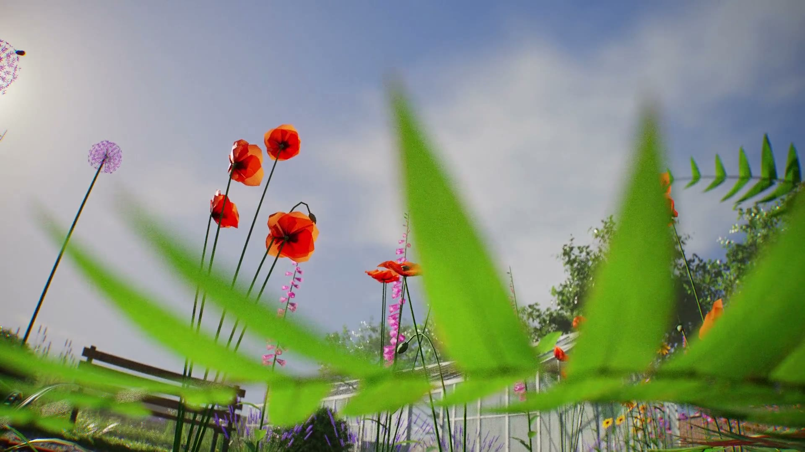

# Cat Garden: a botanical garden through a cat's eyes, computed entirely by code

English | [中文](README.zh-CN.md)

[](https://github.com/BubbleBrainBB/awesome-fable-5.2/releases/download/cat-garden-v1.0/cat_garden.mp4)

A cat squeezes under a fence into a botanical garden, then walks, stops, stares, sniffs and pounces its way through it, and finally jumps onto a stone wall to lie in the sun and close its eyes. The camera is the cat's eyes.

**No AI generation, photos, textures, models, HDRIs, sound assets or off-the-shelf renderer were used anywhere in the film.** The picture is rendered by a path tracer written in this directory, the sound is synthesised with numpy, and ffmpeg only encodes and muxes. No agent skill was used.

The code was written by Claude, an AI model (`claude-fable-5-2`), in Claude Code; the picture and the sound were computed by that code.

| Item | Value |
|---|---|
| Film | [`cat_garden.mp4`](https://github.com/BubbleBrainBB/awesome-fable-5.2/releases/download/cat-garden-v1.0/cat_garden.mp4) (above GitHub's per-file limit, so it is attached to a release; the cover `preview.jpg` is frame 780), 1920×1080, 30 fps, 110.0 s (3300 frames), H.264 High yuv420p (BT.709) + AAC-LC 48 kHz stereo; 304 MB, video bitrate about 21.9 Mbps |
| Contact sheet | [`contact_sheet.jpg`](contact_sheet.jpg) (one frame every 2 seconds, 55 cells) |
| Source | `src/` (about 5000 lines: C++/Objective-C++ host, Metal shader, Python post-processing, audio and QC) |
| One-command rebuild | `./render.sh` (fixed random seeds, resumable) |
| QC reports | [`qc_report.txt`](qc_report.txt), [`audio_report.txt`](audio_report.txt), [`audio_spectrogram.png`](audio_spectrogram.png) |

## 1. Route and storyboard (one continuous shot, no cuts)

The garden is one continuous 3D world of about 38 m × 30 m, and the cat covers about 45 m. It is a dewy morning with the sun about 28° above the horizon.

| Time | Place | What the cat does and sees |
|---|---|---|
| 0–4 s | Broken fence → under the box hedge | Crawls low (eye height 10 cm) under a snapped fence board; dead leaves and stems at the foot of the hedge, the bright lawn ahead |
| 4–7 s | Out of the hedge | Hanging twigs and tall grass brush the lens; the auto-exposure lags and briefly overexposes; then the garden opens up for the first time |
| 7–14 s | Dewy lawn | Spots a seven-spot ladybird on a tall blade of grass, moves in to 7–8 cm to stare and sniff; the ladybird climbs to the tip and takes off, and the head follows it up to the sky |
| 14–21 s | Lawn | A white butterfly passes (a glance); daisies and clover; stops to sniff a dandelion clock |
| 21–31 s | Flower border | Pushes under hosta and fern leaves; looks up at backlit poppies, foxgloves and alliums; a bumblebee flies from an allium to hover in front of the nose, and the head turns with it |
| 31–40 s | Brick edging → gravel path | Looks down at ants on the bricks; sits up (eye height about 24 cm), looks down the path to the right after a bird call, tilts its head up at the trees and the sun beyond the bench; a white butterfly drifts down the path and passes less than half a metre in front, and the head follows it from left to right |
| 40–46 s | Path → under the bench | Trots across the gravel and goes under the bench (the seat becomes a roof, light through the slats), looking towards the pond |
| 46–60 s | Pond edge | Reedmace and water lilies; a dragonfly hovers and lands on a bud; a koi swims under the lily pads; the cat leans in to drink (ripples, reflections); the koi suddenly surfaces and the cat jerks back |
| 60–66 s | Round the pond → greenhouse door | Trots to the greenhouse and its misted glass |
| 66–79 s | Greenhouse, tropical side | The lens fogs briefly on entering; monstera, banana, alocasia, tree fern, calathea; moth orchids on a rotten log; a close look at pitcher plants and Venus flytraps |
| 79–85 s | Greenhouse, arid side | A golden barrel cactus in flower, columnar cacti, prickly pear, agave, echeveria, living stones; the cat sniffs the barrel cactus, gets pricked, jerks back and shakes its head |
| 85–92 s | Chasing a butterfly | An orange butterfly flies overhead; crouch, acceleration, a leap that misses; the butterfly leaves through the east door and climbs into the sky |
| 92–98 s | Outside the greenhouse → dry-stone wall | Along the greenhouse wall to a stone raised bed; crouch, jump, landing on top of the wall (squinting into the sun) |
| 98–110 s | Top of the wall | Turns to look back over the route (lawn, greenhouse, distant trees), lies down, two front paws come into frame, a slow blink, eyes close |

## 2. "A cat, not a person crouching": how the point of view was designed

- **Eye height**: 20–23 cm walking, 10–13 cm when stalking or crawling, 6 cm above the water when drinking, about 75 cm after the jump onto the wall. Grass blades, dead leaves, pebbles and bricks are modelled at real size, so they are large in frame.
- **The head motion is simulated, not a keyframe curve with sine waves added** (`src/cat.h`):
  - Head position: about 70 time keys with monotone cubic interpolation (PCHIP), so stop-and-go acceleration appears by itself.
  - Gait: the phase advances with distance travelled divided by stride length (faster means a higher step rate, and the stride lengthens at a trot), and each step's bob has random variation. Vertical bob is only 3–8 mm (a cat's head is very steady), with some sway, slight roll and yaw.
  - Gaze: an "attention script" says what the cat is looking at at each moment (ahead, a point, or a particular animal). Head yaw and pitch are each a second-order spring. Stiffness is high when something moves (a saccade of about 0.15 s with a little overshoot) and low when idling. When the target is an animal, the gaze tracks its actual position.
  - Focus: the focus distance is also a lagging spring whose target is the real distance of whatever is being looked at, so the background dissolves when the cat moves in on the ladybird.
  - Sniffing adds a small 6.5 Hz forward-back nod; each lap while drinking dips the head; after the cactus prick there is a head shake (a roll oscillation).
  - Jumps: four keys for crouch, take-off, flight and landing.
- **Lens**: a stereographic projection with a 96° horizontal field of view (slight barrel distortion, like an action camera), thin-lens depth of field with a 0.72:1 vertical elliptical aperture (borrowing a little from a cat's pupil), 180° shutter motion blur, vignette, slight chromatic aberration, bloom, film grain, and lagging auto-exposure (a low-resolution metering pre-pass followed by causal smoothing).
- **On "cat colour vision"**: there is no blue-yellow dichromat filter. Cats are insensitive to red, but turning the poppies and the ladybird grey would cost the picture its looks and its realism, and would make it a science demo instead of a recording. Only three things were kept: a wider view, very close near objects, and slightly soft distance.
- **The cat's own body**: at the end, when it lies down, two front paws (geometry with about ten thousand hairs) come into frame. Throughout the film there is a proxy cat body that only takes part in shadows and reflections (primary rays do not see it), so the cat's shadow falls on nearby things and its head shows as a dark shape in the water while drinking. Whiskers were built, but they are almost always out of frame or blurred away by the depth of field.

## 3. The engine (all written for this film)

- **Host** `src/main.mm` (C++ / Objective-C++): generates the world, builds the BVH, hands buffers to a Metal compute shader, dispatches several passes per frame to accumulate samples, reads back, does CPU post-processing (bloom, chromatic aberration, vignette, tone mapping, grain, eyelids), and pipes raw frames to ffmpeg to encode intermediate segments. Finally `src/assemble.py` decodes the 55 segments, applies a despeckle written in numpy (a pixel may not be brighter than the second-brightest of its 8 neighbours by more than 10/255; this removes isolated bright pixels and leaves lines and anything two or more pixels wide alone; about 3% of pixels per frame are changed), then encodes once and muxes the soundtrack.
- **Shader** `src/render.metal`: a path tracer in one Metal compute kernel. Metal's ray-tracing acceleration structures and ray-tracing libraries are not used:
  - A two-level BVH built on the CPU (binned SAH), with hand-written stack traversal and Möller–Trumbore intersection in the shader.
  - Instancing: about 380,000 instances, 2.16 million unique triangles, about 395 million triangles after instancing.
  - **Wind**: each instance is sheared by height during traversal (a gust field plus a per-plant phase), with bounding boxes padded for the sway.
  - **Moving things**: a few dozen dynamic instances (insects, fish and so on) get a small BVH rebuilt every frame, with transforms interpolated across the shutter. Wings flap in the shader by absolute time, which is why bee wings blur into a haze.
  - **Lighting**: the sun (area-sampled soft shadows), an analytic sky with procedural clouds, and one indirect bounce. Leaves have three lobes (diffuse reflection, diffuse transmission, specular), and shadow rays are attenuated with colour as they pass through leaves, so backlit leaves and petals glow and the light under leaves is green.
  - **Water**: analytic ripples (wind waves plus event-driven rings) perturb the normal. The first hit evaluates both reflection and refraction (no random either-or, which is far less noisy). Underwater there is absorption and a caustic pattern.
  - **Glass**: thin glass with condensation (randomly split into reflection, a diffuse film, and scattered transmission).
  - **Fog**: analytic haze outdoors; inside the greenhouse a volume that follows the pitched roof, single scattering with shadow rays, so the glazing bars cut light shafts.
  - **Materials**: all procedural functions in the shader (leaf veins, insect holes, dry edges, grass blades, petals, bark, pebbles, soil, wood grain, brick, moss and lichen, koi patterns, ladybird spots and so on), with no bitmap textures. The only "textures" are a CPU-generated ground region map and plant labels set in a 5×7 dot-matrix font.
  - Sampling: a Kronecker low-discrepancy sequence per pixel, 16 samples per pixel per frame. The alpha of the accumulation texture stores the sample count, and a frame that is not full is rejected and re-rendered (a guard against silent bad frames from GPU contention). Distant surfaces probabilistically use a smooth ambient term instead of a bounce (distant detail is smaller than a pixel anyway, and this saves two traversals).
- **Procedural modelling** `src/geom.h, plants.h, plants2.h, world*.h`: a small toolkit (leaf surfaces with midrib bend, fold, curl, wavy edges and twist; tubes along curves; surfaces of revolution; noisy ellipsoids; boxes) builds everything. About 400 prototype meshes:
  - Lawn: 14 kinds of "sod tile" (600 blades each), tall grasses and seed heads, clover, daisies, dandelions (flowers and clocks), mushrooms.
  - Border: hostas (two kinds), ferns, poppies (flower, nodding bud, seed pod), foxgloves, alliums, lavender, rudbeckia, echinacea, cosmos, ox-eye daisies.
  - Pond: lily pads and flowers, reedmace and reeds, irises, stones. Trees: birch, maple-type trees, a dozen backdrop trees beyond the wall, box balls and hedge.
  - Greenhouse: banana, monstera (holes by analytic alpha), alocasia, calathea, tree fern, bromeliads, moth orchids, pitcher plants, Venus flytraps, moss; golden barrel cactus (with areoles and about 1500 spines), columnar cacti, prickly pear, agave, aloe, echeveria, living stones, clay pots.
  - Animals: ladybird, bumblebee, two kinds of butterfly, dragonfly, ants, 5 koi (five swinging segments each).
  - Structures: wooden fence, brick walls, bench, brick path edging, a Victorian glasshouse (dwarf wall, glazing bars, glass, open doors, heating pipes, staging), dry-stone wall.
  - Density is full near the cat's route and falls with distance from it, with individual plants scaled up. Because the route is known in advance, there is no run-time level-of-detail switching and therefore no popping.

## 4. Sound (all synthesised by code, `src/audio.py`)

The renderer first exports an event timeline (the time and ground type of every footfall, sniffs, laps, the distance and bearing of the bee, dragonfly and ladybird relative to the head, the splash, the landing and so on). The audio script synthesises from that timeline, so sound and picture come from the same data:

- Ambience: wind that rises and falls with the gusts, and leaf rustle; 7 kinds of synthesised birdsong (tit, chiffchaff, blackbird, robin, sparrow, wood pigeon, wren, each with its own pattern).
- The cat's footsteps on 5 surfaces (dead leaves, grass, soil, gravel, stone); low-frequency "handling" rumble on fast head turns and runs; sniffing; lapping; one very short "mrrp" when pricked; the head shake; take-off and landing; purring at the end (a 22–27 Hz pulse train alternating between inhale and exhale).
- The bumblebee (a harmonic series at about 188 Hz, with loudness and pan following its distance and bearing from the head); the dragonfly's wing rattle; the ladybird taking off.
- Water at the pond, frogs, the koi's splash; during the seconds of looking around at the path there are two or three nearer bird calls (sparrow, blackbird) that give the head turns a reason.
- Inside the greenhouse the outdoor sound is low-passed and lowered, with ventilation hum, mist hiss, drips and a short glasshouse reverb on top.
- No music and no narration.

## 5. Process and timings

Everything was done on one Apple M4 Max. Times are wall-clock:

| Step | Time | Notes |
|---|---|---|
| Writing the engine, modelling, storyboard stills and more than three rounds of self-critique | About 1.5 hours (estimated from file timestamps) | Includes a low-resolution top view, stills from 15 camera positions, an animatic at one frame every 2 seconds, action strips at 0.1 s intervals, and 1080p crops |
| Metering pre-pass (320×180, 4 spp, every other frame) | About 2 minutes | Not timed separately; estimated from the speed of the verification render |
| First full render (20 spp) | Aborted after 36 minutes | Only 4 segments were done. My speed estimate was off by a factor of 2–3 (it was measured before the trees, hedge and greenhouse existed), so I stopped, profiled and optimised, and restarted at 16 spp |
| **Full render** (1920×1080, 16 spp, 3300 frames, 55 segments) | **183.9 minutes** | 3.34 s per frame on average; the slowest segment (coming out of the hedge, looking at grass from the ground) took 8.4 s per frame, the fastest (looking up at the sky after the butterfly) 0.68 s per frame. All 55 segments succeeded first time, and no frame had to be re-rendered for an incomplete sample count |
| Independent low-resolution re-render (320×180, 8 spp, every 10th frame, 330 frames) | 31 seconds | For the bad-frame comparison |
| Soundtrack synthesis and audio check | A few seconds | |
| Despeckle, final encode and mux | 2 min 53 s | The first encode at crf 20 came out at 1.0 GB / 73 Mbps (grain and noise are expensive to encode), which is not deliverable; at crf 26 it is about 300 MB |
| QC and contact sheet | About 10 seconds | |

The underlying reason the render is slow: a cat's eye looks at grass from ground level, so almost every ray grazes hundreds or thousands of blades, and that traversal cost is intrinsic. Larger sod tiles, removing the trees and hedge, and simplifying distant bounces were all tried and together gained only a little over ten percent.

## 6. Quality control

- **Guard at render time**: the alpha channel of the accumulation texture stores how many samples each pixel actually received, and a frame is rejected and re-rendered if any pixel has fewer than 16. This never triggered during the full render, and all 55 segments returned 0.
- **Format** (ffprobe): h264 High, yuv420p, bt709, 1920×1080, 30 fps, 3300 frames, 110.000 s; AAC-LC 48 kHz stereo, 110.000 s. The whole film was decoded once with no decoding errors.
- **Frame-by-frame decode check** (`src/qc.py`, results in `qc_report.txt`):
  - Black frames outside the fade-in and the eyelid windows: 0. (The slow blink at 105.9–107.5 s and the closed eyes after 107.9 s are black on purpose.)
  - Frozen frames (identical to the previous one): 0.
  - "Lost tile" candidates (a 120×120 pixel block that goes dark for exactly one frame while the frames before and after are bright and agree): 22. I laid out the previous, current and next frames for each of them and looked at every one. They are all real content: blades and twigs sweeping past the lens, bench slats, motion blur in fast head turns, the shadow edge of the stone wall. None is a rectangular rendering fault.
  - The general "single-frame outlier" score I wrote first exceeds its threshold on 543 frames. That detector is inherently sensitive to fast motion close to the lens and cannot be used as a bad-frame verdict. I looked at the 8 highest-scoring places as well, and they are normal picture. The report keeps the score as "informational only".
- **Comparison with the independent re-render**: 330 frames (every 10th) were compared block by block with the matching frames of the film. The median difference is 9.1/255 and the largest 19.4/255 (frame 90, backlit dead leaves under the hedge; the difference comes from the noise of the 8-spp re-render itself). No frame has a block that is clearly different. Note that this covers only one frame in ten.
- **Contact sheet**: all 55 cells (one every 2 seconds) were looked at, and there are no bad frames. The cells that look odd all have an explanation: 0 s is the fade-in; 30 s is entirely green because the cat is pushing under a hosta leaf that is pressed against the lens; 74 s is motion blur from a fast head turn in the greenhouse; after the last cell the eyes are closed.
- **Audio** (`audio_report.txt`): loudness −19.6 LUFS, loudness range 10.6 LU, true peak −2.1 dBFS, 0 clipped samples, left-right correlation 0.76. Event alignment: the splash (58.72 s) is 23.1 dB above the preceding 0.2 s, the landing (98.26 s) 10.3 dB, the pounce (89.35 s) 11.1 dB; 38 footsteps on gravel and dead leaves have a median onset rise of +3.5 dB. The prick (84.00 s) is only 1.3 dB above what precedes it, so that "mrrp" is probably masked by the ambience and hard to hear.

## 7. Known shortcomings

Overall level: single frames from the lawn, the border, the pond and the greenhouse come fairly close to real macro or action-camera footage. Watched continuously, it can still be recognised as a render. Specifically:

**Picture**
- **Noise**: 16 samples per frame. It does not show in the grass, but large defocused foregrounds (leaves and dead leaves close to the lens when the depth of field is shallow), walls and paving in shadow, and the misted greenhouse glass are grainy, and the grain is uncorrelated from frame to frame, so in playback it will "boil" like high-ISO noise. It is most visible at 20–22 s at the dandelions: the defocused white clocks and daisies are surrounded by white speckle instead of smooth bokeh. Post-processing only applies a light despeckle (isolated bright pixels), not a real denoiser. The final encode (crf 26) removes some of the finest grain and also costs a little sharpness in the grass.
- **The distant lawn** flickers: distant blades are smaller than a pixel, and when backlit the bright ones are hit at random, giving a fine sparkle (especially at 7–20 s when looking into the distance).
- **Bricks** (bed edging, greenhouse kerb) are ellipsoids squeezed square, so they are as rounded as soap and their surface is plain. **Moss** is small dark green cushions that look like green buns up close. These two are the most obvious leftovers of a "modelling clay" look.
- **Greenhouse glass**: the condensation is a statistical frosted surface with no real droplets or runs; the glass on the arid side is pale and flat.
- **White butterfly**: the one that passes in front of the cat at the path is scaled to 1.8 times its usual size (otherwise it is a dozen pixels and you cannot tell what the cat is staring at). Its wings blur across the shutter, so up close it is a white smear, not a clear wing shape.
- **Koi** are five rigid segments, with overlaps hiding the joints when the tail swings; scales and fins are simple. The ripples are analytic functions, and the rings while drinking are too regular. The cat's reflection in the water is only a dark outline with no face.
- **The cat's own body**: only the two front paws at the end come into frame, and the fur is ten thousand straight strips that look like plush slippers up close. The paws are not visible while walking, and the whiskers are essentially invisible. The cat's shadow should appear in theory, but I did not clearly find it in any frame I checked.
- **Plants**: individuals of a species are 3–5 prototype variants scaled and rotated, and the repetition can be spotted on a close look (the back row of the border, the lily pads). Poppy and foxglove stems are too straight. Leaves have no real thickness, apart from the succulents, which have two-sided thick leaves. There are only three tree skeletons, and the backdrop trees have similar outlines. The inside of the hedge is a dark box.
- **Wind** is a whole-plant shear, with no leaf-level flutter and no grass being pushed aside by the cat's body. The grass does not move when the cat walks through it, which is one of the things that breaks the first-person illusion.
- **Dew**: the dewdrops on the grass are highlight points in the shader. Only the blade with the ladybird has real droplet geometry.
- **Sky**: an analytic gradient with one layer of procedural cloud that translates but does not change shape.
- The plant labels are set in a 5×7 dot-matrix font and are pixel letters up close.

**Motion**
- The head motion comes from rules (springs, gait phase, noise), not motion capture. Bob frequency and amplitude were tuned by hand to the order of magnitude found in the literature. There is no "eyes first, then head" in the turns, and ears and body do not exist, so the result is steadier than a real cat and closer to a stabiliser.
- The gait does not distinguish four legs. Take-off and landing have only four keys, and the landing has no secondary settling of the body.
- The 4 seconds of crawling under the hedge at the start change little in composition and run slow.

**Sound**
- Everything is a synthesiser timbre. The birdsong is sine glides arranged into patterns that resemble a species and would not be taken for a recording. The purr, the sniffing and the "mrrp" all sound electronic. There is no spatial reverberation model (outdoors only a few simple echoes) and none of the real texture of wind on a microphone.
- Loudness is about −20 LUFS, a quiet ambience-type track with no music.

## 8. What was not verified

- **Nobody, including me, has listened to this soundtrack.** I can only look at levels, loudness, the spectrogram and event-alignment numbers. Whether it sounds good or lifelike is entirely unverified.
- **The film has not been watched in continuous playback.** What I checked are sampled frames (the contact sheet at one frame every 2 seconds, several runs of consecutive frames at 0.1 s intervals, a few dozen 1080p crops). Smoothness of motion, whether the head movement feels natural, and how visible the noise is in playback are all inferred.
- It has only run on one machine (Apple M4 Max). Byte-identical output from two full renders was not verified (the seeds are fixed, but GPU floating-point repeatability was not tested).
- Every step of `render.sh` has been run separately, but the script has never been run from an empty directory in one go (that would take another 3 hours of rendering).
- In the bad-frame checks, the comparison with the independent re-render covers only 1 frame in 10. The other frames rely on the sample-count check at render time and the single-frame detection after decoding, and I judged the latter's 22 candidates by eye from 320×180 thumbnails.
- The despeckle filter was compared before and after on crops of only two frames (the dandelions, the ladybird in the grass). It was not checked section by section for dimming small highlights that should stay bright, such as dewdrops.
- Small things such as the dragonfly, the ants and the white butterfly on the lawn are only a few dozen pixels in frame. I confirmed that they exist and are in sensible places in a few enlarged frames, not that they stay where the gaze is pointing throughout.

## 9. Revision history

**Version 2 (the person removed).** Version 1 had a person walking down the path at 31–40 s. The figure was obviously a dummy and was replaced after feedback:

- The person is removed from the dynamic instances entirely (the footsteps and cloth sound too). The prototype meshes for the shoes, legs and upper body are still in `src/world3.h` but are no longer placed in the scene. They were kept so that the generation order of the rest of the scene does not change and the 46 segments that were not re-rendered belong to exactly the same world as the 9 new ones.
- New content: after the ants, the cat sits up (eye height from a 12 cm crouch to about 24 cm), looks down the path to the right, tilts its head up at the trees and the sun beyond the bench, then stares at a white butterfly drifting down the path, and the head follows it from left to right. This stretch of the butterfly's route is blended into its original route in a time window (33.5–44.5 s); outside the window its positions are bit-identical to version 1.
- Only the 9 affected segments (14–22, 28–46 s) were re-rendered, in 22.3 minutes, all succeeding first time. Metering was redone for this stretch, and the exposure curve returns linearly to the old curve over frames 1340–1379. I looked at consecutive frames and mean brightness on both sides of the two joins (frames 839/840 and 1379/1380), and there is no jump.
- The soundtrack was re-synthesised as a whole. Because the random number sequence changed with it, random details after the person (the exact times of drips and frog calls, for example) differ from version 1. Overall loudness went from −21.3 to −19.6 LUFS (the old peak came from the person's footsteps).
- The source, contact sheet and QC reports in this repository and the film in the release are all version 2. Version 1 is not in the repository.
- When rebuilding from scratch with `render.sh`, metering is done uniformly for the whole film, so the exposure curve at 28–46 s will differ slightly from the published film (in the published film, new metering for this stretch was spliced into the old curve).
- This version too has not been listened to or watched in continuous playback. For the new section I looked at thumbnails at 0.2 s intervals and 6 preview frames at 960×540.

## Rendering it yourself

Requires macOS on Apple Silicon (Metal), clang++, Python 3 (numpy, scipy, Pillow) and ffmpeg.

```bash
./render.sh
```

The script compiles the host, exports the event timeline, runs the metering pre-pass, renders 55 segments of 60 frames (finished segments are skipped, so it can be interrupted and resumed), synthesises the soundtrack, assembles `cat_garden.mp4`, runs the bad-frame checks and builds the contact sheet. Intermediate files go to `work/`. Expect about 3 hours on an M4 Max.
