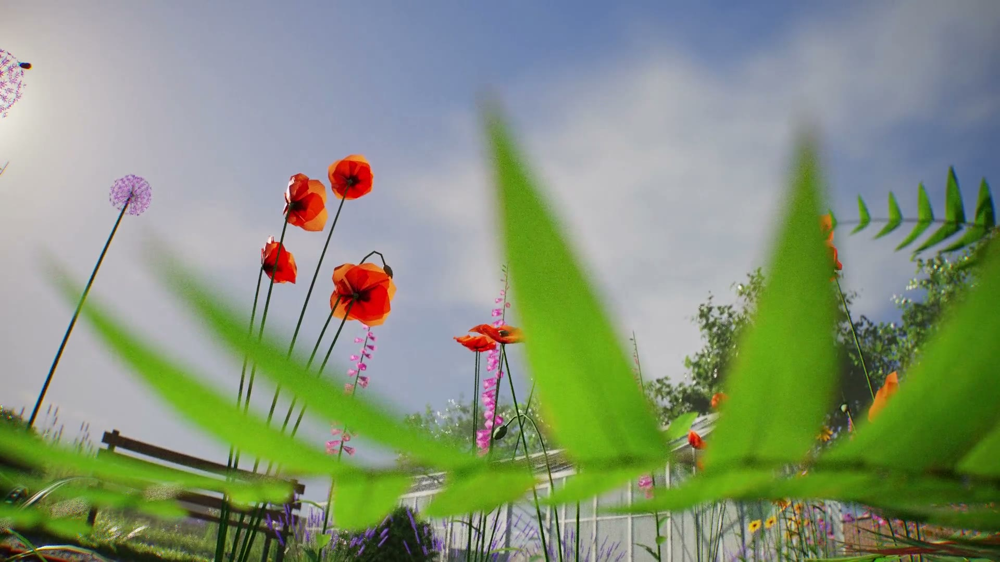

# 猫眼植物园：用猫的眼睛逛一座植物园，完全由代码计算

[English](README.md) | 中文

[](https://github.com/BubbleBrainBB/awesome-fable-5.2/releases/download/cat-garden-v1.0/cat_garden.mp4)

一只猫从篱笆底下钻进一座植物园，一路走、停、盯、闻、扑，最后跳上石墙晒太阳闭眼。
镜头就是猫的眼睛。**全片没有任何 AI 生成、照片、贴图、模型、HDRI、音效素材或现成渲染器**——画面由本目录里自己写的
路径追踪器渲染，声音由 numpy 合成，ffmpeg 只负责编码和混流。没有使用任何 skill。

代码由 AI 模型 Claude（`claude-fable-5-2`）在 Claude Code 里编写，画面和声音由这些代码计算得出。

| 项目 | 值 |
|---|---|
| 成片 | [`cat_garden.mp4`](https://github.com/BubbleBrainBB/awesome-fable-5.2/releases/download/cat-garden-v1.0/cat_garden.mp4)（超过 GitHub 单文件上限，放在 Release 附件里；封面 `preview.jpg` 是第 780 帧），1920×1080，30 fps，110.0 s（3300 帧），H.264 High yuv420p（BT.709）+ AAC-LC 48 kHz 立体声；304 MB，视频码率约 21.9 Mbps |
| 联系表 | [`contact_sheet.jpg`](contact_sheet.jpg)（每 2 秒一帧，55 格） |
| 源码 | `src/`（约 5000 行：C++/Objective-C++ 主程序、Metal 着色器、Python 后期/音频/质检） |
| 一键重建 | `./render.sh`（固定随机种子，可断点续渲） |
| 质检报告 | [`qc_report.txt`](qc_report.txt)、[`audio_report.txt`](audio_report.txt)、[`audio_spectrogram.png`](audio_spectrogram.png) |

## 1. 路线与分镜（一镜到底，没有剪辑点）

整座园子是一个连续的三维世界（约 38 m × 30 m），猫走了约 45 m。时间为带露水的上午，太阳高度约 28°。

| 时间 | 位置 | 猫在做什么 / 看到什么 |
|---|---|---|
| 0–4 s | 木栅栏破洞 → 黄杨树篱底下 | 压低身子（眼高 10 cm）从断掉的栅栏板下钻入，树篱根部的枯叶、枝干，前方草坪的亮光 |
| 4–7 s | 钻出树篱 | 垂下的枝叶和高草擦过镜头，自动曝光滞后造成短暂过曝，然后园子第一次展开 |
| 7–14 s | 带露水的草坪 | 发现一片高草叶上的七星瓢虫，凑到 7–8 cm 处盯着看、嗅；瓢虫爬到叶尖起飞，头跟着它抬向天空 |
| 14–21 s | 草坪 | 白蝴蝶掠过（瞥一眼）；路过雏菊、三叶草；停下闻蒲公英绒球 |
| 21–31 s | 花境 | 从玉簪和蕨的叶子下面钻过去；抬头看逆光的罂粟、毛地黄、大花葱；一只熊蜂从葱花飞到鼻子前悬停，头跟着它转 |
| 31–40 s | 砖砌花坛边 → 砾石小径 | 低头看砖上的蚂蚁；抬头坐直（眼高约 24 cm），循着鸟叫朝小径右边望，再歪头看长椅后面的树和太阳；一只白蝴蝶顺着小径飘过来，从面前不到半米处掠过，头跟着它从左转到右 |
| 40–46 s | 小径 → 长椅下 | 小跑穿过砾石路，钻到长椅底下（椅面成了屋顶，板缝漏光），望向水池 |
| 46–60 s | 水池边 | 看香蒲和睡莲，蜻蜓悬停、落在花苞上；锦鲤从睡莲叶下游过；探头喝水（水面涟漪、倒影）；锦鲤突然浮头，猫吓得后撤 |
| 60–66 s | 绕池 → 温室门口 | 小跑去温室，雾蒙蒙的玻璃 |
| 66–79 s | 温室热带区 | 进门时镜头短暂起雾；龟背竹、芭蕉、海芋、树蕨、竹芋；挂在朽木上的蝴蝶兰；凑近看瓶子草和捕蝇草 |
| 79–85 s | 温室多肉区 | 金琥（开着花）、柱状仙人掌、仙人掌掌片、龙舌兰、石莲花、生石花；凑上去闻金琥被刺到，猛缩头、甩头 |
| 85–92 s | 追蝴蝶 | 橙色蝴蝶从头顶飞过；蹲伏、加速、起跳扑空，蝴蝶飞出东门升上天 |
| 92–98 s | 温室外 → 干垒石墙 | 沿温室外墙走到石砌花台前，蹲下、起跳、落在墙顶（迎着太阳眯眼） |
| 98–110 s | 墙顶 | 转身俯瞰来路（草坪、温室、远树），趴下，两只前爪伸进画面，慢慢眨眼，闭眼 |

## 2. "是猫，不是蹲低了的人"——视角是怎么设计的

- **眼高**：行走 20–23 cm，潜行/钻洞 10–13 cm，喝水时离水面 6 cm，跳上墙后约 75 cm。草叶、落叶、卵石、砖块都按真实尺寸建模，所以它们在画面里很大。
- **头部运动是模拟出来的，不是关键帧曲线叠正弦**（`src/cat.h`）：
  - 头的位置：70 个时间关键点，用保单调三次插值（PCHIP），走走停停自然出现加减速；
  - 步态：相位按"走过的距离 / 步幅"推进（速度越快步频越高，小跑时步幅变长），每一步的起伏幅度带随机扰动；垂直起伏只有 3–8 mm（猫头很稳），另有左右摆、轻微滚转和偏航；
  - 注视：一张"注意力脚本"规定每个时刻猫在看什么（前方 / 某个点 / 某只动物）；头的偏航和俯仰各是一个二阶弹簧，看到会动的东西时刚度很高（约 0.15 s 的扫视并带一点过冲），发呆时刚度低；注视动物时是实时追踪它的位置；
  - 对焦：对焦距离也是一个带滞后的弹簧，目标是被注视物体的真实距离，所以凑近瓢虫时背景会虚成一片；
  - 嗅闻时有 6.5 Hz 的小幅前后探头；喝水时每舔一下头就点一下；被仙人掌扎后有一段甩头（滚转振荡）；
  - 跳跃：蹲伏—起跳—腾空—落地缓冲四个关键点。
- **镜头**：水平视角 96° 的球极投影（轻微桶形失真，类似运动相机），薄透镜景深，光圈是 0.72:1 的竖椭圆（借了一点"猫瞳"的形状），180° 快门运动模糊，暗角、轻微色差、辉光、胶片颗粒，带滞后的自动曝光（低分辨率测光预通道 → 因果平滑）。
- **关于"猫眼色觉"的取舍**：没有做蓝黄二色的色盲滤镜。猫对红色不敏感，但把罂粟和瓢虫变灰会直接损失画面的好看和真实感，也更像科普片而不是录像。只保留了"视角更宽、近处极近、远处略虚"这三点。
- **猫自己的身体**：结尾趴下时两只前爪（带约一万根毛的几何体）伸入画面；全程有一个只参与投影和反射的猫身体代理模型（主光线看不到它），所以猫的影子会落在近处的东西上，喝水时水里有它头部的暗影；胡须做了，但几乎都在画面外或被景深虚掉，基本看不出来。

## 3. 引擎（全部自写）

- **主程序** `src/main.mm`（C++ / Objective-C++）：生成世界 → 建 BVH → 把缓冲区交给 Metal 计算着色器 → 每帧多次调度累加采样 → 读回 → CPU 后期（辉光、色差、暗角、色调映射、颗粒、眼睑）→ 原始帧经管道送给 ffmpeg 编码成分段中间文件。最后由 `src/assemble.py` 把 55 段解码、做一次 numpy 写的“去散点”（一个像素不允许比它 8 个邻居里第二亮的那个亮出 10/255 以上——只压孤立的亮点，线条和两个像素以上宽的东西不动；平均每帧改动约 3% 的像素），再一次性编码并混入音轨。
- **着色器** `src/render.metal`：一个 Metal 计算内核里的路径追踪器。没有使用 Metal 的光追加速结构或任何光追库：
  - 自建两级 BVH（CPU 端分箱 SAH 构建），着色器里手写栈式遍历和 Möller–Trumbore 求交；
  - 实例化：约 38 万个实例、216 万个独立三角形、实例化后约 3.95 亿三角形；
  - **风**：每个实例在遍历时按高度做剪切变形（阵风场 + 每株相位），包围盒预留摆动余量；
  - **会动的东西**：昆虫、鱼等几十个动态实例每帧重建一棵小 BVH；快门内线性插值变换；翅膀在着色器里按绝对时间拍动（所以蜂翅自然糊成一片）；
  - **光照**：太阳（面光源采样的软阴影）+ 解析天空（含程序云）+ 一次间接反弹；叶片是"漫反射 + 漫透射 + 高光"三瓣，阴影光线穿过叶片时带颜色地衰减，所以逆光的叶子和花瓣会发亮、叶下的光是绿的；
  - **水**：解析波纹（风浪 + 事件驱动的环形涟漪）扰动法线；第一次命中同时算反射和折射（不做随机二选一，噪点小很多），水下有吸收和焦散纹；
  - **玻璃**：薄玻璃 + 凝露（随机分成反射 / 漫射薄层 / 带散射的透射）；
  - **雾**：室外是解析薄雾；温室内是贴合斜屋顶的体积雾，单次散射带阴影光线，所以窗棂会切出光柱；
  - **材质**：全部是着色器里的程序化函数（叶脉、虫洞、枯边、草叶、花瓣、树皮、卵石、土壤、木纹、砖、苔藓地衣、锦鲤花纹、瓢虫斑点……），没有任何位图贴图；唯一的"纹理"是 CPU 生成的地面分区图和 5×7 点阵字库拼出的植物铭牌。
  - 采样：每像素 Kronecker 低差异序列；每帧 16 spp；累加纹理的 alpha 存采样数，不满就拒写重渲（防 GPU 争用造成的静默坏帧）；距离较远的表面按概率用平滑环境项代替一次反弹（远处细节本来就小于一个像素，省两次遍历）。
- **程序化建模** `src/geom.h, plants.h, plants2.h, world*.h`：一套小工具（带中脉弯曲/对折/卷边/波浪边/扭转的叶片曲面、沿曲线的管、回转体、带噪声的椭球、方块）拼出所有东西。约 400 个原型网格：
  - 草坪：14 种"草皮块"（每块 600 片草叶）、高草与穗、三叶草、雏菊、蒲公英（花与绒球）、蘑菇；
  - 花境：玉簪（两种）、蕨、罂粟（花/垂头花苞/蒴果）、毛地黄、大花葱、薰衣草、金光菊、松果菊、波斯菊、滨菊；
  - 水池：睡莲叶与花、香蒲/芦苇、鸢尾、石头；树：白桦、槭树型乔木、墙外十几棵远景树、黄杨球与树篱；
  - 温室：芭蕉、龟背竹（开孔用解析 alpha）、海芋、竹芋、树蕨、凤梨、蝴蝶兰、瓶子草、捕蝇草、苔藓；金琥（带刺座和约 1500 根刺）、柱状仙人掌、仙人掌掌片、龙舌兰、芦荟、石莲花、生石花、陶盆；
  - 动物：瓢虫、熊蜂、两种蝴蝶、蜻蜓、蚂蚁、5 条锦鲤（分 5 节摆动）；
  - 建筑：木栅栏、砖墙、长椅、砖砌路缘、维多利亚式玻璃温室（矮墙、窗棂、玻璃、敞开的门、暖气管、花架）、干垒石墙。
  - 靠近猫的路线的地方用全密度，离得远的地方按距离降低密度并放大单体（因为路线是已知的，所以没有运行时 LOD 切换，也就没有跳变）。

## 4. 声音（全部代码合成，`src/audio.py`）

渲染器先导出一份事件时间线（每一步落脚的时刻和地面类型、嗅闻、舔水、蜜蜂/蜻蜓/瓢虫相对猫头的距离与方位、水花、落地……），音频脚本照着它合成，所以声画是同一份数据：

- 环境：随阵风起伏的风声和叶子沙沙声；7 种合成鸟鸣（山雀、叽喳柳莺、乌鸫、知更鸟、麻雀、斑鸠、鹪鹩，各有自己的音型）；
- 猫的脚步按地面分 5 种（枯叶、草、土、砾石、石板）；快速转头/奔跑时的"机身"低频扰动；嗅闻；舔水；被刺到时一声很短的"mrrp"；甩头；起跳和落地；结尾的呼噜（吸气/呼气交替的 22–27 Hz 脉冲列）；
- 熊蜂（约 188 Hz 的谐波列，响度和声像跟着它与猫头的距离、方位走）；蜻蜓翅膀的沙沙声；瓢虫起飞；
- 池边的水声、蛙鸣、锦鲤的水花；路边张望那几秒有两三声较近的鸟叫（麻雀、乌鸫），给转头一个由头；
- 进温室后室外声音被低通并压低，叠加通风嗡声、喷雾嘶声、滴水声和玻璃房的短混响。
- 没有配乐，没有旁白。

## 5. 流程与耗时

全部在一台 Apple M4 Max 上完成，时间为墙钟时间：

| 步骤 | 耗时 | 说明 |
|---|---|---|
| 写引擎、建模、分镜静帧与三轮以上自评修改 | 约 1.5 小时（按文件时间戳估算） | 包括低分辨率俯视图、15 个机位的静帧、每 2 秒一帧的动画预览、0.1 秒间隔的动作连拍、1080p 局部放大 |
| 测光预通道（320×180，4 spp，隔帧） | 约 2 分钟 | 没有单独计时，按复渲速度估算 |
| 第一次正式渲染（20 spp） | 36 分钟后中止 | 只渲出 4 段。我对速度的预估错了 2–3 倍（预估是在树、树篱、温室还没建好时测的），于是停下来做剖析和优化，改成 16 spp 重来 |
| **正式渲染**（1920×1080，16 spp，3300 帧，55 段） | **183.9 分钟** | 平均 3.34 秒/帧；最慢的一段（钻出树篱，贴地看草）8.4 秒/帧，最快的一段（仰头看天追蝴蝶）0.68 秒/帧。55 段全部一次成功，没有因采样数不满而重渲的帧 |
| 独立低分辨率复渲（320×180，8 spp，每 10 帧一帧，共 330 帧） | 31 秒 | 给坏帧比对用 |
| 音轨合成 + 音频检查 | 几秒 | |
| 去散点 + 最终编码 + 混流 | 2 分 53 秒 | 第一次按 crf 20 编出来是 1.0 GB / 73 Mbps（颗粒和噪点很吃码率），不适合交付；改为 crf 26，得到约 300 MB |
| 质检、联系表 | 约 10 秒 | |

渲染慢的根本原因：猫眼贴着地面看草，几乎每条光线都要擦过成百上千片草叶，这个遍历成本是固有的。试过更大的草皮块、去掉树和树篱、简化远处反弹，合计只快了一成多。

## 6. 质检

- **渲染时的防线**：累加纹理的 alpha 通道存每个像素实际累加的采样数，读回时只要有像素不满 16 就拒绝这一帧并重渲。整个正式渲染里这个重渲一次都没有触发，55 段的返回码全是 0。
- **规格**（ffprobe）：h264 High、yuv420p、bt709、1920×1080、30 fps、3300 帧、110.000 s；AAC-LC 48 kHz 立体声 110.000 s。整片完整解码一遍，没有任何解码错误。
- **逐帧解码检查**（`src/qc.py`，结果在 `qc_report.txt`）：
  - 淡入和眼睑窗口之外的黑帧：0。（105.9–107.5 s 的慢眨眼和 107.9 s 之后的闭眼是故意的黑。）
  - 冻结帧（与前一帧完全相同）：0。
  - “丢块”候选（某个 120×120 像素的块只在一帧里变暗，而前后两帧都亮且彼此一致）：22 处。我把这些候选的前/中/后帧拼出来逐个看过，都是真实画面——贴着镜头扫过的草叶和枝条、长椅板条、快速转头时的运动模糊、石墙的阴影边——没有一处是矩形的渲染损坏。
  - 我最初写的通用“单帧离群”分数在 543 帧上超过阈值，这个检测对贴镜头的快速运动天然敏感，不能当坏帧判据用；分数最高的 8 处我同样逐个看过，都是正常画面。报告里把它保留为“仅供参考”。
- **与独立复渲比对**：330 帧（每 10 帧一帧）与成片对应帧按块比较，中位差 9.1/255，最大 19.4/255（第 90 帧，树篱下的逆光枯叶，差异来自 8 spp 复渲自己的噪点），没有出现“某一块明显不一样”的帧。注意这只覆盖了十分之一的帧。
- **联系表**：55 格（每 2 秒一格）逐格看过，没有坏帧。能看到的“异常格”都有解释：0 s 是淡入；30 s 整格是绿的，因为猫正从玉簪叶子底下钻过去，叶子贴在镜头上；74 s 是温室里快速转头的运动模糊；最后一格之后是闭眼。
- **音频**（`audio_report.txt`）：响度 −19.6 LUFS，响度范围 10.6 LU，真峰值 −2.1 dBFS，削波采样 0 个，左右相关 0.76。事件对齐：水花（58.72 s）比前 0.2 秒高 23.1 dB，落地（98.26 s）高 10.3 dB，起扑（89.35 s）高 11.1 dB；38 次砾石/枯叶上的脚步，起音中位数 +3.5 dB。被刺那一下（84.00 s）只高出 1.3 dB——那声“mrrp”很可能被环境声盖住，基本听不出来。

## 7. 已知不足（如实）

整体水平：单帧截图在草坪、花境、池塘、温室这些段落里相当接近真实的微距/运动相机画面；连续看仍然能认出是渲染的。具体问题：

**画面**
- **噪点**：每帧 16 个采样。草丛里看不出来，但大面积虚化的前景（景深很浅时贴近镜头的叶子、落叶）、阴影里的墙面和石板、起雾的温室玻璃上有颗粒，而且逐帧不相关，播放时会像高感光度噪点一样"沸腾"。最明显的是 20–22 s 蒲公英那一段：虚化的白色绒球和雏菊周围是一圈白色散点，而不是平滑的光斑。后期只做了一个很轻的去散点（压孤立亮点），没有做真正的降噪；最终编码（crf 26）又抹掉了一部分最细的颗粒，同时也损失了一点草叶的锐度。
- **远处草坪**会闪：远处草叶小于一个像素，逆光时亮的草叶被随机采到，形成细碎的闪烁（尤其 7–20 s 朝远处看的时候）。
- **砖**（花坛边、温室路缘）是把椭球挤方得到的，圆润得像肥皂，表面纹理也偏素；**苔藓**是一团团深绿色小垫子，近看是"绿馒头"。这两样是最明显的"泥塑感"残留。
- **温室玻璃**的凝露是统计意义上的雾面，没有真正的水珠和流痕；多肉区一侧玻璃偏白、偏平。
- **白蝴蝶**：路边那一段从面前掠过的白蝴蝶被放大到平时的 1.8 倍（否则在画面里只有十几个像素，看不出猫在盯什么），翅膀在快门里糊成一片，近看是一团白，而不是清楚的翅形。
- **锦鲤**是 5 节刚体拼的，摆尾时节与节之间靠重叠遮掩；鳞片和鳍比较简单。水面涟漪是解析函数，喝水时的同心圆过于规整；猫在水里的倒影只是一个暗色轮廓，没有脸。
- **猫自己的身体**：只有结尾的两只前爪进画面，毛是一万根直片，近看像毛绒拖鞋；走路时看不到爪子；胡须基本不可见。猫的影子理论上会出现，但我没有在任何检查帧里明确找到它。
- **植物**：同种植物的个体是由 3–5 个原型变体缩放旋转而来，仔细看能认出重复（花境后排、睡莲叶）；罂粟和毛地黄的茎偏直；叶片没有真实厚度，只有多肉做了双面厚叶；树只有三种骨架，远景树轮廓相似；树篱内部是一个暗色盒子。
- **风**是每株整体的剪切摆动，没有叶片级的颤动，也没有草浪被猫身体推开的效果——猫走过草丛时草不会被碰动，这是第一视角里比较出戏的一点。
- **露水**：草叶上的露珠是着色器里的高光点，只有瓢虫那片草叶上是真正的水滴几何体。
- **天空**是解析渐变加一层程序云，云不随时间变形，只平移。
- 铭牌字是 5×7 点阵，近看是像素字。

**运动**
- 头部运动来自规则（弹簧 + 步态相位 + 噪声），不是动捕。走路时的起伏频率和幅度是按文献量级手调的；转头没有"先眼后头"、耳朵和身体也不存在，所以比真猫更"稳"、更像稳定器。
- 步态没有区分四条腿，起跳/落地只有四个关键点，落地没有身体的二次缓冲。
- 开头在树篱下爬行的 4 秒构图变化小，偏慢。

**声音**
- 全部是合成器音色。鸟鸣是正弦滑音拼的"像某种鸟"的音型，不会被认成真实录音；呼噜、嗅闻、那一声"mrrp"都偏电子；没有空间混响建模（室外只有几次简单回声），没有风噪打在话筒上的真实质感。
- 响度约 −20 LUFS，偏安静的环境声类型，没有配乐。

## 8. 没有验证过的

- **没有人（也没有我）听过这条音轨。** 我只能看电平、响度、频谱图和事件对齐的数字；音色好不好听、像不像，完全没有验证。
- **没有连续观看过成片。** 我检查的是抽帧（每 2 秒一帧的联系表、若干段 0.1 秒间隔的连续帧、几十张 1080p 局部），运动的流畅度、头部晃动是否自然、噪点在播放时有多明显，都是推断。
- 只在这一台机器（Apple M4 Max）上跑过；没有验证两次完整渲染逐字节一致（种子是固定的，但 GPU 浮点结果未做重复性测试）。
- `render.sh` 的各个步骤都分别运行过，但没有从空目录完整地一口气跑一遍（那需要再渲 3 小时）。
- 坏帧检查里“与独立复渲比对”只覆盖每 10 帧中的 1 帧；其余帧靠渲染时的采样数校验和解码后的单帧突变检测，后者的 22 处候选是我用 320×180 的缩略图人工判断的。
- 去散点滤镜只在两帧上对比过处理前后的局部（蒲公英、瓢虫草丛），没有逐段检查它有没有把露珠之类该亮的小高光压暗。
- 蜻蜓、蚂蚁、白蝴蝶这些小东西在画面里只有几十个像素，我只在个别放大帧里确认过它们存在且位置合理，没有逐段确认它们一直在镜头注视的位置上。

## 9. 修订记录

**第 2 版（去掉行人）。** 第 1 版在 31–40 s 有一个人从小径上走过，假人感明显，按反馈换掉了：

- 行人整个从动态实例里删除（脚步声和衣料声也一并删除）；鞋、腿、上身的原型网格还留在 `src/world3.h` 里但不再被放进场景——留着是为了不改变其余场景的生成顺序，让没重渲的 46 段与新渲的 9 段严格属于同一个世界。
- 新内容：猫看完蚂蚁后抬头坐直（眼高从蹲伏的 12 cm 改为约 24 cm），先朝小径右边望，再歪头看长椅后面的树和太阳，然后盯着一只顺着小径飘来的白蝴蝶，头跟着它从左转到右。蝴蝶的这段路线是在原路线上按时间窗混入的（33.5–44.5 s），窗外的位置与第 1 版逐位相同。
- 只重渲了受影响的 9 段（第 14–22 段，28–46 s），用时 22.3 分钟，全部一次成功；这一段的测光重新做过，曝光曲线在第 1340–1379 帧线性过渡回旧曲线，接缝两侧（第 839/840 帧、第 1379/1380 帧）我看过连续帧和平均亮度，没有跳变。
- 音轨整条重新合成。因为随机数序列随之改变，行人之后的随机细节（滴水、蛙鸣的具体时刻等）与第 1 版不同；整体响度从 −21.3 变为 −19.6 LUFS（原来的峰值来自行人的脚步）。
- 仓库里的源码、联系表、质检报告和 Release 里的成片都是第 2 版；第 1 版没有放进仓库。
- 按 `render.sh` 从头重建时，测光是对整片统一做的，所以 28–46 s 的曝光曲线会与这里发布的成片有细微差别（发布的成片在这一段是把新测光拼接进旧曲线的）。
- 这一版同样没有人听过音轨、没有连续播放看过；新片段我看的是 0.2 秒间隔的缩略图和 6 张 960×540 的预览帧。

## 自己渲染

需要 macOS + Apple Silicon（Metal）、clang++、Python 3（numpy / scipy / Pillow）、ffmpeg。

```bash
./render.sh
```

脚本会编译主程序、导出事件时间线、跑测光预通道、渲染 55 段 × 60 帧（已完成的分段会跳过，可以中断后续渲）、合成音轨、合成 `cat_garden.mp4`、做坏帧检查并生成联系表。中间文件放在 `work/`。在 M4 Max 上大约需要 3 小时。
