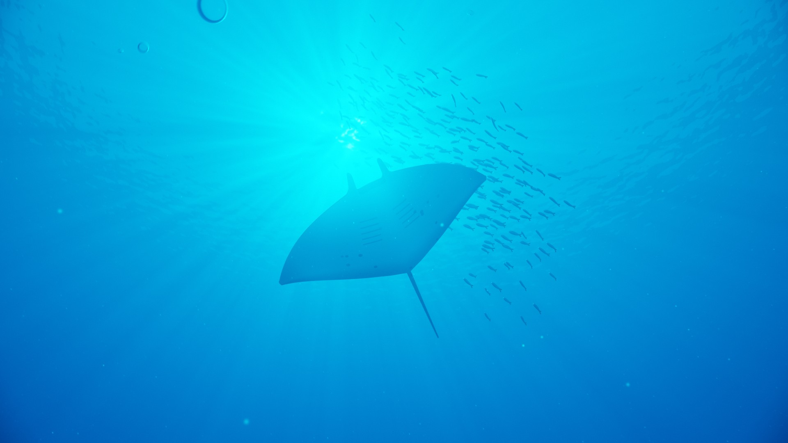

# Deep Dive —— 第一人称深潜短片（纯代码）

一支 78 秒的第一人称（POV）潜水短片：镜头就是潜水员的眼睛。从水面下仰望斯涅尔之窗开始，沿沙沟游过浅礁，
越过礁缘翻下峭壁，在二十多米深处打开手电，最后转向深蓝，看一只蝠鲼从头顶的阳光里滑过。

[](https://github.com/BubbleBrainBB/awesome-fable-5.2/releases/download/deep-dive-v1.0/deep_dive.mp4)

- 成片：[`deep_dive.mp4`](https://github.com/BubbleBrainBB/awesome-fable-5.2/releases/download/deep-dive-v1.0/deep_dive.mp4)（1920×1080，30 fps，78 s，H.264 High / yuv420p + AAC 立体声，faststart）。
  文件有 129 MB，超过 GitHub 单文件上限，所以不在仓库里，放在 Release 附件中；按下面「重新生成」跑一遍也会在本目录得到它。
- 封面：`preview.jpg`（成片第 2085 帧）
- 联系表：[`contact_sheet.jpg`](contact_sheet.jpg)（全片每秒一帧，共 78 格）
- 质检报告：[`qc_report.txt`](qc_report.txt)，音轨频谱图：[`audio_spectrogram.png`](audio_spectrogram.png)

代码由 Claude（`claude-fable-5-2`）编写，画面和声音由这些代码计算得出。

画面、运动、声音全部由本目录里的代码算出来：没有用 AI 生图/生视频模型，没有照片、视频、模型、贴图、
音效或音乐素材，没有用 Blender、游戏引擎或现成渲染器，也没有用任何视频类 skill。只用了 clang++、
系统自带的 Metal（自己写的计算着色器）、Python（numpy / scipy / Pillow），ffmpeg 只负责编码封装。

## 分镜与路线

世界坐标：y 向上，水面在 y = 0；礁坪在 x < 0，礁缘在 x ≈ 0，峭壁朝 +x（外海）一侧直落。太阳在外海方向，
高度角 47°（折射进水里后约偏离天顶 30°）。

| 时间 | 段落 | 深度 | 看到什么 |
| --- | --- | --- | --- |
| 0–6 s | 入水 | 1.6 m | 仰头：头顶是晃动的水面，天空被折射压进一个圆窗（斯涅尔之窗），窗外是全反射，映着礁石；入水的气泡正在上浮 |
| 6–13 s | 低头下潜 | 2–5 m | 视线从水面落到前方：光柱斜穿下来，沙沟和礁坪上是流动的焦散光网 |
| 13–26 s | 沿沙沟前进 | 6–7 m | 两侧是桌面珊瑚、分枝珊瑚、团块珊瑚；一群梅鲷（黄带、蓝背）从左前方横穿而过，绕开潜水员 |
| 26–35 s | 礁顶 | 4–6 m | 升上礁顶，珊瑚头上方悬停着一团团橙色的花鮨；礁缘外开始露出深蓝 |
| 35–44 s | 越过礁缘 | 4→11 m | 脚下的礁石退去；右转，贴着峭壁俯视下潜，海鞭和海扇从壁上伸出来 |
| 44–60 s | 峭壁 | 11→21 m | 水色由青绿变成深蓝，红色消失，海扇只剩黑色剪影；45.6 s 打开手电，光斑扫到的海扇和海绵恢复红橙本色，光束里的悬浮颗粒发亮 |
| 60–66 s | 转向深蓝 | 22 m | 离开峭壁向外看，只有蓝；远处鱼群，一个影子从雾里出现 |
| 66–75 s | 蝠鲼 | 22 m | 蝠鲼迎面游来，从头顶掠过太阳；视线跟着它仰起，头顶二十多米外是遥远的水面和放射状的光；自己的气泡向上升去 |
| 75–78 s | 结尾 | 22 m | 蝠鲼沿着峭壁向上游远，淡出 |

呼吸贯穿全片：约 6 秒一次（吸气约 1.9 s，呼气约 2.8 s，每次略有不同），吸气时身体微微上浮、呼气时下沉；呼气的气泡从画面
下方两侧升起（平游时大多在视野外，低头和仰头时能看到）。

## 技术方案

### 渲染：自己写的 Metal 光线步进器

`src/render.metal` 是一个计算着色器，每个采样做一次完整的"水下相机"计算；`src/main.mm` 是宿主程序，
负责场景、模拟、每帧的水面与焦散、调度 GPU、后期和写 PNG。几何全部是有符号距离场（SDF），没有网格、没有贴图文件。

**水下的光（成败所在）**

- **水面**：`src/water.h` 用自己写的 FFT 把一个随机波谱（色散关系 ω = √(gk)，沿风向传播）合成为 1024² 的
  周期高度场（25.6 m 一块），每个子帧重新计算，所以水面是真的在走的波。
- **焦散与光柱同源**：每个子帧把约 420 万条太阳光线按斯涅尔定律折射穿过这张水面，正向"泼"到 36 层水平
  切片上（0.35 m 到 66 m 深，沿平均折射方向剪切），得到一个三维的"聚焦后阳光"光场。沙地、珊瑚、鱼、蝠鲼、
  悬浮颗粒都从这里读取阳光；视线上的体积散射也沿途查询同一个光场，所以水里的光柱和海底的光网是对得上的，
  随时间的流动也来自同一张波面。太阳的角直径和水的前向散射按深度把光场模糊，深处的焦散自然变软。
- **水体**：按 RGB 分别吸收和散射（光束衰减系数：红光每米约衰减 28%，绿约 9%，蓝约 7%），远处的东西融进蓝雾，越深越蓝，
  红色最先消失。太阳的单次散射沿视线步进（48 步，按透射率重要性采样），用前向很强的双 Henyey–Greenstein
  相函数，所以朝着太阳看光柱最明显；多次散射是一个随深度衰减、向上更亮的解析项。
- **从水下看水面**：视线到达水面时用波面的法线求折射——折射出去看到天空和太阳，超过临界角 48.6° 就是
  全反射，此时再追一条反射光线去看礁石（所以窗外的水面映着礁盘）。窗口的形状是物理算出来的，不是画的。
- **手电**：一个带柔边的聚光灯跟着视线（有滞后和手抖），照亮表面、悬浮颗粒，并有很弱的体积光束；
  它的光没有被二十米的水滤过，所以照到的地方红色回来了。
- **曝光**：先用低分辨率预跑一遍，统计每帧的平均亮度，像相机的自动曝光那样缓慢、不完全地补偿
  （`auto_exposure.py`），所以深处比浅处暗，但仍然看得清。

**场景与生物（全部程序化）**

- **礁盘**（`src/shared.h`，同一份代码既给着色器也给 CPU 用）：礁坪 + 沙沟 + 礁缘 + 峭壁的基础形状，
  叠加用整数哈希计算的 Perlin / Worley 噪声做的珊瑚头、疙瘩和指状小突起；每个"细胞"是一个群体，有自己的颜色。
- **珊瑚与海绵**（约 1700 个实例，放在一张三维网格里供光线查找）：桌面珊瑚、分枝珊瑚（折叠空间的分形）、
  海扇（二维分形树）、海鞭、桶状海绵、团块珊瑚。海扇、海鞭随涌浪弯曲。
- **涌浪**：一个统一的往复水流函数，软体、悬浮颗粒、鱼、气泡和潜水员本人都按同一相位被它带着晃，
  这是"水下的东西一起动"的来源。
- **梅鲷群**（280 条）：群体行为模拟——分离、对齐、聚集，沿一条随时间移动的"锚点"成流线形队伍，
  避开礁石、潜水员和蝠鲼；身体按游速摆尾，转弯时身体弯曲，银色的体侧反射环境光。
- **花鮨**（约 630 条，46 团）：各自在珊瑚头上方的小空间里悬停、顶流、不时窜动；潜水员靠近时缩回珊瑚。
- **蝠鲼**：SDF 建模（菱形体盘、头鳍、尾、背鳍、腹面的鳃裂和斑点），翼沿圆弧卷曲拍动（保持翼长），
  翼尖相位滞后；路径是带侧倾的样条。
- **气泡**：粒子模拟（按半径决定上浮速度、螺旋晃动、大泡扁成帽状并抖动），呼气节奏来自呼吸时间线；
  渲染时边缘按全反射变成镜面亮环，中间透明。
- **海雪**：空间哈希的悬浮颗粒，有视差，被阳光（含焦散）和手电照亮。

**第一人称镜头**（`src/sim.h`）

关键帧样条给出路线和视线；在此之上叠加：头部转动的二阶滞后（视线有惯性）、呼吸带来的浮沉（肺容积驱动
一个阻尼弹簧）、踢蹼的左右摆和滚转（随游速变化）、低频的头部漂移、涌浪的推动；蝠鲼出现后视线锁定它。
镜头是 104° 的广角，带一点桶形畸变和很轻的面镜暗角。

**时间一致性**

- 每帧 4 个子帧 × 6 采样 = 24 采样，180° 快门；每个子帧有自己的波面、焦散光场和模拟状态；
  相机、鱼、气泡在子帧内部还按速度做连续的逐采样运动，所以运动模糊是连续的而不是四重影。
- 除了像素抖动和体积步进的抖动，没有随机光线，画面本身没有蒙特卡洛噪点；最后加了很轻的胶片颗粒和抖动，
  避免蓝色渐变在 8 位编码里出现条带。
- 所有随机数种子固定：同样的命令得到同样的片子。

### 声音：`audio.py`（numpy / scipy 合成）

和画面共用同一条呼吸时间线（`work/frames/timeline.txt`）和相机深度曲线：

- 水下底噪（低频隆隆声 + 中频水声，随深度变暗）、与画面同一函数的涌浪冲刷声、开头水面的拍击声；
- 调节器：吸气是带软管共鸣的气流嘶声，开阀有一下轻响；呼气是排气阀的咕噜声加一群气泡——每个气泡按
  Minnaert 共振频率（与半径成反比，随水压升高）发出一个衰减的小音；
- 礁石的噼啪声（鼓虾），浅礁密、深处稀；
- 深蓝段远处的鲸类叫声（滑音 + 长混响）；
- 极克制的铺底和声（几个长音，没有节奏）；手电开关的一声轻响。

各层按"实际发声时的电平"混音，调节器是最响的一层（潜水员听到的就是这样）。

### 文件

| 文件 | 内容 |
| --- | --- |
| `make.sh` | 一条命令重新生成全片（渲染 → 音轨 → 质检 → 编码 → 校验） |
| `render.sh` / `build.sh` | 编译与渲染（可断点续渲：已存在的帧会跳过） |
| `src/main.mm` | 宿主：Metal 调度、屏幕分块索引、后期（眩光、色调曲线、暗角、颗粒）、PNG |
| `src/render.metal` | 计算着色器：光线步进、材质、水体、水面、鱼、蝠鲼、气泡、海雪 |
| `src/shared.h` | CPU 与 GPU 共用：地形 SDF、噪声、涌浪、焦散切片布局 |
| `src/water.h` | FFT 波面、正向焦散光场 |
| `src/world.h` | 珊瑚实例的摆放与网格 |
| `src/sim.h` | 相机/潜水员、鱼群、蝠鲼、气泡的模拟 |
| `src/base.h` | 向量、哈希、并行、FFT、PNG 编码 |
| `auto_exposure.py` | 由预跑的亮度统计生成曝光曲线 |
| `audio.py` / `audio_check.py` | 音轨合成 / 频谱与呼吸对齐检查 |
| `qc.py` / `verify.sh` / `sheet.py` | 逐帧质检与联系表 / 成片校验 / 调试用联系表 |

## 重新生成

```sh
./make.sh
```

需要 macOS（Apple Silicon，Metal）、Xcode 命令行工具里的 clang++、Python 3（numpy、scipy、Pillow）、ffmpeg。
中间文件写在 `work/`（帧约 5.5 GB），可以随时中断后重跑，已渲染的帧会被跳过。

耗时（16 核 M4 Max）：这次实际的数字（渲染期间机器上还有别的会话在跑，空闲时会更快）：

| 步骤 | 耗时 |
| --- | --- |
| 低分辨率预跑（曝光统计，390 帧） | 36 秒 |
| 正片 2340 帧（1920×1080，24 采样，4 子帧） | 76.6 分钟（平均 1.96 秒/帧；浅水段约 0.9 秒，峭壁段约 3 秒） |
| 独立校验渲染 2340 帧（480×270） | 21 分钟 |
| 音轨、质检、编码、校验 | 约 6 分钟 |

合计约 1 小时 45 分。交付的成片还多做了一步：质检发现一处问题后（见下），改了着色器并重渲了受影响的 771 帧
（27 分钟 + 校验 10 分钟）；现在的源码已包含这个修改，从头跑 `./make.sh` 不需要这一步。

快速小样：`SIZE=960x540 SPP=8 ./render.sh`（先删掉 `work/frames`）。

## 质检结果

`qc_report.txt` 是 `qc.py` 对最终帧的原始输出，`verify.sh` 的输出见下。都是我实际跑出来的结果。

**逐帧（2340 帧 PNG）**

- 2340 帧全部存在、可解码、1920×1080；渲染日志里 0 个 GPU 错误。渲染器在累加缓冲的 alpha 通道里记录每个像素
  收到的采样数，只要有一个像素不满就拒绝写这一帧（本次没有触发）。
- 每一帧都和一份**独立重渲**的低分辨率版本（另一次进程、480×270）按 32×18 个块比较平均值：最大块差的中位数
  0.95 级（8 位），全片最大 10.07 级（第 1840 帧），低于 14 级的阈值——没有"无报错但局部缺块/损坏"的帧。
- 没有黑帧（淡入淡出之外平均亮度最低 120.8）、没有黑块；过曝像素最多的一帧占 0.59%。
- 闪烁检测（一个 480×360 的大区域相对前后两帧同时跳变）：全片最大 2.44 级，阈值 4，0 帧被标记。
  同样的指标放到 60×60 的小块上会有 402 帧超过 9 级，我看过其中最高的几处（第 85–90、603–606、659–660 帧），
  是贴近镜头的气泡和游过的鱼在一帧内穿过小块，属于画面内容而不是渲染闪烁，所以只作为信息列出。
- **这一步抓到并修掉的真问题**：第一次全片渲染后，大区域闪烁检测标出第 1504 帧——一个贴着面镜的气泡只在一帧里
  出现，成了左下角一下白闪（独立渲染里也有，说明是场景内容而不是坏帧）。修法：气泡在离镜头 7–14 cm 内渐隐；
  用模拟扫描出有气泡近距离经过视野的 771 帧，重渲了这些帧的正片和校验版，再整片重新质检，结果如上。
- 联系表 `contact_sheet.jpg`：每秒一帧共 78 格，我整张看过。

**成片 `deep_dive.mp4`**

- ffprobe：H.264 High，yuv420p，1920×1080，30 fps，2340 帧，78.000 s，视频约 13.0 Mbps；AAC-LC 48 kHz 立体声
  约 263 kbps；文件 129 MB；`moov` 在 `mdat` 之前（faststart）。
- 完整解码一遍：无错误，解出 2340 帧；blackdetect 只报了片尾淡出的 0.3 秒。
- 压缩后抽帧检查了深蓝渐变区：颗粒大部分保留（纹理标准差 1.14 级，源帧 1.42 级），没有看到明显条带。

**声音与同步（只做了波形/频谱层面的检查，没有人听过）**

- 我无法"听"这条音轨。能确认的只有数字：整体 RMS −21 dBFS，峰值 −6.9 dBFS；吸气窗口内 1.5–9 kHz 的嘶声比
  呼吸间隙高约 17 dB，呼气窗口内 150–1400 Hz 的气泡声高约 13 dB；频谱图见 `audio_spectrogram.png`
  （下方绿条是吸气、橙条是呼气）。
- 音画同步：画面里"每帧新生的气泡数"（来自渲染日志）和成片音轨的气泡频带能量做互相关，峰值 0.56，
  位于 0 帧延迟；画面的气泡只在呼气窗口内产生（每秒约 16 个，窗口外 0 个）。
- 音色像不像真的调节器、鲸声和铺底好不好听，我没法验证，请以实际试听为准。

## 已知不足（如实说）

- **我不能真正"看片"和"听片"**。运动是靠抽帧联系表、相邻帧对比和数值指标判断的：镜头晃动的幅度、
  鱼群的节奏、蝠鲼拍翼是否自然，都没有经过连续播放的检验；音轨没有人听过。
- **光**：太阳的单次散射、焦散、折射/全反射是算出来的；多次散射只是一个解析近似，水的光学系数是 RGB 三个数
  而不是光谱。光柱不会被礁石和蝠鲼挡出阴影（体积里没有阴影）；表面的阴影是沿平均折射方向的距离场软阴影。
  窗外水面里的礁石倒影用的是简化光照。没有云，太阳被处理成一团柔光，没有真实镜头的星芒和眩光鬼影。
- **礁石和珊瑚**：全是距离场加噪声，近看偏圆润、偏糊，没有真实珊瑚的细孔和触手；一共只有六类造型
  （桌面、分枝、海扇、海鞭、桶状海绵、团块），分枝珊瑚和海扇是对称分形，细看能看出规律；没有软珊瑚、海葵、
  海百合这些。沙纹只是法线扰动，不是几何。
- **鱼**：只有两种；没有胸鳍、腹鳍和鳞片；鱼群是 boids 加一条人为设计的行进路线，不会觅食、不会对手电有反应；
  鱼和蝠鲼都不在海底投影。蝠鲼只有一只，拍翼是给定的弯曲函数而不是受力游动，腹面斑纹是程序生成的。
- **气泡**：是椭球，不会分裂、合并；中间只是透明，没有透过气泡看到背景被折射缩小的效果；贴近镜头 7–14 cm
  内会渐隐（为了去掉一帧的白闪）。
- **第一人称**：画面里没有面镜边框、手、仪表、呼吸管和脚蹼，手电也没有实体，只有光；没有景深。
  运动模糊是每帧 4 个子帧加子帧内的平移插值，相机的转动在子帧内没有插值。
- **观感**：整体偏青蓝单色（不补光的水下确实如此，但真实相机的白平衡和色彩更丰富）；画面略软
  （重建滤波 + 眩光 + 水雾）；60–64 秒转向深蓝的几秒钟画面比较空。
- **可重现性**：种子固定，流程是确定性的，但我没有做"两次完整渲染逐字节相同"的验证；交付的成片里有 771 帧是
  修正后重渲的（其余帧不受该修改影响，理由见质检一节，但同样没有逐字节验证）。
- 这是一支"看起来像潜水录像"的程序化短片，离真实水下摄影的丰富程度还有明显差距：真实礁盘的生物密度、
  形态和颜色的多样性远高于这里。
