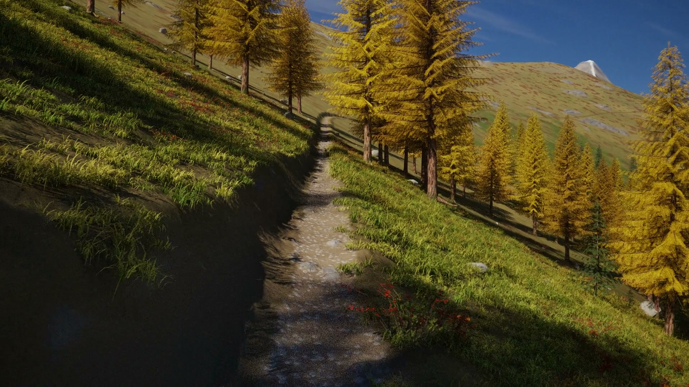

# Mountain Hike: a first-person walk up a mountain, computed entirely by code

English | [中文](README.zh-CN.md)

[](https://github.com/BubbleBrainBB/awesome-fable-5.2/releases/download/mountain-hike-v1.0/mountain_hike.mp4)

The camera is the hiker's eyes. The walk starts in spruce forest at 1600 m, crosses a footbridge over a brook, passes through misty woods, comes out at a treeline of golden larches, and goes on over a meadow, a saddle and a rocky ridge dusted with snow, to stand on a 2488 m summit in the evening with a sea of cloud below.

No AI image, video or music generation, no photos, textures, models, HDRIs, sound effects or sampled instruments, and no Blender, game engine, off-the-shelf renderer or ray-tracing library were used. No agent skill was used. The picture is rendered by the engine written in `src/`; the music and ambience are synthesised by `src/audio/synth.py`.
**The one exception is the English narration**: its seven lines were generated with `edge-tts` (an online neural text-to-speech service). The text was written for this film.

The code was written by Claude, an AI model (`claude-fable-5-2`), in Claude Code; the picture and the sound (apart from the narration) were computed by that code.

| Item | Value |
|---|---|
| Film | [`mountain_hike.mp4`](https://github.com/BubbleBrainBB/awesome-fable-5.2/releases/download/mountain-hike-v1.0/mountain_hike.mp4) (above GitHub's per-file limit, so it is attached to a release; the cover `preview.jpg` is frame 1150), 1920×1080, 30 fps, 95.0 s (2850 frames), 8 shots, H.264 High yuv420p (BT.709) + AAC-LC 48 kHz stereo; 384 MB, about 32 Mbps (the picture has grain and noise, so the bitrate is generous) |
| Contact sheet | [`contact_sheet.jpg`](contact_sheet.jpg) (one frame every 2 seconds, 48 cells) |
| Source | `src/` (about 3000 lines: C++/Objective-C++ host, Metal shader, Python audio, editing and QC) |
| One-command rebuild | `./render.sh` (fixed random seeds, resumable per shot; the narration step needs the network) |
| QC reports | [`qc_film.txt`](qc_film.txt), [`qc_verify.txt`](qc_verify.txt), [`audio_report.txt`](audio_report.txt), [`audio_spectrogram.png`](audio_spectrogram.png) |

## Route and shots

The world is a piece of mountain country 30.7 km square, with distant ranges 98 km square around it. The trail is 6.4 km long and climbs about 890 m. A path-finding algorithm found it on the terrain, switchbacks included.
The film is not a single shot, because 95 seconds of real walking covers only a hundred metres or so. Like a hiking vlog, it is eight clips cut along the same trail, and the sun moves through a whole day:

| # | Time in film | Shot | Distance along trail / altitude | Sun (elevation) | What you see |
|---|---|---|---|---|---|
| 0 | 0–12 s | forest | 0.26 km / 1620 m | Morning, 27° | Spruce forest with the sun behind the camera: mossy ground, roots, ferns, patches of light |
| 1 | 12–23 s | stream | 1.10 km / 1714 m | 30° | Down to the brook and onto a plank bridge, turning to look upstream: cobbles, white water, glare on the surface, thin mist |
| 2 | 23–34 s | shafts | 1.41 km / 1771 m | 33° | Misty forest against the light, looking up at shafts of light between the crowns |
| 3 | 34–45 s | treeline | 3.12 km / 2041 m | 38° | Out of the forest: golden larches and a path cut into the slope |
| 4 | 45–54 s | meadow | 3.88 km / 2137 m | Noon, 42° | Traversing a grass slope, turning to look at a whole hillside of larches |
| 5 | 54–65 s | saddle | 4.98 km / 2211 m | 35° | A grassy saddle facing a rock peak, with a sea of cloud in the valley |
| 6 | 65–75 s | ridge | 6.23 km / 2449 m | 21° (in shade) | A ridge of broken rock with a dusting of snow, turning to look down on the ranges and the cloud |
| 7 | 75–95 s | summit | 6.43 km / 2488 m | Evening, 5.5° | The last steps to the top, a stop, a 200° look around: the setting sun, the cloud sea, the main peak, fade out |

The season is October: the larches have turned, there is new snow high up, and an inversion keeps cloud in the lowlands all day. That gives the route layers of colour with altitude.

## The engine (`src/`, about 3000 lines, all written for this film)

| File | What it does |
|---|---|
| `terrain_gen.cpp` | **A landscape-evolution model**: an uplift field, implicit river incision (stream power, priority-flood depression filling, random Rho8 flow directions), isotropic critical-slope collapse (eikonal fast sweeping) and hillslope creep, solved level by level from 256² to 4096². Ridges, gullies and drainage networks grow out of the model; they are not layered noise |
| `shared.h` | Code **shared** by the C++ host and the Metal shader: integer-hash noise, jointed rock blocks, ecological zones (treeline, meadow, scree, snowline), positions of distant trees. This keeps what the CPU places and the ground the GPU draws in agreement |
| `terrain.h` | The exact ground function; route finding (a direction-aware Dijkstra with a turning cost, which is why there are long traverses and switchbacks); the bench cut for the path; the stream channel; two local height maps baked per shot (6.25 cm and 1 m) |
| `flora.h` | Procedural meshes: spruce and larch (trunk, whorled branches, drooping twigs; needles are twig cards whose transparency is computed analytically at real needle size), grass tufts, bilberry, ferns, boulders (random convex polyhedra with noise and creased normals), fallen logs, the footbridge |
| `bvh.h` | A binned-SAH BVH written for this film, in two levels (mesh BLAS and instance TLAS), with 20,000 to 460,000 instances per shot |
| `shader.metal` | The renderer itself (a Metal compute shader): height-field ray marching plus BVH traversal; sun shadow rays with a penumbra from the solar disc; one diffuse bounce; transmission through leaves; single scattering in morning mist (with shadow rays to the sun, hence the light shafts); a volumetric cloud sea; cirrus; the brook (ripples from a flow map, foam, Fresnel reflection and a refracted view of the bed) |
| `atmos.h` | A physical sky computed on the CPU once per shot: Rayleigh, Mie and ozone, with a transmittance table and a Hillaire multiple-scattering table. The shader uses it for aerial perspective with distance |
| `camera.h` | The walking camera: eye height 1.66 m, step rate that depends on the slope, per-step bob, sway and slight roll, slow gaze drift, scripted head turns, handheld jitter; motion blur for a 1/60 s shutter |
| `post.h` | The "camera" stage: metered auto-exposure (a low-resolution metering pass first, then a 0.9 s lag), local tone mapping, bloom and backlight glare and ghosts, vignette, a film curve, low-light denoising, grain, sRGB |
| `engine.mm` / `scene.h` | The host program, the definitions of the eight shots, and the scattering of vegetation and rocks |
| `audio/synth.py` | All the sound: wind (multi-band gusts), forest room tone, the brook (multi-band noise plus bubble tones), birdsong (FM chirps), footsteps placed on the picture's footfalls (forest floor, scree, snow, planks), and the music (a pad of stacked saw waves, an additive "felt piano", FM bells, convolution reverb) |
| `audio/narration.py` | The edge-tts narration (`en-GB-RyanNeural`) |
| `pipeline/`, `tools/` | Edit list, muxing (single PNG frames can replace frames of a segment), contact sheet, QC, spectrogram |

A few things done specifically for realism:

- **Precision**: world coordinates run past ten thousand metres, where float precision is only millimetres and the near ground turns noisy. The shader works in coordinates relative to the camera, and the height maps store relative heights.
- **Consistent level of detail**: secondary rays use the same terrain level of detail as the primary ray. Otherwise shadows and sky light are blocked by a different version of the ground.
- **Three distance layers**: within about 50 m there are real meshes of grass blades, shrubs and rocks; from there to 0.3–2.6 km every tree is an instance; beyond that there is a canopy height field generated from the same tree positions, and further still a smooth canopy.
- **Wind**: grass and shrubs are sheared per instance (the ray is sheared the opposite way), with a gust phase.

## Music and narration

- The music is in D major at a free pulse of about 66 bpm. In the forest it is a low, dark Bm(add9) drone; the harmony brightens at the treeline (D→A/C♯), thins to a suspended Em7 on the ridge, and resolves to D(add9) with bells at the moment the hiker stops on the summit and the camera turns to the setting sun (9.5 s into the summit shot).
- The ambience follows the picture: almost no wind and some birds in the forest; more wind shot by shot above the treeline; the crunch of snow underfoot on the ridge and the summit; the hollow sound of planks on the bridge, with the brook loudest mid-span. Footstep times come straight from the renderer's gait phase.
- There are 7 lines of narration, each matching the content of a shot, and the music is lowered by 5 dB under them. If `edge-tts` is unavailable, `render.sh` skips the narration and still produces the film.
- Overall loudness is normalised to −17 LUFS, with a soft limiter at −1.5 dBFS.

## Rendering it yourself

```bash
./render.sh
```

Requires macOS on Apple Silicon (Metal), `clang++` from the Xcode command-line tools, `ffmpeg`, and Python 3 (numpy, scipy, Pillow). The narration step needs the network (it installs `edge-tts` into `work/venv`).
All random numbers have fixed seeds; the terrain height map `fine.bin` is byte-identical when regenerated on this machine (checked). The whole run takes about 6 hours, of which about 5.6 hours are rendering. `render_one.sh` resumes per shot (**do not edit it while it is running**, see below).
`st.sh` and `pv.sh` are small preview tools from development and are not needed for a rebuild.

One thing that needs saying: the trail centre line `src/data/trail_line.bin` was found by `engine route` on an earlier version of the terrain during tuning and then **frozen** (a 100 KB table of coordinates, itself produced by code, not drawn by hand).
Route finding on the final terrain gives a different path (this was tried; it differs by a few hundred metres), and none of the shots would match. So `render.sh` uses the frozen line and only refits the path's heights to the final terrain (`engine rebed`).

## Render statistics for this film (M4 Max, one GPU job at a time)

| Shot | Frames | Samples per pixel | Instances | Time per frame | Total |
|---|---|---|---|---|---|
| 0 forest | 360 | 16 | 22,000 | 9.3 s | 56 min |
| 1 stream | 330 | 16 | 21,000 | 10.8 s | 59 min |
| 2 shafts | 330 | 20 | 22,000 | 14.4 s | 79 min |
| 3 treeline | 330 | 16 | 76,000 | about 6.4 s | about 35 min |
| 4 meadow | 270 | 20 | 126,000 | 6.3 s | 28 min |
| 5 saddle | 330 | 20 | 105,000 | 4.7 s | 26 min |
| 6 ridge | 300 | 24 | 298,000 | 4.4 s | 22 min |
| 7 summit | 600 | 24 | 458,000 | 3.2 s | 32 min |

That is 2850 frames and about 5.6 hours of pure rendering (not counting the metering passes or encoding). The forest shots are slowest: needles are twig cards with transparency, rays pass through many layers of them, and the mist adds volume samples.
(I deleted the render log of the treeline shot by mistake, see "What went wrong along the way" below. Its time per frame is what I noted when checking progress during the render.)

### Where this film differs from a fresh run of `render.sh`

A frame-jump check after six shots had been rendered showed two faults in the camera code. Both are fixed in `src/camera.h`:

1. **Frame 0 of every shot was blurred.** The gait amplitude depends on walking speed, and speed was computed from the distance travelled between 0.05 s before and 0.05 s after. At t=0 there is no "before", so the speed came out at half its value and the pitch jumped by about 1.2° within the shutter time.
2. **In the second and a half when the hiker stops on the summit, the head came up in jerks.** Distance along the trail was accumulated in single-precision floats. At 6 km each 1/240 s step was rounded, so the actual speed could only take values 0.12 m/s apart. While slowing down, the head nodded each time the speed dropped a step (about 0.7°, six times a second).

The fix makes the gait amplitude use the intended speed instead of the distance difference. Comparing the camera pose of every frame before and after the fix (`engine shot N --camdump`), the only frames that change are **frame 0 of every shot** and **frames 222–266 of the summit shot**. For all other frames the position differs by less than 1 mm and the angles by less than 0.01°. So the shots were not re-rendered in full. Instead:

- Shots 0, 2, 4, 5, 6 and 7 were rendered with the program before the fix. The frames above (51 in all) were then re-rendered with the fixed program and substituted at mux time (`src/pipeline/patch_frames.sh` → `work/patch/`; `concat_video.py` does the substitution).
- Shot 3 had its frame 0 re-rendered before encoding. Shot 1 was rendered entirely with the fixed program.

A fresh run gives the fixed picture directly, but the metering pass will read frame 0 slightly differently, so the exposure in roughly the first second of each shot may differ from this film by up to 0.1 EV. **This is an estimate; it was not checked by an actual re-run.**

The same float problem has one consequence that is **not fixed**: in the saddle, ridge and summit shots the forward speed switches between two values, 0.94 and 1.06 m/s (in the lower shots the steps are much smaller). Fixing it changes the camera position of every frame in those three shots and needs a full re-render, which was not done.

### What went wrong along the way

- At first two render queues ran at the same time, and the total time was about three times that of running them one after the other. After that only one ran at a time.
- While the treeline shot was rendering I edited `render_one.sh`, which was running (bash reads a script as it executes it). After all 330 frames had been rendered the script read a misaligned line, stopped, and truncated this shot's log. The frames themselves were intact (the count was checked), and the encode was then done by hand with the same command.

## Known shortcomings

The conclusion first: this is mountain scenery that can be recognised as a render, and it is clearly some way from being mistaken for footage. The distance and the light hold up fairly well. The ground and rock in the near and middle distance are the weak part.

Picture:

- **The mountains have one shape.** The terrain comes from an erosion model of the critical-slope kind, so almost every slope is a straight slope of about 30°. Real high mountains have cliffs, cirques, benches and rock strata, and these do not. The pyramid-shaped main peak in the distance looks particularly like folded paper.
- **The rock face looks like modelling clay.** The peak facing the saddle (shot 5) is a smooth curved surface with fine stripes, without the jointed blocks and broken light and shade of a real face. A height field cannot draw overhangs or truly vertical faces, and there is stretching up close.
- **The grass slopes in the middle distance are flat.** Further off in the meadow and saddle shots the slopes are uniform in colour, and the pale patches on them look pasted on. Only the nearest 50 m or so is real grass geometry, and the change in density at the transition can be seen.
- **The scree on the ridge and the summit is too regular.** The stones come from the "jointed block" function, and their edges and sizes are too alike, like laid paving. The path through them is too clean a band.
- **The edge of the cloud sea is hard.** Where it meets the mountainside it looks cut out, and the undulation of the cloud top is too regular.
- **The forest is dark and noisy.** The three forest shots have only 16–20 samples per pixel, covered by denoising and grain. The shadows still show noise and a smeared look, and the misty shot is blue-grey overall. Larch needles use stochastic transparency and sparkle when the head turns.
- **The brook**: the pools are too flat, the lips of the drops are straight, and the cobbles look like slabs. The foam is shaded on, not real spray.
- **Few plant species**: one parametric model each for spruce and larch (with several variants), one kind each of grass, bilberry and fern. The repetition is obvious, and there is none of the real disorder of a litter layer.
- **There is no hiker**: no hands, no poles, no shadow of your own (the long shadow on the ground in shot 0 is a tree trunk), and no breath in the cold.
- **Hard cuts only.** Time and altitude jump quite far between the eight clips. There is one fade in at the start and one fade out at the end.
- **Motion**: the gait is sine waves plus noise and is more regular than a real head. The two-speed switching described above is part of this.

Sound (judged only from waveforms, loudness and the spectrogram, see the next section):

- The music is a very simple drone with sparse piano and bell notes, and hardly counts as composition. The synthesised "piano" probably sounds more like an electric piano.
- Birdsong, water, wind and footsteps are all synthesised from noise and FM, with limited realism. The footfalls come from the picture's gait, but there are only five ground timbres.
- The first line of narration says "First light", while the sun in the picture is already 27° up. Strictly it is morning, not dawn.

## What was not verified

- **I cannot hear.** The audio was only checked objectively: loudness, peak, clipping, whether the energy of each section matches its shot, whether the music is lowered under the narration, and a look at the spectrogram. Whether the timbres are pleasant, whether narration and music are comfortably balanced, and whether the edge-tts pronunciation and tone sound natural have not been confirmed by ear.
- **I have not watched the film in continuous playback.** The picture was checked through sampled frames (the contact sheet, key frames at 100% crop, some runs of consecutive frames) and through numbers (frame-by-frame jump detection, displacement between adjacent frames). How the gait feels, whether it is nauseating, whether the motion blur is right, whether the wind in the grass looks natural, and whether the sparkle is distracting have not been confirmed by watching it as a video.
- **`render.sh` has never been run from start to finish.** Each of its steps was run separately (compiling, generating the terrain and checking it byte for byte, bedding the path, rendering each shot, narration, muxing, QC), but the whole chain has not been run in one go in a clean directory. The "exposure difference in the first second" above is also an estimate.
- **It has only run on one machine** (Apple Silicon, Metal). Other GPUs and other macOS versions were not tried.
- Layers in the ambience, such as wind growing with altitude, could not be confirmed from objective data (see the audio item in the next section).
- The coverage of the bad-frame checks is described below.

## QC results

Objective checks with `src/tools/qc.py` and ffmpeg (raw output in `qc_film.txt` and `qc_verify.txt` in this directory):

- **Format**: H.264 High, yuv420p, 1920×1080, 30 fps, 2850 frames; AAC-LC 48 kHz stereo at 256 kbps; duration 95.000 s; colour tags BT.709 limited range; faststart. The whole film (video and audio) decodes without errors.
- **Frame-by-frame check (all 2850 frames)**: no black frames outside the fades; no frozen frames; no large block brightness jumps outside the cuts. Before the fix this check reported jumps of 19–24 levels at the first frames of the ridge and summit shots, which was the frame 0 problem described above. After the fix and the substitution it reports nothing.
- **Self-check at render time (every frame)**: the alpha channel of the accumulation buffer records how many samples each pixel actually received. If any pixel is short, the frame is not written and is retried. The logs of the shots show 0 failed frames (the log of the treeline shot is lost, so this cannot be checked for it, but it passed the two checks around this one).
- **Comparison with an independent re-render (sampled)**: one frame per second of every shot (frames 15, 45, 75 and so on, 95 frames in all) was re-rendered independently at 480×270 with 12 samples. The film frame is scaled down and compared by the means of 16×9 blocks. The largest difference is 8.2/255 (threshold 16), and no frame was flagged. **This covers only 1 frame in 30**; the rest rely on the two checks above.
- **Joins of the substituted frames**: in the substituted range of the summit shot (film frames 2472–2516), mean brightness is continuous with the neighbouring frames, and the frame-to-frame image shift changed from "move for 3 frames, stop for 2" to a smooth change.
- **Contact sheet**: all 48 cells were looked at. There are no black cells, corruption, missing blocks or misplaced shots.
- **Audio**: integrated loudness −17.0 LUFS, true peak −1.6 dBFS, 0 clipped samples, loudness range 6 LU. All 7 lines of narration fall inside their own shots (the last one ends at 90.8 s; the film is 95 s long). What the spectrogram (`audio_spectrogram.png`) agrees with: the brook section (12–23 s) is a band of broadband noise; the forest shots have short bright lines of birdsong in the high frequencies; energy between 300 Hz and 3 kHz rises shot by shot from −26 dB in the forest to −21 dB on the summit (the music thickening). **What it does not agree with**: by design the wind should grow shot by shot with altitude, but energy between 40 and 300 Hz is about the same in every shot (−26 to −28 dB) and is lowest in the meadow (−32 dB). The wind shares that band with the bass of the music, so the numbers cannot confirm that it really grows.
