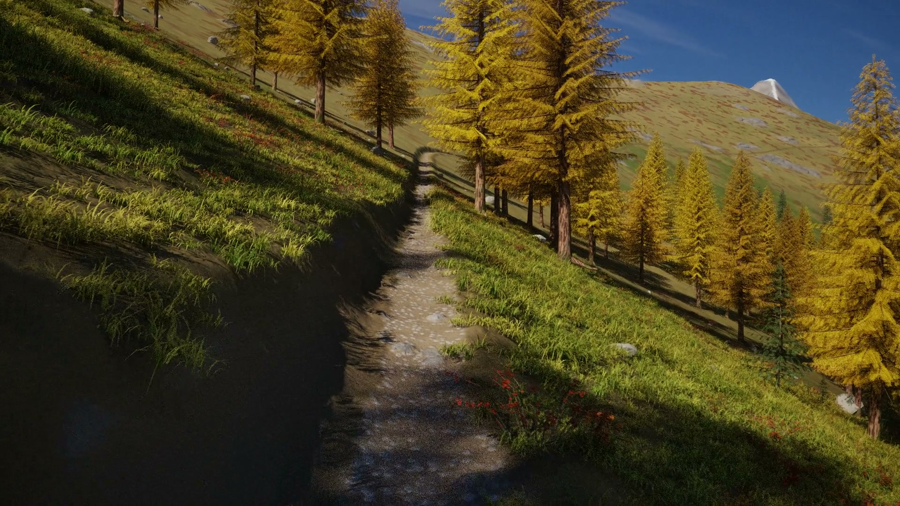

# 山行：第一人称登山短片，完全由代码计算

[English](README.md) | 中文

[](https://github.com/BubbleBrainBB/awesome-fable-5.2/releases/download/mountain-hike-v1.0/mountain_hike.mp4)

镜头就是登山者的眼睛：从海拔 1600 m 的云杉林出发，过溪上的木桥，穿过晨雾里的林子，走出金色的落叶松林线，
经草甸、鞍部、带薄雪的岩脊，傍晚站上 2488 m 的峰顶，脚下是云海。

没有用任何 AI 生图/生视频/生音乐模型、照片、贴图、模型、HDRI、音效或采样音色，也没有用 Blender、游戏引擎、现成渲染器或光追库，没有用任何 skill。
画面全部由 `src/` 里自己写的引擎渲染；配乐和环境声全部由 `src/audio/synth.py` 合成。
**唯一的例外是英文旁白**：7 句话用 `edge-tts`（联网的神经网络语音合成服务）生成，文本是自己写的。

代码由 AI 模型 Claude（`claude-fable-5-2`）在 Claude Code 里编写，画面和声音（旁白除外）由这些代码计算得出。

| 项目 | 值 |
|---|---|
| 成片 | [`mountain_hike.mp4`](https://github.com/BubbleBrainBB/awesome-fable-5.2/releases/download/mountain-hike-v1.0/mountain_hike.mp4)（超过 GitHub 单文件上限，放在 Release 附件里；封面 `preview.jpg` 是第 1150 帧），1920×1080，30 fps，95.0 s（2850 帧），8 个镜头，H.264 High yuv420p（BT.709）+ AAC-LC 48 kHz 立体声；384 MB，约 32 Mbps（画面带颗粒和噪点，码率给得比较足） |
| 联系表 | [`contact_sheet.jpg`](contact_sheet.jpg)（每 2 秒一帧，48 格） |
| 源码 | `src/`（约 3000 行：C++/Objective-C++ 主程序、Metal 着色器、Python 音频/剪辑/质检） |
| 一键重建 | `./render.sh`（固定随机种子，逐镜头可断点续渲；旁白一步需要联网） |
| 质检报告 | [`qc_film.txt`](qc_film.txt)、[`qc_verify.txt`](qc_verify.txt)、[`audio_report.txt`](audio_report.txt)、[`audio_spectrogram.png`](audio_spectrogram.png) |

## 路线与分镜

世界是一块 30.7 km 见方的山地（外加 98 km 见方的远山）。小径全长 6.4 km、爬升约 890 m，由寻路算法在地形上找出来（带之字形折返）。
片子不是一镜到底——真实步行 95 秒只能走一百来米——而是像徒步 vlog 一样，沿同一条路剪了 8 段，太阳也跟着走了一整天：

| # | 片内时间 | 镜头 | 小径里程 / 海拔 | 太阳（高度角） | 看到什么 |
|---|---|---|---|---|---|
| 0 | 0–12 s | forest | 0.26 km / 1620 m | 上午 27° | 顺光的云杉林，苔藓地面、树根、蕨，林间光斑 |
| 1 | 12–23 s | stream | 1.10 km / 1714 m | 30° | 下到溪边，走上木板桥，转头看上游：卵石、白水、水面反光、薄雾 |
| 2 | 23–34 s | shafts | 1.41 km / 1771 m | 33° | 逆光的雾林，抬头看树冠间的光柱 |
| 3 | 34–45 s | treeline | 3.12 km / 2041 m | 38° | 走出林线，金黄的落叶松、半挖式山径 |
| 4 | 45–54 s | meadow | 3.88 km / 2137 m | 正午 42° | 横切草坡，转头看整面落叶松林坡 |
| 5 | 54–65 s | saddle | 4.98 km / 2211 m | 35° | 草甸鞍部，正对岩峰，山谷里的云海 |
| 6 | 65–75 s | ridge | 6.23 km / 2449 m | 21°（背阴） | 落着薄雪的碎岩山脊，转头俯瞰群山和云海 |
| 7 | 75–95 s | summit | 6.43 km / 2488 m | 傍晚 5.5° | 最后几步登顶，停下，200° 环顾：落日、云海、主峰，淡出 |

季节定在十月（落叶松变黄、高处新雪、低地全天逆温云海），这样沿途的颜色随海拔有层次。

## 引擎结构（`src/`，约 3000 行，全部新写）

| 文件 | 做什么 |
|---|---|
| `terrain_gen.cpp` | **地貌演化模型**：抬升场 + 隐式河流下切（stream-power，优先队列填洼 + 随机 Rho8 流向）+ 各向同性临界坡度崩塌（eikonal 快速扫描）+ 坡面蠕移，256²→4096² 逐级求解。山脊、沟谷、水系是"长"出来的，不是噪声叠出来的 |
| `shared.h` | 主机 C++ 与 Metal 着色器**共用**的代码：整数哈希噪声、岩石节理碎块、生态分带（林线/草甸/碎石/雪线）、远景树位——保证 CPU 摆放的东西和 GPU 画的地面永远对得上 |
| `terrain.h` | 精确地面函数、选线（带"转向代价"的方向感知 Dijkstra，所以有长横切和之字折返）、半挖式路基、溪道开凿、每个镜头烘焙两级局部高度图（6.25 cm 和 1 m） |
| `flora.h` | 程序化网格：云杉/落叶松（主干、轮生枝、下垂小枝，针叶是按真实尺寸解析计算透明度的小枝片）、草丛、越橘灌丛、蕨、岩块（随机凸多面体 + 噪声 + 折痕法线）、倒木、木桥 |
| `bvh.h` | 自写的分箱 SAH BVH，两级结构（网格 BLAS + 实例 TLAS），每个镜头 2–46 万个实例 |
| `shader.metal` | 渲染器本体（Metal 计算着色器）：高度场光线步进 + BVH 遍历；太阳阴影光线（有太阳圆面的半影）；一次漫反射弹射；叶片透射；晨雾单次散射（对太阳做阴影光线，所以有光柱）；云海体积云；卷云；溪水（流向图波纹、白沫、菲涅耳反射 + 透视河床） |
| `atmos.h` | CPU 上每个镜头算一次的物理天空：瑞利 + 米氏 + 臭氧，透射率表 + Hillaire 多重散射表；着色器里用它做随距离的大气透视 |
| `camera.h` | 行走相机：眼高 1.66 m，步频随坡度变化，每步的上下起伏/左右摆动/轻微滚转，缓慢的视线漂移、脚本化的转头、手持微抖；1/60 s 快门的运动模糊 |
| `post.h` | "相机"环节：测光式自动曝光（先低分辨率跑一遍测光，再带 0.9 s 滞后）、局部色调映射、泛光与逆光眩光/鬼影、暗角、胶片曲线、弱光降噪、颗粒、sRGB |
| `engine.mm` / `scene.h` | 宿主程序、8 个镜头的定义、植被与岩石的散布 |
| `audio/synth.py` | 全部声音：风（多频带阵风）、林间底噪、溪水（多带噪声 + 气泡音）、鸟鸣（调频啁啾）、按画面步点落下的脚步（腐殖土/碎石/雪/木板）、配乐（锯齿波叠加的 pad、加法合成的"毡锤钢琴"、FM 钟音、卷积混响） |
| `audio/narration.py` | edge-tts 旁白（`en-GB-RyanNeural`） |
| `pipeline/`、`tools/` | 剪辑表、混流（可用单帧 PNG 替换片段里的帧）、联系表、质检、频谱图 |

几个为"像真的"专门做的事：

- **精度**：世界坐标有一万多米，float 精度只有毫米级，近处地面会出噪点。着色器改用以镜头为原点的相对坐标，高度贴图也存相对高度。
- **细节层级一致**：二次光线使用和主光线相同的地形细节层级，否则阴影和天光会被"另一个版本的地面"挡住。
- **远近三层**：近处（约 50 m 内）是真的草叶/灌木/岩块网格；中景到 0.3–2.6 km 是逐棵实例化的树；更远是同一套树位生成的林冠高度场，再远是平滑林冠。
- **风**：草和灌木按实例做剪切变形（对光线做逆剪切），有阵风相位。

## 音乐与旁白

- 配乐 D 大调，约 66 bpm 的自由节拍：林中是低暗的 Bm(add9) 长音，出林线时和声变亮（D→A/C♯），岩脊上退成 Em7 的悬置，登顶停步、镜头转向落日的那一刻（峰顶镜头第 9.5 秒）解决到 D(add9) 并加入钟音。
- 环境声和画面对应：林里几乎无风、有鸟；林线以上风逐段变大；岩脊和峰顶脚下是雪的"嘎吱"声；桥上是木板的空响，溪水声在桥中间最大。脚步时间直接来自渲染器的步态相位。
- 旁白 7 句，每句对应一个镜头的内容，旁白期间音乐压低 5 dB。若 `edge-tts` 不可用，`render.sh` 会跳过旁白继续出片。
- 整体响度归一到 −17 LUFS，软限幅在 −1.5 dBFS。

## 重现

```bash
./render.sh
```

依赖：macOS + Apple Silicon（Metal）、Xcode 命令行工具里的 `clang++`、`ffmpeg`、Python 3（numpy、scipy、Pillow）。旁白这一步需要联网（会在 `work/venv` 里装 `edge-tts`）。
所有随机数都有固定种子；地形高度图 `fine.bin` 在本机重跑是逐字节一致的（核对过）。全流程约 6 小时，其中渲染约 5.6 小时；`render_one.sh` 逐镜头可断点续渲（**不要在它运行时修改它**，见下）。
`st.sh`、`pv.sh` 是开发时出预览图的小工具，重建用不到。

需要说明的一点：小径中心线 `src/data/trail_line.bin` 是 `engine route` 在调参过程中的一版地形上找出来、之后**冻结**的（100 KB 的坐标表，同样是代码生成的，不是手绘）。
最终地形上重新寻路会得到另一条路（已试过，差几百米），镜头就都对不上了，所以 `render.sh` 用冻结的线、只把路面高度重新贴合到最终地形（`engine rebed`）。

## 本次成片的渲染统计（M4 Max，一次只跑一个 GPU 任务）

| 镜头 | 帧数 | 每像素采样 | 实例数 | 每帧耗时 | 合计 |
|---|---|---|---|---|---|
| 0 forest | 360 | 16 | 2.2 万 | 9.3 s | 56 min |
| 1 stream | 330 | 16 | 2.1 万 | 10.8 s | 59 min |
| 2 shafts | 330 | 20 | 2.2 万 | 14.4 s | 79 min |
| 3 treeline | 330 | 16 | 7.6 万 | 约 6.4 s | 约 35 min |
| 4 meadow | 270 | 20 | 12.6 万 | 6.3 s | 28 min |
| 5 saddle | 330 | 20 | 10.5 万 | 4.7 s | 26 min |
| 6 ridge | 300 | 24 | 29.8 万 | 4.4 s | 22 min |
| 7 summit | 600 | 24 | 45.8 万 | 3.2 s | 32 min |

共 2850 帧，纯渲染约 5.6 小时（不含测光预渲、编码）。林子里的镜头最慢：针叶是带透明度的小枝片，光线要穿过很多层，再加上雾的体积采样。
（林线镜头的渲染日志被我自己误删了——见下面"过程中出的岔子"——它的每帧耗时是渲染中途看进度时记下的。）

### 本次成片和"从零跑一遍 `render.sh`"不完全一样的地方

渲完六个镜头后做跳帧检查，发现相机代码有两个毛病，都已在 `src/camera.h` 里修掉：

1. **每个镜头的第 0 帧是糊的**。步态幅度由"行走速度"决定，而速度用前后各 0.05 s 的里程差来算，在 t=0 处取不到"之前"的里程，速度被算成一半，快门时间内俯仰角突变约 1.2°。
2. **峰顶停步的那一秒半，抬头是一顿一顿的**。里程用单精度浮点累加，在 6 km 处每 1/240 s 的步进被舍入，实际速度只能取 0.12 m/s 一级的台阶；减速时每跨一级，头就点一下（约 0.7°，每秒 6 次）。

修法是让步态幅度直接用"设定速度"而不是里程差。对比修复前后每一帧的相机位姿（`engine shot N --camdump`）：变化的只有**每个镜头的第 0 帧**和**峰顶镜头第 222–266 帧**，其余帧位置差 < 1 mm、角度差 < 0.01°。所以没有整段重渲，而是：

- 镜头 0、2、4、5、6、7 用修复前的程序渲染，之后用修复后的程序重渲上述帧（共 51 帧），混流时替换进去（`src/pipeline/patch_frames.sh` → `work/patch/`，`concat_video.py` 负责替换）；
- 镜头 3 在编码前重渲了第 0 帧；镜头 1 整段用修复后的程序渲染。

从零重跑会直接得到修复后的画面，但测光预渲的第 0 帧读数会略有不同，每个镜头开头约 1 秒的曝光可能和本片差 0.1 档以内。**这一点是推算，没有实际重跑验证。**

同一个浮点问题还有一个**没有修**的后果：鞍部、岩脊、峰顶三个镜头里，前进速度在 0.94 和 1.06 m/s 两档之间切换（低处的镜头台阶小得多）。修它会改变这三个镜头每一帧的机位，需要全部重渲，没有做。

### 过程中出的岔子

- 最初两个渲染队列同时跑，总耗时反而是串行的三倍左右，改成一次一个。
- 林线镜头渲染期间我修改了正在运行的 `render_one.sh`（bash 是边读边执行的），脚本在 330 帧全部渲完之后读到错位的一行而中断，并清空了这个镜头的日志。帧本身完好（数量核对过），编码是随后手动按同样的命令做的。

## 已知不足（如实）

先说结论：这是一段"看得出是渲染的"山景，离"以假乱真"还有明显距离。远景和光线比较站得住，中近景的地表和岩石是弱项。

画面：

- **山体形状单一**。地形来自"临界坡度"式的侵蚀模型，坡面几乎全是 30° 左右的直坡，缺少真实高山的陡崖、冰斗、阶地和岩层；远处那座金字塔形的主峰尤其像纸折的。
- **岩壁像泥塑**。鞍部正对的岩峰（镜头 5）表面是平滑曲面加细条纹，没有真实岩壁的节理块体和明暗破碎；高度场画不出悬垂和真正的竖直面，近看有拉伸。
- **中景草坡发平**。草甸、鞍部远一点的坡面颜色均匀，上面的浅色斑块像贴上去的；只有约 50 m 内是真的草叶网格，过渡处密度变化看得出来。
- **岩脊和峰顶的碎石过于规整**。石块是"节理碎块"函数生成的，棱角和大小太一致，像铺的石板；路面在其中是一条过于干净的带子。
- **云海边缘偏硬**，贴着山体的地方像切出来的；云顶起伏也偏规则。
- **林子里偏暗、偏噪**。森林三个镜头每像素只有 16–20 个样本，靠降噪和颗粒遮盖，暗部仍有噪点和涂抹感；雾林镜头整体偏蓝灰。落叶松针叶用随机透明度，转头时会闪烁。
- **溪水**：水潭太平，跌水的边缘是直的，卵石像石板；白沫是着色出来的，不是真的水花。
- **植被种类少**：云杉、落叶松各一套参数化模型（若干变体），草、越橘、蕨各一种，重复感明显；没有枯枝落叶层的真实杂乱。
- **没有"人"**：看不到手、登山杖、自己的影子（镜头 0 地上那条长影子是树干的），也没有呼吸的白气。
- **剪辑只有硬切**，8 段之间时间和海拔跳得比较大；首尾各有一个淡入淡出。
- **运动**：步态是正弦叠加噪声，比真人头部运动规整；上面说的速度两档切换也在其中。

声音（只能从波形、响度和频谱判断，见下节）：

- 配乐是很简单的长音铺底加稀疏的钢琴、钟音，谈不上作曲；合成的"钢琴"听起来大概更像电钢琴。
- 鸟鸣、溪水、风、脚步都是噪声和调频合成的，真实感有限；脚步的落点来自画面步态，但音色只有五种地面。
- 旁白第一句说 "First light"，而画面里太阳已经有 27° 高，严格说是上午而不是破晓。

## 没有验证过的

- **我听不到声音**。音频只做了客观检查：响度、峰值、有无削波、各段能量与镜头是否对应、旁白时段音乐是否压低、频谱图目测。音色好不好听、旁白与音乐的平衡是否舒服、edge-tts 的发音和语气是否自然，都没有人耳确认。
- **我没有连续播放过成片**。画面只看过抽帧（联系表、关键帧 100% 局部、若干连续帧）和数值检查（逐帧跳变检测、相邻帧位移）。步态的观感、是否晕、运动模糊是否合适、风吹草动是否自然、闪烁是否扰人，都没有以"看视频"的方式确认。
- **`render.sh` 没有从头到尾完整跑过**。它的每一步都单独跑过（编译、地形生成并核对逐字节一致、贴路面、逐镜头渲染、旁白、混流、质检），但整条链没有在干净目录里一次跑通；上面说的"开头 1 秒曝光差异"也是推算。
- **只在这一台机器上跑过**（Apple Silicon / Metal）。别的 GPU、别的 macOS 版本没有试。
- "风随海拔变大"这类环境声的层次，客观数据没能证实（见下节音频一条）。
- 坏帧检查的覆盖范围见下。

## 质检结果

用 `src/tools/qc.py` 和 ffmpeg 做的客观检查，结果如下（原始输出在本目录的 `qc_film.txt`、`qc_verify.txt`）：

- **规格**：H.264 High / yuv420p / 1920×1080 / 30 fps / 2850 帧；AAC-LC 48 kHz 立体声 256 kbps；时长 95.000 s；色彩标记 BT.709 有限范围；faststart。整片（视频 + 音频）完整解码无报错。
- **逐帧检查（全部 2850 帧）**：淡入淡出以外没有黑帧；没有冻结帧；剪辑点以外没有大块亮度突变。修复前这项检查在岩脊、峰顶两个镜头的首帧报过 19–24 级的跳变，就是上面说的第 0 帧问题；修复并替换后不再报。
- **渲染时的自检（每一帧）**：累加缓冲的 alpha 通道记录每个像素实际收到的样本数，有任何像素缺样本就不写出该帧并重试。各镜头日志里失败帧为 0（林线镜头的日志丢了，无法核对这一条，但它通过了上一项和下一项检查）。
- **独立重渲对比（抽查）**：每个镜头每秒留一帧（第 15、45、75…帧，共 95 帧），用 480×270、12 样本独立重渲，把成片帧缩小后按 16×9 分块比较均值。最大差 8.2/255（阈值 16），没有被标记的帧。**这只覆盖 1/30 的帧**；其余帧靠前两项。
- **补帧衔接**：峰顶镜头替换区间（成片第 2472–2516 帧）前后相邻帧的平均亮度连续，逐帧画面位移从"动 3 帧停 2 帧"变成了均匀变化。
- **联系表**：48 格逐格看过，没有黑格、花屏、缺块或错位的镜头。
- **音频**：整体响度 −17.0 LUFS，真峰值 −1.6 dBFS，削波样本 0，响度范围 6 LU。7 句旁白都落在各自镜头之内（最晚一句在 90.8 s 结束，片长 95 s）。频谱图（`audio_spectrogram.png`）上能对上的：溪流段（12–23 s）是一片宽带噪声；林中镜头高频有鸟鸣的短促亮线；300 Hz–3 kHz 的能量从林中的 −26 dB 逐段升到峰顶的 −21 dB（配乐逐段加厚）。**对不上的**：设计上风声应随海拔逐段变大，但 40–300 Hz 的能量各镜头差不多（−26 到 −28 dB），草甸段反而最低（−32 dB）——风声被配乐的低音盖在同一频段里，从数字上无法证实它确实在变大。
