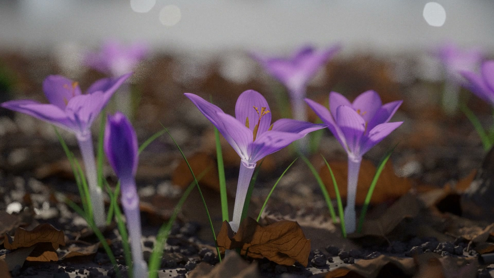

# Spring Awakening: a nature short from winter woodland to spring meadow, computed entirely by code

English | [中文](README.zh-CN.md)

[](https://github.com/BubbleBrainBB/awesome-fable-5.2/releases/download/spring-awakening-v1.0/spring_awakening_v2.mp4)

A 93-second nature short in thirteen shots. It opens on a snow-covered woodland and ends on the same woodland as a spring meadow: icicles thaw, a drop falls, the snow draws back, crocuses open, a seed breaks the soil, a fern unrolls, beech buds split, a ladybird climbs a grass stem and flies, rain falls on the new leaves, and a snail sets out.

Every pixel is computed by the renderer in `src/`, which was written for this film. No AI image, video or music generation, no photos, textures, models, HDRIs, font files or sound packs, no Blender, game engine, off-the-shelf renderer or ray-intersection library were used. No agent skill was used.
**The exceptions are the narration and a few library calls**, listed in full under [Third-party software](#third-party-software-an-honest-list): the English voice comes from `edge-tts`, the Mandarin voice from Seed Audio (both online text-to-speech services), and the lens-glow blur in every frame calls scipy's Gaussian filter.

The code was written by Claude, an AI model (`claude-fable-5-2`), in Claude Code; the picture and the sound (apart from the narration) were computed by that code.

There are two published editions with the same picture:

| Edition | Film | Narration |
|---|---|---|
| English | [`spring_awakening_v2.mp4`](https://github.com/BubbleBrainBB/awesome-fable-5.2/releases/download/spring-awakening-v1.0/spring_awakening_v2.mp4) (387.5 MB) | English, `edge-tts`, with an English soft-subtitle track |
| Taiwanese Mandarin | [`spring_awakening_v2_zh_tw.mp4`](https://github.com/BubbleBrainBB/awesome-fable-5.2/releases/download/spring-awakening-v1.0/spring_awakening_v2_zh_tw.mp4) (387.5 MB) | Mandarin in a soft Taiwanese female voice, Seed Audio, with a Simplified Chinese soft-subtitle track |

The files carry `v2` in their names because this is the second cut. The first cut had beech leaves passing through the twig in the bud and rain shots; it is not published (see [round 5](#iteration-log)).

| Item | Value |
|---|---|
| Films | Above GitHub's per-file limit, so they are attached to a release. 1920×1080, 24 fps, 93.000 s (2232 frames), 13 shots, H.264 High yuv420p + AAC 48 kHz stereo, one soft-subtitle track each (not burnt in); about 33 Mbps. The cover `preview.jpg` is frame 744 |
| Subtitles | [`narration.srt`](narration.srt) (English), [`narration_zh_tw.srt`](narration_zh_tw.srt) (Simplified Chinese) |
| Contact sheet | [`contact_sheet_v2.jpg`](contact_sheet_v2.jpg) (48 frames; the timecode digits are drawn by the code as seven-segment figures) |
| QC reports | [`qc_report_v2.txt`](qc_report_v2.txt), [`qc_report_v2_zh_tw.txt`](qc_report_v2_zh_tw.txt) |
| Source | `src/` (about 4700 lines: Objective-C++ host, C++ scene headers, Metal kernel, Python for developing, audio, muxing and QC), `render.sh`, `build.sh`, `dev.sh` |
| One-command rebuild | `./render.sh` (fixed random seeds, resumable in 48-frame segments; the narration step needs the network) |

## Shot list

| # | Time | Shot | Length | Picture | Camera | Samples per pixel |
|---|---|---|---|---|---|---|
| 1 | 0:00.0 | winter | 7.5 s | A winter woodland: snow, spruces carrying snow, bare branches, thin cold mist | Wide, a slow push in, fades in | 40 |
| 2 | 0:07.5 | icicles | 6.0 s | A row of icicles under a branch; the sun comes in; polygonal bokeh behind | Long macro, shallow depth of field | 80 |
| 3 | 0:13.5 | drop | 4.5 s | A drop gathers at the tip of an icicle, stretches and falls; the woodland is upside down inside it | Macro, high-speed (about 1/30 speed) | 128 |
| 4 | 0:18.0 | thaw | 7.0 s | The forest floor: the snow retreats in time-lapse and uncovers leaf litter, mossy stones and crocus shoots | High angle, time-lapse | 56 |
| 5 | 0:25.0 | crocus | 7.5 s | Crocuses open through the last of the snow | Ground level, time-lapse, shallow depth of field | 56 |
| 6 | 0:32.5 | seedling | 9.5 s | A seed breaks the soil: the hook pushes the crumbs aside, the seed leaves open, the seedling circles for light | Ground-level macro, time-lapse (with frame-to-frame jitter and passing cloud shadow) | 72 |
| 7 | 0:42.0 | fern | 7.5 s | A fern's fiddleheads unroll into fronds, lit from behind | Low angle, time-lapse | 64 |
| 8 | 0:49.5 | bud | 7.5 s | Bud scales split on a twig and downy new leaves stretch out | Long lens, time-lapse, bokeh background | 112 |
| 9 | 0:57.0 | ladybird | 8.0 s | A seven-spot ladybird climbs a grass stem hung with water drops | Macro from the side, real time, follow focus | 112 |
| 10 | 1:05.0 | takeoff | 4.0 s | The wing cases open, the hind wings unfold, and it flies out of frame | Macro, slow motion (about 1/25 speed) | 128 |
| 11 | 1:09.0 | rain | 7.0 s | The same twig, now in leaf; spring rain falls and drops hang on the leaves | Long lens, rain streaks, cool grey background | 96 |
| 12 | 1:16.0 | snail | 7.0 s | After the rain a banded snail glides along a mossy branch, feeling ahead with its tentacles | Macro from the side, real time | 80 |
| 13 | 1:23.0 | spring | 10.0 s | The woodland of the opening shot: grass, wild flowers, shafts of light in the morning mist | Wide, a slow push in, fades out | 32 |

2232 frames in all.

## Narration

### English (`src/narration.py`)

Voice: `edge-tts`, `en-GB-ThomasNeural`, rate −10 %. Only the sentences below, the voice name and the rate were sent to the service. The macOS `say` fallback in `tts.py` was not used.

1. For months, the forest has held its breath.
2. Then, one morning, the sun returns with warmth in it.
3. And the ice begins to let go.
4. Day by day, the snow draws back from the ground it has kept hidden.
5. The first flowers do not wait for it to leave.
6. Under the soil, a seed has felt the change. All it has saved goes into a single push toward the light.
7. Ferns unroll, each frond packed tight since last year.
8. On the branches, buds made last summer split open, and the wood turns green.
9. A ladybird that slept through the winter among the dead leaves climbs toward the sun.
10. Then the rain comes. And it is no longer cold.
11. Now even the slowest are on the move.
12. None of this is new. It was all here, under the snow, waiting.

The take-off shot has no narration, only the wings. Every line sits inside its own shot.

### Taiwanese Mandarin (`src/narration_zh.py`)

This is not a translation of the English script. It was rewritten in the voice of a soft-spoken young Taiwanese woman, with sentence-final particles (喔, 耶, 呢, 啰). Traditional characters were sent to the service; the subtitles are in Simplified Chinese:

1. 整个冬天，森林都静悄悄的，好像在憋气一样喔。
2. 直到有一天早上，太阳变得暖暖的。
3. 冰，就开始融化了耶。
4. 雪一天一天退开，把藏了好久的土地露出来。
5. 最早的小花才不要等呢，雪还没走，就自己开了。
6. 泥土下面，种子也感觉到了喔。它把存了好久的力气，全部拿来往上一顶。
7. 蕨类把去年就卷好的叶子，一圈一圈慢慢打开。
8. 去年夏天就准备好的芽裂开了，树枝一下子变绿了耶。
9. 睡了一整个冬天的瓢虫也醒来啰，朝着太阳慢慢往上爬。
10. 然后，下雨了。可是已经不冷了喔。
11. 你看，连最慢的小家伙，也出门了呢。
12. 其实呀，它们一直都在，在雪下面，等春天来。

The voice comes from ByteDance's Seed Audio (`seed-audio-1.0`). The model has no preset voices; a "director's script" describes the speaker, the accent and the delivery (`DIRECTION` in `src/narration_zh.py`). How it was made:

- All twelve lines are read in one call (`src/tts_seed.py`), so the voice is the same from start to finish. Five takes were recorded and the fifth (`take_e`) was used.
- A local whisper transcript gives the time of every character; it is aligned to the script and the take is cut into twelve lines in the silences (`src/narr_zh_cut.py`). Pauses inside a line longer than 0.5 s are shortened to 0.5 s. The transcript differs from the script only in homophones (蕨/绝, 芽/牙, 瓢/嫖, 啰/了哦).
- In the first three takes the last line took 7.5 s at her pace and did not fit the closing shot, so it was shortened and recorded again.
- Only the director's script and the narration text were sent. The API key is read from the environment at run time and is not stored in this directory.

## How it works

### Renderer (`src/kernel.metal`, `src/main.mm`, `src/scene.h`)

- **Path tracing**: a complete path tracer in one Metal compute shader, compiled from source at run time. Metal's ray-tracing API is not used, and neither is any intersection library.
- **Acceleration structure**: a two-level BVH written for this film. Each mesh has its own BLAS (binned SAH; the leaves are triangles or capsule segments, which draw down and needles), and a TLAS over all instances is rebuilt every frame.
- **Camera**: thin-lens depth of field, a polygonal aperture, cat's-eye bokeh towards the edges of the frame, brighter bokeh rims. Instance-level motion blur (the matrices at the two ends of the shutter are interpolated).
- **Bokeh layer**: small bright points in the background never converge with Monte Carlo sampling, so the host hands the shader a list of point lights and the shader spreads each one analytically into a disc with the same lens model, with shadow rays for occlusion. Background bokeh, highlights on drops, glints on snow and drops after rain all use it.
- **Materials**: diffuse + GGX clear coat + diffuse transmission (leaves glow when backlit); dielectrics (water and ice, with Beer absorption; the first two events on the camera path trace both reflection and refraction); thin films (wings, rain streaks). Eighteen procedural textures are written with noise and analytic functions in `src/patterns.metal`: soil, leaf veins, petals, stems, snow, ice, bark, wing veins, wing-case spots, snail shell, snail skin and others.
- **Atmosphere**: single scattering in exponential height fog, stratified. The in-scattered light is accumulated in a separate buffer and blurred on the host before it is added back, which keeps the light shafts from flickering.
- **Environment**: three procedural skies and backdrops (a gradient sky, a mottled distance, a woodland distance with trunk stripes).
- **Validation**: before a frame is written, every pixel's sample count is checked; a frame that falls short is rendered again (up to three times). The final render needed no retries.

### Geometry (`src/geom.h`, `src/plants.h`, the `src/shot_*.h` files)

- **Plants**: one general "blade" generator (midrib curl, fold, cup, twist, pleats, serration, thickness) produces leaves, petals, seed leaves and bud scales. Tubes, surfaces of revolution, ellipsoids and stem hairs complete the kit.
- **Ground**: a soil kit (a base surface plus instanced crumbs), a leaf-litter kit and a moss kit.
- **Time-lapse growth**: the seedling's circling, the frame-to-frame jitter and the cloud shadow imitate real time-lapse footage.
- **Trees**: recursive generators for a deciduous tree and a spruce. The meadow is instanced turf tiles with gusts moving across them.
- **Ladybird** (`src/ladybird.h`): rigid parts, an alternating tripod gait, two-bone leg IK with a check for knee flips.
- **Snail** (`src/shot_snail.h`): a logarithmic-spiral shell, a soft body rebuilt every frame, tentacles that extend and retract.

### Developing and assembly (`src/develop.py`, `src/encode.py`, `src/assemble.py`, `src/grade.py`)

- The renderer writes linear floating-point frames. Python applies exposure and white balance, firefly removal, lens glow, vignette, a film curve and sRGB.
- Every 48 frames are stored as a near-lossless segment (x264 crf 9, 4:4:4 10-bit), so the render can be stopped and resumed, and a single shot can be rendered again.
- Assembly adds the fades and film grain generated by the code, then encodes and muxes the sound and the subtitle track.
- In the film itself ffmpeg only encodes and muxes (no `-vf` or `-af` filters). Outside the film, the contact sheet and the QC use it to extract frames and scale them down.

### Sound (`src/audio.py`, `src/tts.py`, `src/narration.py`)

- Everything except the narration is synthesised with numpy and scipy: wind, dripping icicles, meltwater, rain, wing beats, birdsong (tits, chiffchaff, blackbird, robin, cuckoo, a woodpecker drumming), a pad of chords with bells, and a reverb impulse generated by the code.
- Loudness is measured with an own implementation of BS.1770, with a look-ahead limiter. The background ducks under the narration.

### Third-party software (an honest list)

No assets, models, textures, fonts, sound packs, off-the-shelf renderers, intersection libraries, generated images or skills were used. But "nothing external apart from the narration" would not be true. These parts were not written here:

| Software | Where it is used | In the film? |
| --- | --- | --- |
| Apple Metal, clang, the C++ standard library | Run the shader written here on the GPU. Metal's ray-tracing API, MPS and texture sampling are not used | Yes (runtime) |
| numpy | Array maths, random numbers, FFT | Yes |
| **scipy.ndimage `gaussian_filter`, `zoom`** | The blur and upscale of the lens glow and halation (`develop.py`); a slight softening of the film grain (`assemble.py`) | **Yes, every frame** |
| scipy.signal `butter`, `sosfilt`, `fftconvolve`, `lfilter`, `resample_poly` and others | Filtering in the sound synthesis, reverb convolution (the impulse is generated here), loudness and true-peak measurement, the limiter envelope | Yes (sound) |
| edge-tts (and its dependencies, installed in `work/venv`) | English narration | Yes (sound) |
| Seed Audio (`seed-audio-1.0`, ByteDance OpenSpeech, called with requests) | Mandarin narration | Yes (the sound of the Mandarin edition only) |
| whisper (run locally, offline) | Transcribes the Mandarin take, to check the words and find where to cut | No |
| ffmpeg (libx264, AAC, mov_text) | Encoding, muxing, decoding the narration mp3 to wav | Yes (encoding) |
| ffmpeg `scale` | Thumbnails for the contact sheet and small frames for QC | No |
| Pillow | Only writes JPEGs (key frames, contact sheet); it draws nothing and sets no type | No |

The closest thing to a ready-made filter is scipy's Gaussian blur: the design of the glow (three blurred layers, halation, strengths) is from here, but the blur itself is a library call. The blur of the fog buffer is in the renderer's host and was written here.

## Iteration log

**Round 1: single-shot stills (many small renders of each shot)**

- Engine: closed meshes were wound the wrong way, so drops were treated as bubbles; the bokeh discs were 1000 times too dim, then noisy from position jitter; the background noise looked blocky. Fixed one by one.
- Drop: it looked like a ball stuck on a pipe. The profile was rewritten (a teardrop with a thin neck), the initial velocity removed, and the fall slowed.
- Fern: stumps of old stalks looked like a spider and were removed; the pinnae were too wide; the unrolling was too fast.
- Bud: the twig looked like a cable (bark texture and bends at the nodes were added); the scales looked like claws; the leaves opened towards the camera.
- Wide shots: the light shafts were noisy (changed to stratified sampling and a separately blurred fog buffer); a frame of the spring shot was too slow (fewer trees, instanced turf tiles; down to about 14 s a frame).

**Round 2: creature tests (stills and motion strips)**

- Ladybird: at first only its back was visible, so the shot became a side view of the stem. The wing cases opened the wrong way and it flew upside down; both fixed. The climb now ends at the tip of the stem. Passed.
- Snail: the shell looked like a flat ammonite and the body like a stone. Changed to a globular shell, a round head and thin tentacles. A marginal pass, noted as the weakest creature.

**Round 3: a low-resolution moving storyboard of the whole film (480×270)**

- The seed line is 8.2 s long and did not fit an 8-second shot; the shot was lengthened to 9.5 s.
- The end of the drop shot was empty; the timing of the gathering and the fall was adjusted.
- The music covered the narration; the parts were rebalanced.

**Round 4: review of the film after the final render**

- The background refracted in the drop was blocky camouflage, not a woodland. The backdrop pattern for this shot was enlarged and simplified, and the shot rendered again.
- Snail: in the film the mouth of the shell was a flat cut and the skin looked like paving. The mouth was sunk into the body and plugged with a mantle, the head and neck reach forward and down, the tentacles bend and carry eye spots, and the skin texture is finer. Rendered again.
- Take-off: QC flagged five single-frame jumps. The slow-motion factor was not slow enough (8.5 wing beats per second on screen), so motion blur wiped the wings out in most frames and they flashed sharp for one frame at the ends of the stroke. The beat was slowed to 3.4 per second (about 1/25 speed, which also agrees better with the body's acceleration), and the highlight that turned the whole wing white was lowered. Rendered again, with the wing sound slowed to match.
- Grain and bit rate: in the first assembly the film grain looked like high-ISO noise at 100 %, at 88 Mbps and 1 GB. The grain was halved and the encode changed to crf 20 with a capped peak bit rate.

**Round 5: feedback after viewing (the second cut)**

A viewer of the first cut reported that leaves passed through other things in several places and that the leaves folding down looked unnatural. Checked shot by shot, the problem was in the bud and rain shots (the same beech twig); no leaf intersections were found in the other shots.

- Why they intersected: the leaf directions were split left and right of the bud axis within the picture plane, so half of the leaves pointed straight at the twig, and passed through the middle of it as soon as they drooped. Now the leaves head alternately in front of and behind the plane of the twig, and slightly away from it; the leaves of one shoot fan out by height, so two leaves on the same side do not cross.
- Why the droop looked unnatural: the whole leaf rotated rigidly about the base of its stalk, and the stalk was a straight rod. Now the base of the blade stays within about 35° of horizontal and the droop is carried by a bend along the midrib; the stalk is a short curve that ends in the direction of the blade.
- A per-frame intersection check was written (`BUDCHECK=1`): it samples the leaves and scales and finds the nearest distances to the twig's centre line and to each other. Once the leaves have opened, no leaf intersects the twig or another leaf in either shot. While the leaves are still bundled inside the bud and pushing out, leaves and scales touch each other; that is ordinary contact and was left alone. The scales on the twig side no longer fold back through the twig.
- One mistake of my own in this round: when changing the scale length I put a `//` comment in the middle of a line with several statements, which commented out the width settings after it, and the scales rendered as crumpled paper balls. It was found when looking at the key frames of the re-render; that pass (about 18 minutes) was thrown away and rendered again.
- The two shots were rendered again: 348 frames, 13.3 minutes of GPU time, no retries. The other eleven shots are the segments of the first render.

## Render time (Apple M4 Max, 1920×1080)

| Shot | Frames | Per frame | Total |
|---|---|---|---|
| winter | 180 | 6.89 s (5.75–8.67) | 20.7 min |
| icicles | 144 | 3.34 s (2.87–3.69) | 8.0 min |
| drop | 108 | 0.63 s (0.47–1.53) | 1.1 min |
| thaw | 168 | 6.24 s (4.36–8.12) | 17.5 min |
| crocus | 180 | 7.36 s (5.68–9.94) | 22.1 min |
| seedling | 228 | 6.43 s (5.53–8.54) | 24.5 min |
| fern | 180 | 6.75 s (4.93–11.25) | 20.3 min |
| bud (second cut) | 180 | 1.65 s | 4.9 min |
| ladybird | 192 | 1.65 s (1.18–2.18) | 5.3 min |
| takeoff | 96 | 1.64 s (1.32–2.07) | 2.6 min |
| rain (second cut) | 168 | 2.99 s | 8.4 min |
| snail | 168 | 4.07 s (3.03–5.74) | 11.4 min |
| spring | 240 | 17.07 s (14.37–24.62) | 68.3 min |
| **Total** | 2232 | | **215.1 min** (GPU render time only) |

- The first final render took about 3 hours 37 minutes of wall time, including a 30-minute pause. The re-renders of the drop, snail and take-off shots took about 15 minutes more; the table shows the numbers after those re-renders. One frame of the seedling shot was rendered twice across the pause, so its log records 229 frames.
- Assembly takes about 4 minutes and QC about 4 minutes.
- Test renders during development (stills, motion strips, the low-resolution storyboard) were not timed separately.

## QC results

The same automatic checks were run on both published files (`spring_awakening_v2.mp4`, 387.5 MB, 33.34 Mbps; `spring_awakening_v2_zh_tw.mp4`, 387.5 MB, 33.33 Mbps):

- **Streams**: H.264 High, 1920×1080, yuv420p, 24 fps, 2232 frames, 93.000 s; AAC 48 kHz stereo; one mov_text subtitle track (language tag `chi` in the Mandarin edition). All as expected.
- **Full decode**: no errors.
- **Black and frozen frames**: none outside the fades.
- **Loudness**: English −16.09 LUFS, true peak −2.36 dBTP; Mandarin −16.03 LUFS, −2.49 dBTP (target −16 LUFS, ceiling −1 dBTP). No clipping.
- **Narration**: all twelve lines of each edition sit inside their shots. In the Mandarin edition the tightest are line 3 (starts 0.40 s after the cut) and line 7 (ends 0.69 s before the cut).
- **Render logs**: no retries and no errors.
- **Independent re-render comparison**: 26 frames; the largest block luminance difference is 16.3 (on 0–255), under the threshold of 28. The four frames from the bud and rain shots are between 6.0 and 9.4.
- **Single-frame jump detection** flags one frame, which was inspected and is ordinary motion: in frame 1608 the ladybird's hind wing sweeps across the grass stem. This is why the reports end with "ITEMS TO LOOK AT" and not with an all-passed line.

The full numbers are in the two reports. The "independent re-render" renders two frames of every shot again at 480×270 and 32 spp and compares their luminance block by block with the same frames of the film scaled down, to catch frames where the render went wrong.

## Known shortcomings

- **The snail is still the weakest part.** After the rework its outline holds, but the body is a smooth lump: there are no waves along the foot and none of the wet translucency of real snail skin.
- **Ladybird**: the tarsi are very simplified and the body does not rise and fall as it walks. The slow-motion take-off was designed from memory, not calibrated against footage.
- **The two wide shots are noisy** (32–40 spp): grain is visible in the snow and the mid-distance trees when enlarged. They are also the slowest shots.
- **There is residual noise in the blurred backgrounds**; the bright patches in the crocus and seedling shots look sandy, and the film grain hides part of it.
- **Plant growth in the time-lapse shots is procedural interpolation**, not a growth simulation. The pace of the crocus opening and the fern unrolling was set by eye.
- **At the end of the take-off shot** the stem is empty for about 0.7 s after the ladybird leaves the frame.
- **Motion blur is a linear interpolation per instance.** Fast rotating parts (the wings) are handled by slowing the action down, not by sub-frame sampling.
- **Sound**: the birdsong is a synthesised approximation, and someone who knows birds will hear that it is not real. The music is a simple pad of chords.
- **Bud and rain shots**: while the leaves are still inside the bud and pushing out, leaves and scales rest against each other without collision handling. One leaf of the bud above the twig hangs in front of the twig in the rain (there is a gap, it does not pass through), and from a distance it may still look as if it touches.
- **Mandarin narration**: the accent and the softness of the delivery depend entirely on how the model reads the director's script. I can check the words, the timing and the pitch (median about 246 Hz) but cannot hear the result.

## What is not on screen

- No birds or mammals (only synthesised birdsong): they could not be made convincing.
- Three planned shots were not made: a stream, wild geese, frogspawn.
- No bees (this repository has a separate bee film, [Bee Documentary](../bee-documentary/); its source was not consulted for this one).
- No people.

## Not verified

- **Nobody is known to have watched the second cut from start to finish.** The first cut was watched by one viewer, whose feedback led to round 5. The new leaves were checked on extracted frames and with the intersection check, not by watching their motion at 24 fps.
- **Nobody has listened to the Mandarin narration**: whether the accent is Taiwanese, whether the delivery is as soft as intended and whether every tone is right has not been confirmed by a human ear. The local transcript only shows that no word was misread, added or dropped.
- **The sound was balanced by measurement.** I cannot listen to it.
- **`render.sh` has not been run from an empty directory.** The films were made by resuming and by re-rendering single shots; the resume logic has been used for real, but the path from one command to the finished film has not been verified end to end. After the Seed Audio key was moved to an environment variable for publishing, `src/tts_seed.py` was not run again.
- **Anatomy and phenology are from memory**, not checked against references: that fern fiddleheads are formed the year before, that buds are formed the previous summer, that the seven-spot ladybird overwinters as an adult in leaf litter, that crocuses can flower through snow.
- **The subtitle tracks** were confirmed to exist with ffprobe but were not viewed in a player.

## Rebuilding

```bash
./render.sh
```

This compiles the renderer, renders every shot in 48-frame segments (finished segments are skipped), synthesises the sound, assembles the film, makes the contact sheet and runs QC. It needs macOS on Apple Silicon (Metal), clang++, Python 3 (numpy, scipy, Pillow) and ffmpeg; the narration step needs the network, and the script installs edge-tts in `work/venv`. All random seeds are fixed. The result is `spring_awakening_v2.mp4`.

The Mandarin edition uses the same picture:

```bash
VARIANT=zh REUSE_VIDEO=1 ./render.sh
```

It needs a Seed Audio API key in the environment variable `SEED_AUDIO_API_KEY`, the `requests` package and a local `whisper`. Every synthesis sounds different, so a rebuild will not reproduce the recording used in the published film.

```bash
./render.sh preview
```

renders a 480×270 moving storyboard into `work/preview/`.

Intermediate files (`work/`: segments, key frames, logs, narration audio, about 2.7 GB) are not in the repository.
