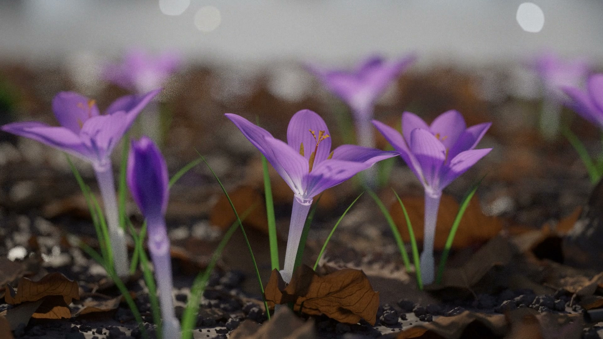

# 万物生：从冬日林地到春日草地的自然短片，完全由代码计算

[English](README.md) | 中文

[](https://github.com/BubbleBrainBB/awesome-fable-5.2/releases/download/spring-awakening-v1.0/spring_awakening_v2.mp4)

一部 93 秒、13 个镜头的自然短片：开场是积雪的冬日林地，结尾是同一片林地的春日草地。中间依次是冰凌消融、水滴坠落、积雪退去、番红花开放、种子破土、蕨展开、山毛榉的芽裂开、瓢虫爬上草茎起飞、春雨落在新叶上、蜗牛出门。

画面里的每个像素都由本目录 `src/` 下为这部片子写的渲染器算出来，没有用 AI 生图/生视频/生音乐，没有照片、贴图、模型、HDRI、字体文件或音效包，没有 Blender、游戏引擎、现成渲染器或求交库，也没有使用任何 skill。
**例外是旁白和少数几处库函数**，完整清单见下面的"用到的第三方软件"：英文配音来自 `edge-tts`，中文配音来自 Seed Audio（都是联网的语音合成服务），每一帧镜头光晕的模糊调用了 scipy 的高斯滤波。

代码由 Claude（模型 `claude-fable-5-2`）在 Claude Code 里编写，画面和声音（旁白除外）由这些代码计算得出。

发布了两个版本，画面相同：

| 版本 | 成片 | 旁白 |
|---|---|---|
| 英文版 | [`spring_awakening_v2.mp4`](https://github.com/BubbleBrainBB/awesome-fable-5.2/releases/download/spring-awakening-v1.0/spring_awakening_v2.mp4)（387.5 MB） | 英文，`edge-tts`，带英文软字幕轨 |
| 台湾腔版 | [`spring_awakening_v2_zh_tw.mp4`](https://github.com/BubbleBrainBB/awesome-fable-5.2/releases/download/spring-awakening-v1.0/spring_awakening_v2_zh_tw.mp4)（387.5 MB） | 中文，台湾腔女声，Seed Audio，带简体中文软字幕轨 |

文件名里带 `v2`，因为这是第二版。第一版的芽和春雨两个镜头里山毛榉叶片穿过了枝条，没有发布（见"迭代记录"第 5 轮）。

| 项目 | 说明 |
|---|---|
| 成片 | 超过 GitHub 的单文件上限，所以作为 Release 附件。1920×1080，24 fps，93.000 秒 / 2232 帧，13 个镜头，H.264 High / yuv420p，AAC 立体声 48 kHz，各带一条软字幕轨（未烧进画面），约 33 Mbps。封面 `preview.jpg` 是第 744 帧 |
| 字幕 | [`narration.srt`](narration.srt)（英文）、[`narration_zh_tw.srt`](narration_zh_tw.srt)（简体中文） |
| 联系表 | [`contact_sheet_v2.jpg`](contact_sheet_v2.jpg)（48 格，时间码也是自己画的七段数码） |
| 质检报告 | [`qc_report_v2.txt`](qc_report_v2.txt)、[`qc_report_v2_zh_tw.txt`](qc_report_v2_zh_tw.txt) |
| 源码 | `src/`（约 4700 行：Objective-C++ 宿主、C++ 场景头文件、Metal 内核，以及显影、声音、合成、质检用的 Python）、`render.sh`、`build.sh`、`dev.sh` |
| 一键重建 | `./render.sh`（随机种子固定，按 48 帧一段可续渲；旁白一步需要联网） |

## 分镜表

| # | 时间 | 镜头 | 时长 | 画面 | 镜头语言 | 每像素采样 |
|---|---|---|---|---|---|---|
| 1 | 0:00.0 | winter | 7.5 s | 冬日林地全景：积雪、挂雪的云杉、落叶树的枝桠、冷色薄雾 | 广角，缓慢前推，淡入 | 40 |
| 2 | 0:07.5 | icicles | 6.0 s | 枝下一排冰凌，阳光逐渐照进来，背景是多边形光斑 | 长焦微距，浅景深 | 80 |
| 3 | 0:13.5 | drop | 4.5 s | 冰凌尖端水滴凝聚、拉长、坠落，水滴里是倒置的林地 | 微距，高速摄影（约 1/30 速） | 128 |
| 4 | 0:18.0 | thaw | 7.0 s | 林地地面，积雪延时消退，露出落叶、苔石和番红花芽 | 俯角，延时 | 56 |
| 5 | 0:25.0 | crocus | 7.5 s | 番红花穿过残雪开放 | 贴地低机位，延时，浅景深 | 56 |
| 6 | 0:32.5 | seedling | 9.5 s | 种子破土：弯钩顶开土粒，子叶展开，幼苗绕圈找光 | 贴地微距，延时（带逐帧抖动和云影明暗） | 72 |
| 7 | 0:42.0 | fern | 7.5 s | 蕨的拳卷幼叶展开成羽片，逆光透亮 | 低机位，延时 | 64 |
| 8 | 0:49.5 | bud | 7.5 s | 枝头芽鳞裂开，带绒毛的新叶伸展 | 长焦，延时，散景背景 | 112 |
| 9 | 0:57.0 | ladybird | 8.0 s | 七星瓢虫沿草茎爬向顶端，茎上挂着水珠 | 微距侧拍，实时，跟焦 | 112 |
| 10 | 1:05.0 | takeoff | 4.0 s | 鞘翅张开，后翅展出，起飞出画 | 微距，慢动作（约 1/25 速） | 128 |
| 11 | 1:09.0 | rain | 7.0 s | 同一根枝条已经长满新叶，春雨落下，叶面挂珠 | 长焦，雨丝，冷灰背景 | 96 |
| 12 | 1:16.0 | snail | 7.0 s | 雨后，一只带条纹的蜗牛在长苔的枝上滑行，触角探触 | 微距侧拍，实时 | 80 |
| 13 | 1:23.0 | spring | 10.0 s | 与开场同一片林地：草地、野花、晨雾里的光柱 | 广角，缓慢前推，淡出 | 32 |

合计 2232 帧。

## 旁白全文

### 英文版（`src/narration.py`）

声音：edge-tts，`en-GB-ThomasNeural`，语速 −10 %（联网只发送了下面这些英文句子，没有带任何用户信息）。没有用到 macOS `say` 兜底。

1. For months, the forest has held its breath.
2. Then, one morning, the sun returns with warmth in it.
3. And the ice begins to let go.
4. Day by day, the snow draws back from the ground it has kept hidden.
5. The first flowers do not wait for it to leave.
6. Under the soil, a seed has felt the change. All it has saved goes into a single push toward the light.
7. Ferns unroll, each frond packed tight since last year.
8. On the branches, buds made last summer split open, and the wood turns green.
9. A ladybird that slept through the winter among the dead leaves climbs toward the sun.
10. Then the rain comes. And it is no longer cold.
11. Now even the slowest are on the move.
12. None of this is new. It was all here, under the snow, waiting.

起飞镜头没有旁白，只有翅膀声。每句都落在自己的镜头内，离切点至少 0.5 秒（见 `qc_report_v2.txt` 第 5 节）。

### 台湾腔旁白版（`src/narration_zh.py`）

不是英文稿的直译，是按"嗲嗲的台湾女生"的口吻重写的，句尾带喔、耶、呢、啰。送去合成的是繁体字，字幕用简体：

1. 整个冬天，森林都静悄悄的，好像在憋气一样喔。
2. 直到有一天早上，太阳变得暖暖的。
3. 冰，就开始融化了耶。
4. 雪一天一天退开，把藏了好久的土地露出来。
5. 最早的小花才不要等呢，雪还没走，就自己开了。
6. 泥土下面，种子也感觉到了喔。它把存了好久的力气，全部拿来往上一顶。
7. 蕨类把去年就卷好的叶子，一圈一圈慢慢打开。
8. 去年夏天就准备好的芽裂开了，树枝一下子变绿了耶。
9. 睡了一整个冬天的瓢虫也醒来啰，朝着太阳慢慢往上爬。
10. 然后，下雨了。可是已经不冷了喔。
11. 你看，连最慢的小家伙，也出门了呢。
12. 其实呀，它们一直都在，在雪下面，等春天来。

声音来自字节跳动的 Seed Audio（`seed-audio-1.0`）。这个模型没有预设音色，靠一段"导演稿"描述人物、口音和念法（稿子在 `src/narration_zh.py` 的 `DIRECTION`）。做法：

- 12 句放在同一次调用里一口气念完（`src/tts_seed.py`），保证从头到尾是同一个声音；共录了 5 条，选用第 5 条（`take_e`）。
- 用本地 whisper 听写出每个字的时间，和稿子对齐后在静音处切成 12 句（`src/narr_zh_cut.py`），句内超过 0.5 秒的停顿缩到 0.5 秒。听写与稿子只有同音字差异（蕨/绝、芽/牙、瓢/嫖、啰/了哦）。
- 前 3 条里最后一句按她的慢语速要 7.5 秒，放不进收尾镜头，所以把最后一句改短后重录。
- 联网发出去的只有导演稿和旁白文本；密钥在运行时从环境变量读取，没有写进本目录。

## 做法

### 渲染器（`src/kernel.metal`、`src/main.mm`、`src/scene.h`）

- **路径追踪**：一个 Metal 计算着色器里的完整路径追踪器，着色器源码在运行时编译。没有用 Metal 的光线追踪 API，也没有用任何求交库。
- **加速结构**：自己写的两级 BVH。每个网格一棵 BLAS（分箱 SAH，叶子是三角形或胶囊线段，线段用来画绒毛和针叶），每帧在所有实例上重建一棵 TLAS。
- **相机**：薄透镜景深、多边形光圈、画面边缘的猫眼光斑、光斑边缘加亮。实例级运动模糊（快门两端的矩阵插值）。
- **散景光斑层**：背景里的小亮点如果靠蒙特卡洛采样永远收敛不了，所以由宿主程序给出点光源，在着色器里按同一个透镜模型解析地摊成光斑，并用阴影射线处理遮挡。背景散景、水珠高光、雪地闪点、雨后水珠都用它。
- **材质**：漫反射 + GGX 清漆层 + 漫透射（叶片逆光透亮）；电介质（水、冰，带 Beer 吸收，前两次相机链事件同时追反射和折射）；薄膜（翅膀、雨丝）。18 种程序化纹理全部在 `src/patterns.metal` 里用噪声和解析函数写成：土壤、叶脉、花瓣、茎、雪、冰、树皮、翅脉、鞘翅斑点、蜗牛壳、蜗牛皮等。
- **大气**：指数高度雾的单次散射，分层采样；雾的入射光单独累积到一个缓冲区，在宿主端做高斯模糊后再加回去，光柱才不闪。
- **环境**：三种程序化天空/背景（渐变天空、斑驳远景、带树干条纹的林地远景）。
- **校验**：每帧写出前检查每个像素的采样数是否足额，不足则自动重渲（最多 3 次）。正式渲染全程 0 次重试。

### 几何（`src/geom.h`、`src/plants.h`、各 `src/shot_*.h`）

- **植物**：一个通用的"叶片"生成器（中脉弯曲、折叠、杯状、卷曲、褶皱、锯齿、厚度），叶、花瓣、子叶、芽鳞都由它出。另有管、旋转体、椭球、茎上绒毛。
- **地面**：土壤套件（底面 + 土粒实例）、落叶套件、苔藓套件。
- **延时生长**：幼苗的回旋转头、逐帧抖动、云影明暗，模拟真实延时摄影的质感。
- **树**：递归分枝的落叶树和云杉生成器；草地用"草皮块"实例化，带一阵阵移动的风。
- **瓢虫**（`src/ladybird.h`）：刚体部件拼装，三足步态，两段骨骼 IK，带膝盖跳变检查。
- **蜗牛**（`src/shot_snail.h`）：对数螺线壳、逐帧重建的软体、可伸缩的触角。

### 显影与合成（`src/develop.py`、`src/encode.py`、`src/assemble.py`、`src/grade.py`）

- 渲染器输出线性浮点帧，Python 端做曝光/白平衡、去亮点、镜头光晕、暗角、胶片曲线、sRGB。
- 每 48 帧存成一个近无损分段（x264 crf 9、4:4:4 10 bit），所以可以随时中断续渲，也可以只重渲某个镜头。
- 合成时加淡入淡出和自己生成的胶片颗粒，再编码、混入音轨和字幕轨。
- ffmpeg 在成片里只用于编码和封装（没有加任何 `-vf` / `-af` 滤镜）。成片之外，联系表和质检用它抽帧并把帧缩小（`scale`）。

### 声音（`src/audio.py`、`src/tts.py`、`src/narration.py`）

- 除旁白外全部用 numpy/scipy 合成：风、冰凌滴水、融雪细流、雨、翅膀扇动、鸟鸣（山雀、叽喳柳莺、乌鸫、知更鸟、杜鹃、啄木鸟敲击）、铺底和弦与钟声音乐、自己生成的混响脉冲。
- 响度用自己实现的 BS.1770 测量，带前瞻限幅器；旁白出现时背景自动压低。

### 用到的第三方软件（事后审计，如实清单）

没有用任何素材、模型、贴图、字体、音效包、现成渲染器、求交库、AI 生成或 skills。但"除了 edge-tts 什么外部东西都没用"这句话不成立，下面这些不是自己写的：

| 软件 | 用在哪里 | 是否进入成片 |
| --- | --- | --- |
| Apple Metal、clang、C++ 标准库 | 把自己写的着色器跑在 GPU 上。没有用 Metal 的光线追踪 API、MPS、纹理采样 | 是（运行环境） |
| numpy | 数组运算、随机数、FFT | 是 |
| **scipy.ndimage `gaussian_filter`、`zoom`** | 镜头光晕和红晕的模糊与放大（`develop.py`），胶片颗粒的轻微柔化（`assemble.py`） | **是，每一帧** |
| scipy.signal `butter`、`sosfilt`、`fftconvolve`、`lfilter`、`resample_poly` 等 | 合成声音时的滤波、混响卷积（脉冲响应是自己生成的）、响度和真峰值测量、限幅器包络 | 是（声音） |
| edge-tts（及其依赖，装在 `work/venv`） | 英文旁白 | 是（声音） |
| Seed Audio（`seed-audio-1.0`，字节跳动 OpenSpeech 接口，用 requests 调用） | 台湾腔旁白 | 是（仅台湾腔版的声音） |
| whisper（本地运行，不联网） | 听写台湾腔旁白，用来核对文字和找切句位置 | 否 |
| ffmpeg（libx264、AAC、mov_text） | 编码、封装、把旁白 mp3 解成 wav | 是（编码） |
| ffmpeg `scale` | 联系表缩略图、质检用的小图 | 否 |
| Pillow | 只用来写 JPEG（关键帧、联系表），没有用它画图或排字 | 否 |

其中最接近"现成滤镜"的是 scipy 的高斯模糊：光晕的做法（三层模糊叠加、红晕、强度）是自己设计的，但模糊这一步本身调用的是库函数。雾缓冲区的模糊在渲染器宿主端，是自己写的。

英文版联网只有两处：`pip install edge-tts numpy`，以及 edge-tts 合成旁白（试音 7 个音色各 2 句，正式 12 句；发出去的只有旁白文本、音色名和语速）。

## 迭代记录

**第 1 轮：单镜头静帧（每个镜头反复渲小图）**

- 引擎：闭合网格绕向反了，水珠被当成气泡；散景光斑亮度差了 1000 倍，后来又因位置抖动而发噪；背景噪声有方块感。逐一修掉。
- 水滴：像一个球粘在管子上。重写了轮廓（泪滴形、颈部收细），去掉初速度，放慢下落。
- 蕨：旧叶柄残桩像蜘蛛，删掉；羽片太宽；展开太快。
- 芽：枝条像电缆（加树皮纹理和节间折曲）；芽鳞像爪子；叶子朝着镜头张开。
- 全景：光柱噪点重（改为分层采样 + 单独的雾缓冲区模糊）；春景一帧太慢（减树、改草皮块实例，降到约 14 秒一帧）。

**第 2 轮：生物测试（静帧 + 运动条）**

- 瓢虫：最初只看得到背；改为茎侧面的侧拍。鞘翅张开方向反了、飞行时上下颠倒，都修正。爬行终点改到茎尖。通过。
- 蜗牛：壳像扁平的菊石、身体像石头。改成球形壳、圆头、细触角。勉强通过，标记为最弱的生物。

**第 3 轮：全片低清动态分镜（480×270）**

- 种子那句旁白 8.2 秒，塞不进 8 秒的镜头，镜头延长到 9.5 秒。
- 水滴镜头末尾画面是空的，调整了凝聚和坠落的时间。
- 音乐盖过了旁白，重新平衡各声部。

**第 4 轮：正式渲染后的成片审看**

- 水滴里折射出的背景是块状迷彩，不像林地。把这个镜头的背景纹理放大、简化，重渲。
- 蜗牛：成片里壳口是一块平切面，皮肤像铺路石。把壳口沉进身体并用外套膜填上，头颈向前下探，触角加弯并加眼点，皮肤纹理改细。重渲。
- 起飞：质检标出 5 帧"单帧突变"。原因是慢动作倍率定得不够慢（每秒 8.5 次振翅），翅膀在多数帧被运动模糊抹得几乎看不见，只在行程两端清晰闪现一帧。把振翅放慢到每秒 3.4 次（约 1/25 速，与身体的起飞加速度反而更自洽），并压低整片翅膀同时反光发白的高光。重渲，翅膀声同步改慢。
- 颗粒与码率：首次合成的胶片颗粒在 100 % 下像高感噪点，码率 88 Mbps、文件 1 GB。颗粒强度减半，编码改为 crf 20 并限制峰值码率。

**第 5 轮：看片后的反馈（第二版）**

看过第一版的人反馈"有几个地方树叶穿模了，折下去的树叶不自然"。逐镜头查过，问题在芽和春雨两个镜头（同一根山毛榉枝条），其他镜头没有发现叶片穿插。

- 穿模的原因：叶片方向原来是在画面平面内按芽轴左右分的，一半叶子正好朝着枝条，再一下垂就从枝条中间穿过去。改成叶片交替伸向枝条平面的前方和后方，并略微背离枝条；同一根新梢上的叶子按高低扇形排开，同侧的两片不会交叉。
- 下垂不自然的原因：原来是整片叶子绕叶柄根部硬转下去，叶柄是一根直棍。改成叶片基部只在水平上下约 35° 内变化，下垂由沿主脉的弯曲承担；叶柄改成一小段曲线，末端方向与叶片一致。
- 写了一个逐帧的穿插检查（`BUDCHECK=1`）：对叶片、芽鳞采样，和枝条中心线及彼此求最近距离。叶片展开之后，两个镜头里叶片与枝条、叶片与叶片都没有交叉；叶片还裹在芽里往外钻的阶段，叶片和芽鳞互相贴着，这属于正常接触，没有处理。芽鳞朝枝条一侧也不再向后翻穿过枝条。
- 这一轮自己出过一次错：改芽鳞长度时把注释写在了一行多条语句的中间，后面的宽度设置被注释掉，芽鳞渲成了皱纸团。是在看重渲后的关键帧时发现的，那一遍（约 18 分钟）作废重渲。
- 两个镜头重渲 348 帧，纯 GPU 时间 13.3 分钟，0 次重试。其余 11 个镜头沿用第一版的分段。

## 渲染耗时（Apple M4 Max，1920×1080）

| 镜头 | 帧数 | 每帧渲染 | 小计 |
|---|---|---|---|
| winter | 180 | 6.89 s（5.75–8.67） | 20.7 分钟 |
| icicles | 144 | 3.34 s（2.87–3.69） | 8.0 分钟 |
| drop | 108 | 0.63 s（0.47–1.53） | 1.1 分钟 |
| thaw | 168 | 6.24 s（4.36–8.12） | 17.5 分钟 |
| crocus | 180 | 7.36 s（5.68–9.94） | 22.1 分钟 |
| seedling | 228 | 6.43 s（5.53–8.54） | 24.5 分钟 |
| fern | 180 | 6.75 s（4.93–11.25） | 20.3 分钟 |
| bud（第二版重渲） | 180 | 1.65 s | 4.9 分钟 |
| ladybird | 192 | 1.65 s（1.18–2.18） | 5.3 分钟 |
| takeoff | 96 | 1.64 s（1.32–2.07） | 2.6 分钟 |
| rain（第二版重渲） | 168 | 2.99 s | 8.4 分钟 |
| snail | 168 | 4.07 s（3.03–5.74） | 11.4 分钟 |
| spring | 240 | 17.07 s（14.37–24.62） | 68.3 分钟 |
| **合计** | 2232 | | **215.1 分钟**（纯 GPU 渲染时间） |

- 正式渲染墙上时间约 3 小时 37 分钟（其中暂停了 30 分钟）。随后水滴、蜗牛、起飞三个镜头的重渲约 15 分钟，表中这三行是重渲后的数字。种子镜头在暂停时有一帧渲了两次，日志里记了 229 帧。
- 合成约 4 分钟，质检约 4 分钟。
- 开发阶段的试渲（静帧、运动条、低清动态分镜）没有单独计时。

## 质检结果

发布的两个文件（`spring_awakening_v2.mp4`，387.5 MB，33.34 Mbps；`spring_awakening_v2_zh_tw.mp4`，387.5 MB，33.33 Mbps）用同一套自动检查各跑了一遍：

- **流参数**：H.264 High、1920×1080、yuv420p、24 fps、2232 帧、93.000 秒；AAC 48 kHz 立体声；一条 mov_text 字幕轨（台湾腔版的语言标记为 chi）。全部符合。
- **完整解码**：无错误。
- **黑帧 / 冻结帧**：淡入淡出之外均为 0。
- **响度**：英文版 -16.09 LUFS / 真峰值 -2.36 dBTP；台湾腔版 -16.03 LUFS / -2.49 dBTP（目标 −16，上限 −1）。无削波。
- **旁白**：两版的 12 句都落在各自镜头内。台湾腔版离切点最近的是第 3 句（镜头开始后 0.40 秒起）和第 7 句（结束后 0.69 秒切镜头）。
- **渲染日志**：0 次重试、0 个错误。
- **独立复渲比对**：26 帧，逐块亮度差最大 16.3（0–255），没有超过阈值 28 的帧；芽和春雨镜头的 4 帧在 6.0–9.4 之间。
- **单帧突变检测**标出 1 帧，逐帧看过，是正常运动而不是坏帧：第 1608 帧是瓢虫后翅扫过草茎。报告末尾因此写的是 "ITEMS TO LOOK AT" 而不是全部通过。

完整数字见 `qc_report_v2.txt`、`qc_report_v2_zh_tw.txt`。其中"独立复渲"一项是用 480×270、32 spp 重新渲染每个镜头的两帧，与成片缩小后的同一帧逐块比较亮度，用来抓渲染出错的帧。

## 已知不足

- **蜗牛仍是最弱的一环**：改过之后轮廓成立，但身体还是偏光滑的"面团"，没有真实蜗牛足部的波动和皮肤的湿润通透感。
- **瓢虫**：足的跗节很简化，爬行时身体没有细微的起伏；起飞的慢动作是凭印象设计的，不是按实拍资料校准的。
- **两个全景镜头噪点偏多**（32–40 spp），放大看雪地和中景树丛有颗粒；它们同时也是最慢的镜头。
- **虚化背景里有残余噪点**，番红花和种子镜头的亮斑处呈"砂感"，靠胶片颗粒遮掩。
- **延时镜头的植物生长是程序化的插值**，不是生长模拟；番红花开放、蕨展开的节奏是凭印象调的。
- **起飞镜头末尾**瓢虫出画后有约 0.7 秒空茎。
- **运动模糊只在实例级做了线性插值**，快速转动的部件（翅膀）靠放慢动作规避，而不是靠子帧采样解决。
- **声音**：鸟鸣是合成的近似，熟悉鸟类的人听得出不是真的；音乐只是简单的铺底和弦。
- **芽和春雨镜头**：叶片还裹在芽里往外钻的那一小段，叶片和芽鳞是互相贴着的，没有做碰撞处理；枝条上方那个芽的一片叶子在雨中会垂到枝条前面（中间有间隙，不是穿过去），远看可能仍像贴在一起。
- **台湾腔旁白**：口音和"嗲"的程度完全取决于模型对导演稿的理解，我只能核对文字、时长和音高（中位约 246 Hz），听不到实际效果。

## 没有上屏的内容

- 没有鸟和哺乳动物的画面（只做了合成鸟鸣）：做不到令人信服，按要求不上。
- 溪流、大雁、蛙卵这三个设想过的镜头没有做。
- 没有蜜蜂（本仓库另有一部蜜蜂短片[《采蜜》](../bee-documentary/)，本片没有参考它的源码）。
- 画面里没有人。

## 未验证事项

- **据我所知，没有人把第二版从头到尾看过一遍**。第一版有一位观众看过，第 5 轮的修改就来自这次反馈。新叶片是用抽帧和穿插检查验证的，没有以 24 fps 连续播放看过摆动的观感。
- **台湾腔旁白没有人听过**：是不是台湾腔、够不够嗲、有没有念错声调，都没有经过人耳确认；本地听写只能证明字没有念错、没有多字漏字。
- **声音完全是靠测量数值调的**，我听不到。
- **`render.sh` 没有从空目录完整跑过一遍**。成片是分多次续渲、局部重渲得到的；续渲逻辑经过了实际使用，但"一条命令从零到成片"这条路径没有端到端验证。发布前把 Seed Audio 的密钥改成从环境变量读取，改完之后 `src/tts_seed.py` 没有再运行过。
- **解剖和物候细节凭记忆**，没有查资料核对：蕨的拳卷幼叶在前一年形成、芽在前一个夏天形成、七星瓢虫以成虫在落叶层越冬、番红花可顶雪开放。
- **字幕轨**只用 ffprobe 确认了存在，没有在播放器里看过显示效果。

## 重建

```bash
./render.sh
```

会编译渲染器、按 48 帧一段渲染全部镜头（已完成的段自动跳过）、合成声音、合成成片、出联系表、跑质检，得到 `spring_awakening_v2.mp4`。需要 macOS + Apple Silicon（Metal）、clang++、python3（numpy、scipy、Pillow）、ffmpeg；旁白需要联网，脚本会在 `work/venv` 里装 edge-tts。随机种子全部固定。

台湾腔版用同一套画面：

```bash
VARIANT=zh REUSE_VIDEO=1 ./render.sh
```

它需要把 Seed Audio 的密钥放在环境变量 `SEED_AUDIO_API_KEY` 里，还需要 `requests` 和本地的 `whisper`。每次合成的声音都不一样，重新生成得到的不会是成片里这一条录音。

```bash
./render.sh preview
```

渲一遍 480×270 的低清动态分镜到 `work/preview/`。

中间文件（`work/`：分段、关键帧、日志、旁白音频，约 2.7 GB）不在仓库里。
